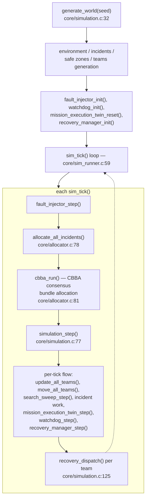
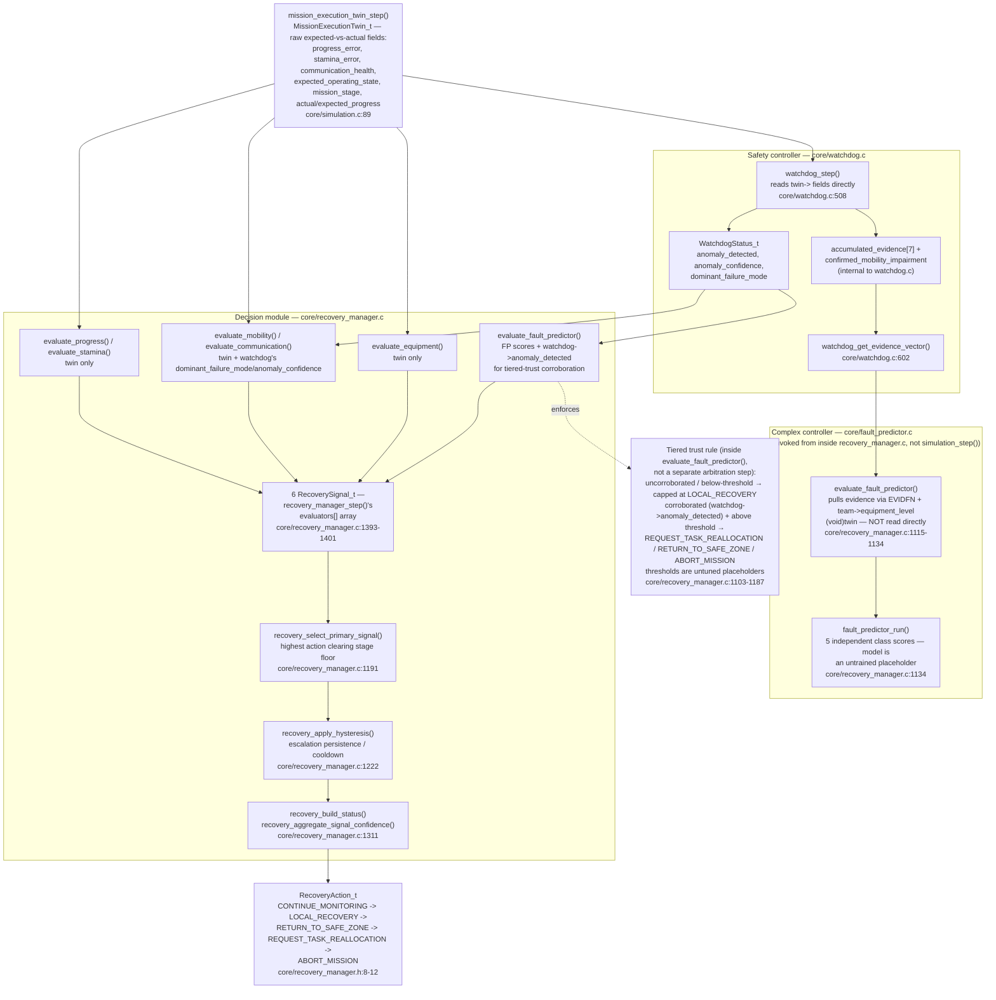

# tron Architecture

Technical reference for contributors and contest judges. Every claim
below is grounded in the actual source at the paths and line counts
shown — where something is a design intent that isn't implemented yet,
it's marked **unverified** or **TODO**, not written up as if it exists.

## System Overview

`tron` is a multi-team disaster-response simulator built for the TRON
Programming Contest 2026. Five specialties — `SPEC_SEARCH`,
`SPEC_MEDICAL`, `SPEC_EXTRACTION`, `SPEC_PERIMETER`, `SPEC_SUPPORT`
(`core/mission_state.h`) — are allocated across `NUM_TEAMS = 10` teams
(two per specialty, via `team.c`'s `specialization = i % 5`) responding
to incidents in a procedurally generated 36×36 (`GRID_WIDTH` /
`GRID_HEIGHT`) disaster environment, using the Consensus-Based Bundle
Algorithm (CBBA) for decentralized task allocation.

**Why CBBA specifically:** CBBA (Choi, Brunet, How, 2009 — cited
directly in `core/cbba.c`'s consensus-table comment) is a
message-passing consensus algorithm by design: each agent maintains
its own local belief about task ownership, broadcasts a snapshot of
that belief, and reconciles what it hears from others using timestamp
freshness to resolve conflicts — not a central coordinator arbitrating.
That property is why the codebase's later evolution toward genuine
per-board decentralization (below) is a natural extension of the
algorithm already in place, not a rewrite.

**Why the platform split:** the project's target is real hardware —
µT-Kernel 3.0 on an STM32N6570-DK (STM32N657, Cortex-M55) — but nearly
all of the actual simulation logic (grid, environment, CBBA, pathing,
scoring, fault injection) has zero dependency on where it runs. Splitting
that portable core out from platform-specific glue means the same
tick logic runs identically on a laptop for fast iteration and on the
target board for real deployment, with one file
(`core/sim_runner.c`) as the single source of truth for the
sequence that has to match on both.

## Pipeline and Per-Tick Fault-Detection Flow

Both diagrams below are drawn from the actual call graph (`core/simulation.c`,
`core/sim_runner.c`, `core/recovery_manager.c`, `core/watchdog.c`), not from
`fault_predictor_architecture_v4.md`'s Section 2/3 description of intended
behavior — see the **6th Recovery Evaluator** section below for where that
doc's intent and the current code diverge.

### Diagram 1 — overall pipeline



### Diagram 2 — per-tick simplex safety structure

Corrected from the draft: the twin's raw fields reach the **safety
controller directly**, but reach the **complex controller only through the
safety controller's evidence buffer** — `fault_predictor_run()` is not a
sibling call in `simulation_step()`, it is invoked from inside one of
`recovery_manager.c`'s own evaluators.



## Layer-by-Layer Breakdown

```
core/             portable simulator — no stdio/OS/filesystem deps
laptop/  desktop entry point (CLI, printf debug, CSV writer)
board/STM32N6570-DK/   STM32N6570-DK entry point (µT-Kernel task, tm_printf)
laptop/tools/            laptop-only: Flask dashboard, snapshot labeler, compare scripts
vendor/           external BSP dependency notes (not bundled — see below)
```

### `core/` — the portable simulator

33 source files, 17,308 lines total (`wc -l core/*.c`, current as of
this pass — this table previously undercounted both figures; see the
full file list below). Verified
freestanding-clean for Cortex-M55 by `make check-board` (see
**Build System** below) — no `stdio.h`, no heap allocation, no OS
calls anywhere in this tier.

| File | Lines | Role |
|---|---|---|
| `environment.c` | 2753 | Procedural world generation: districts, road network, buildings, earthquake damage propagation, plus post-quake `environment_validate_hazard_reachability()` (below). Based substantially on [Grzybojad's Procedural City Generation repository](https://github.com/Grzybojad/ProceduralCityGeneration). |
| `incident.c` | 2350 | Incident lifecycle, task-pool assignment, system tasks (return-to-safe-zone, equipment cache, sector sweep), plus `unreachable_streak`-based quarantine for incidents whose task-branch repeatedly fails to path (below) |
| `recovery_manager.c` | 1655 | Translates watchdog evidence into recovery actions across 6 registered evaluators (a 7th, consensus-fault, is written but compiled out — below) |
| `cbba.c` | 1154 | The CBBA protocol itself — see below |
| `scoring.c` | 867 | CBBA bid scoring (capability/distance/priority/stamina weighted) |
| `mission_link.c` | 805 | Board↔desktop mission-link wire codec: pack/parse roster, incident, and fault-status payloads |
| `mission_execution_twin.c` | 642 | Expected-vs-actual state tracking for anomaly detection |
| `watchdog.c` | 626 | Failure-mode detection from twin/live state divergence; exports `watchdog_get_evidence_vector()` (below) |
| `comms_transport.c` | 591 | Real (non-simulated) outbound/inbound frame transport: channel-busy gating, inbox/outbox queues, precedence — the mechanism `cbba_communication_link_up()`'s simulated coin-flip models a future replacement by (see CBBA/LoRa section above) |
| `mission_link_handshake.c` | 549 | Mission-link handshake codec + state machine (pack/parse request/reply payloads) |
| `path.c` | 540 | A* pathfinding with an intra-call memoization cache (below) |
| `fault_injector.c` | 535 | Deterministic fault profiles (mobility/communication/resource/environment/mission) |
| `team.c` | 501 | Team state, specialization assignment, equipment/fitness speed model |
| `allocator.c` | 399 | CBBA winner → actual task assignment |
| `fault_buffer.c` | 392 | Cross-board fault-evidence ring buffers (local + remote evidence/votes) and dynamic-quorum Brooks-Iyengar fusion — **dormant**: no callers in any build (laptop sim, board firmware, or test harnesses) |
| `simulation.c` | 351 | Per-tick orchestration: movement, work progress, status transitions |
| `fault_comms.c` | 349 | `FAULT_BROADCAST`/`FAULT_VOTE` wire-payload assembly, local-evidence recording, same-board voting — **dormant**, same reason as `fault_buffer.c` (`fault_comms_broadcast_local_teams()`/`fault_comms_ingest_remote_frames()` have no callers anywhere); the transport it rides (`comms_transport.c`/`lora_frame.c`) is real and active, this subsystem's use of it is not — see `KNOWN_LIMITATIONS.md` |
| `test_metrics.c` | 324 | Runtime diagnostic counters |
| `search_zones.c` | 319 | District-based fog-of-war and Search-team sweep dispatch, including `navigable_reachable_map()` — a navigable-cell (not road-only) reachability flood anchored at the caller's position/district center, used to keep frontier-cell picking and coverage-percent's denominator restricted to cells actually reachable (below) |
| `poly1305.c` | 197 | Poly1305 MAC (RFC 8439) — used by the AEAD layer below; see `LORA_ENCRYPTION.md` |
| `mission_link_override.c` | 186 | Mission-link override codec + apply logic |
| `aead_chacha20poly1305.c` | 185 | ChaCha20-Poly1305 AEAD (RFC 8439) combining `chacha20.c`/`poly1305.c` — see `LORA_ENCRYPTION.md` |
| `lora_frame.c` | 161 | LoRa wire envelope: frame pack/parse, checksum, frame-type constants (including `LORA_FRAME_TYPE_FAULT_BROADCAST`/`FAULT_VOTE`) — see `LORA_ENCRYPTION.md` |
| `lora_crypto.c` | 130 | Per-frame nonce construction (bakes in `sender_board_id`) and TX counter bookkeeping for the AEAD layer — see `LORA_ENCRYPTION.md` |
| `chacha20.c` | 130 | ChaCha20 stream cipher (RFC 8439) |
| `mission_state_utils.c` | 123 | Status/incident-status to-string helpers, plus `team_set_available()`'s `heading_to_rest`/`resting_zone_id` clearing on promotion (below) |
| `fault_config.c` | 121 | Fault profile → per-class enable/severity mapping |
| `safezone.c` | 106 | Safe-zone capacity/evacuee bookkeeping |
| `random.c` | 93 | Deterministic xorshift-family streams (world-gen, fault, dispatch — separately seeded) |
| `sim_runner.c` | 79 | Shared tick lifecycle — see below |
| `grid.c` | 52 | Grid safety-value initialization |
| `fault_predictor.c` | 22 | Single-team AI fault-class scoring (`fault_predictor_run()`) — model is currently an always-inert placeholder; consumed by `recovery_manager.c`'s `evaluate_fault_predictor()` evaluator (below), itself operating on data `fault_comms.c` never actually delivers (dormant transport path) — see `KNOWN_LIMITATIONS.md` |
| `mission_state.c` | 21 | Struct definitions' backing storage |

Core sizing constants (`core/mission_state.h`): `NUM_TEAMS=10`,
`NUM_INCIDENTS=15`, `NUM_SYSTEM_TASKS=10`, `CBBA_MAX_BUNDLE_SIZE=3`,
`GRID_WIDTH=GRID_HEIGHT=36`, `TICK_TIME_SEC=36` (so `TICKS_PER_HOUR=100`).

### `laptop/` — desktop entry point

- `main.c` — CLI argument parsing (`./tron [seed] [count] [ticks]
  [--fault-profile <name>] [--live] [--tick-delay-ms=N]`), drives
  `sim_runner`.
- `debug.c` — `printf`-based debug sink; also emits the JSON frames
  (`LIVEFRAME`, `STATICENV`) the dashboard's SSE stream consumes.
- `snapshot.c` — writes `tron_snapshot_dataset.csv` (a per-event
  schema — team state, incident state, CBBA assignment, fault mask,
  mission-twin fields, watchdog/recovery status, and the fog-of-war
  columns `incident_discovered`/`team_zone_id`/`team_zone_trust`).

### `board/STM32N6570-DK/` — STM32N6570-DK entry point

> **Folder-layout note (this restructure):** the STM32 BSP that used to
> live at top-level `vendor/mtk3_bsp2/` now lives at
> `board/STM32N6570-DK/vendor/mtk3_bsp2/` — see that folder's own
> `README.md` for fetch instructions. This is the first step of
> splitting each physical target into its own self-contained
> `board/<name>/` folder (a Pico/RP2040 target, when it exists, gets
> `board/Raspberry_Pi_Pico/vendor/mtk3_bsp` — note: v1, not this v2
> BSP — alongside it), so each board's folder holds what that board
> needs to build/flash rather than sharing one top-level `vendor/`.
> `board/STM32N6570-DK/*.c` itself has NOT moved as part of this step — it
> still targets STM32N6570-DK only, same as this section describes
> below; whether/how it also moves under `board/STM32N6570-DK/` is a
> separate, not-yet-decided follow-up, not something this note should
> be read as already having done.

- `main_board.c` — `EXPORT INT usermain(void)` creates one µT-Kernel
  task (`T_CTSK`, `tk_cre_tsk`) that runs the same `sim_runner`
  sequence as the laptop, reporting progress via `tm_putstring`/
  `tm_printf`. Pacing between ticks uses `tk_dly_tsk` (µT-Kernel's
  `nanosleep` equivalent), off by default (`BOARD_TICK_DELAY_MS=0`) —
  bring-up should run flat out, not paced.
- `debug.c` — same interface as the laptop sink, routed through
  `tm_printf` over USART1 instead of `printf` over stdout. Includes a
  hand-rolled fixed-point float formatter (`fmt_fixed3`) because
  `tm_printf` has no `%f` support (confirmed against the BSP2 manual —
  see **Build System**).
- `snapshot.c` — a fixed-size ring buffer (`BOARD_SNAPSHOT_RING_CAPACITY
  = 256`) standing in for the laptop's CSV writer. **Deliberately not
  full column parity** with the laptop schema — the file's own comment
  notes this was a scope decision to avoid duplicating
  `TeamState_t`/`MissionExecutionTwin_t`/`WatchdogStatus_t` walking
  logic on the board side before a real transport exists to drain it.

**What is not yet implemented, verified directly against the source
(not assumed):** there is currently one task (`sim_task`) and no
second task, no event flag, no mailbox, and no cyclic handler anywhere
in `board/STM32N6570-DK/`. Every USB-related line in `debug.c` and
`snapshot.c` is a `TODO(usb)` comment describing what still needs to
be built, not code that exists. **A specific runtime shape — cyclic
handler → event flag → main sim task → separate USB I/O task via
mailbox, with USB1 Type-C (CN8) as the CDC data link and ST-LINK CN6
kept separate for debug — does not appear anywhere in this repository.**
If that's the intended design, it hasn't been written into code or
comments yet; treat it as a design goal to implement, not a
description of what's here. `search_zones.c`, `snapshot_record()`'s CSV
columns, and `main_board.c`'s ring buffer are the actual current state
of the telemetry path.

### `laptop/tools/` — laptop-only, never built for the board

- `app.py` (Flask) + `templates/index.html` — a local dashboard that
  runs `make` then `./tron <args>`, parsing stdout (`LIVEFRAME`,
  `STATICENV` JSON lines during `--live`) and stderr (`[DIAG ...]`
  lines) into a live map, per-team status table, Incident Journal,
  Recovery/Rest tab, and telemetry charts.
- `label_snapshots.c` — standalone offline labeler; reads
  `tron_snapshot_dataset.csv`, writes a horizon-labeled copy without
  touching the original schema.
- `compare_*.py` — dataset/behavior comparison scripts.

`requirements.txt` lists exactly one dependency: `flask`.

## The CBBA Protocol As Implemented

### Message structure

`CBBAMessage_t` (`core/cbba.c`, defined immediately after a comment
explicitly calling it *"Wire format only — a copied snapshot of one
agent's belief at broadcast time. This is what a real board would put
on the wire; no function below is allowed to read another agent's live
`CBBAAgentState_t` directly."*):

```c
typedef struct
{
    uint8_t  sender_id;
    uint8_t  winner[NUM_INCIDENTS];
    float    winning_bid[NUM_INCIDENTS];
    uint32_t timestamp[NUM_TEAMS];
} CBBAMessage_t;
```

At current sizing (`NUM_INCIDENTS=15`, `NUM_TEAMS=10`), packed size is
**116 bytes** (1 + 15 + 60 + 40). This is deliberately already shaped
as an over-the-wire message, not an in-memory convenience struct — the
comment above it is an explicit design constraint enforced by the
functions around it, not incidental.

### Broadcast / receive / consensus flow

`cbba_consensus()` runs each round:

1. **Broadcast.** Every team calls `cbba_broadcast(team_id, &outbox[team_id])`,
   which copies that team's own `winner[]`/`winning_bid[]`/`timestamp[]`
   into a fresh `CBBAMessage_t` — read-only from that point on.
2. **Link check.** `cbba_communication_link_up(team_id)` gates whether
   that team's broadcast actually "goes out" this round. It reuses the
   same cadence-gating logic `team.c` already applies to degraded
   heartbeats under `FAULT_CLASS_COMMUNICATION`: `(elapsed %
   (severity+1)) == 0`. A down link means the message is silently
   dropped for every receiver this round — not delayed, not queued.
3. **Pairwise consensus.** All `NUM_TEAMS * (NUM_TEAMS - 1)` = 90
   sender/receiver pairs are shuffled (`cbba_shuffle_pairs`) and
   processed in that random order; for each pair, if the sender's link
   was up, `cbba_receive_and_update(receiver_id, &outbox[sender_id])`
   applies the actual CBBA consensus table (Choi/Brunet/How 2009, Table
   I) — whether the receiver adopts the sender's claim depends on
   whether the sender claims the task itself, claims the receiver
   already has it, or is relaying a third agent's claim, with
   timestamp freshness breaking ties.
4. `cbba_release_lost_tasks()` and `cbba_sync_mission_execution_twin()`
   close out the round.

`cbba_run()` (called once per tick from `allocate_all_incidents()`) executes
`cbba_init()`, then `NUM_TEAMS * CBBA_MAX_BUNDLE_SIZE` = 30 rounds of
(every team builds its bundle via `cbba_build_bundle()`, then
`cbba_consensus()`), then `cbba_improve_routes()`.

### Mapping to real distributed comms (LoRa)

The broadcast/receive/link-up decomposition above is why porting this
to real LoRa TX/RX is a substitution, not a redesign: `cbba_broadcast()`
already produces exactly what a board would serialize onto the air,
`cbba_receive_and_update()` already only touches the receiver's own
state from a read-only message, and `cbba_communication_link_up()`
already models a link that can silently fail per-round — the real
board version would replace the simulated coin-flip with "did this
board's LoRa RX actually receive a packet from `sender_id` this
round," which is the same shape, different data source. **This mapping
is a design implication of the current code, not something
implemented or tested against real radios in this repository** — but
unlike CBBA's own consensus messages, a real LoRa transport already
exists elsewhere in the codebase and is wired to real board RX/TX
(confirmed against `board/STM32N6570-DK/sx1262_hal.c` and
`board/Raspberry_Pi_Pico/sx1262_hal.c`; see CHANGELOG.md's "Real
SX1262 RX wired up on both boards" entry): `core/lora_frame.c`/`.h`
(the wire envelope), `core/chacha20.c`, `core/poly1305.c`,
`core/aead_chacha20poly1305.c`, and `core/lora_crypto.c` (the AEAD
encryption layer over that envelope — see `LORA_ENCRYPTION.md`), and
`core/comms_transport.c`/`.h` (the transport `cbba_communication_link_up()`
itself models the eventual replacement for). One consumer of this real
path is `core/fault_comms.c`, which sends
`LORA_FRAME_TYPE_FAULT_BROADCAST`/`LORA_FRAME_TYPE_FAULT_VOTE` frames
(`core/lora_frame.h`) over the same transport as cross-board fault
evidence/voting. That specific path is worth keeping distinct from the
transport layer's own status, though: `fault_comms_broadcast_local_teams()`
and `fault_comms_ingest_remote_frames()` have no callers in any build
(laptop sim, board firmware, or test harnesses) — the transport
carrying them is real and active, but the fault-prediction subsystem
riding on it (`core/fault_buffer.c`, `core/fault_comms.c`,
`core/fault_predictor.c`) is wired but dormant. See
`KNOWN_LIMITATIONS.md`.

### Current single-process limitation (worth stating precisely)

`cbba_consensus()` today loops over **all** `NUM_TEAMS` agents within
one process — every team's `outbox` entry and every pairwise exchange
happens in the same address space per tick. That's what makes the
current build a *simulation* of a distributed protocol rather than a
genuinely distributed one: the message-passing shape is real, but
nothing is actually going out over a wire yet.

## Board Runtime Architecture

**Verified from `board/STM32N6570-DK/main_board.c` and `vendor/README.md`
directly** (see those files for the exact BSP verification commands):

- Entry point: `EXPORT INT usermain(void)`.
- `usermain()` creates and starts exactly one task (`sim_ctsk`,
  priority 10, 8KB stack — noted in the source as "a starting point;
  check high-water mark once you can actually run this," not a tuned
  final value), then parks itself forever (`tk_slp_tsk(TMO_FEVR)`).
- That one task (`sim_task`) runs `sim_runner_init()` →
  (`sim_start_seed()` → tick loop calling `sim_tick()` →
  `sim_end_seed()`) per seed → `sim_runner_shutdown()`, then parks
  itself too.
- FPU: not explicitly requested per-task (`TA_FPU` left unset in
  `T_CTSK.tskatr`) because BSP2's `ALWAYS_FPU_ATR=1` default already
  forces FPU context on every task — the source comment flags this as
  an implicit dependency worth knowing about if that BSP default is
  ever changed.
- Debug output: USART1, 115200-8-N-1, via the ST-LINK micro-USB
  connector already on the dev kit (`vendor/README.md`) — **this is
  the debug UART, not a separate USB1/CN8 data link**; no second USB
  connector or CDC class driver appears anywhere in this repo.

**Confirmed NOT yet built** (see the `board/STM32N6570-DK/` section above
for the full list): second task, event flag, mailbox, cyclic handler,
USB telemetry transport, real firmware project (STM32CubeIDE/CubeMX
scaffolding, linker script, HAL init, TrustZone secure/non-secure
split). `vendor/README.md` documents exactly what's still needed to
get a flashable image and cites the precise BSP2 manual section
(4.2.3) for where `knl_start_mtkernel()` needs to be added to
CubeMX-generated code — that's IDE project work, not something a
source file in this repo can do.

## Performance Characteristics

`core/sim_runner.h`'s own comment states the qualitative finding
directly: *"`allocate_all_incidents()` runs the CBBA auction and is the
dominant cost per tick."* The specific numbers behind that claim aren't
preserved as repository comments, but were measured directly against
this codebase during development (x86, `-O2`, instrumented build, not
a documented repo artifact — reproducible via the same method):

- At full team count, `allocate_all_incidents()` accounted for roughly
  **63% of per-tick time** (~654µs of ~1032µs/tick, 500-tick run).
- Isolating to a single active team dropped `allocate_all_incidents()`
  to ~14.5µs/tick — a **~65× reduction**, consistent with the
  algorithm's `O(NUM_TEAMS²)` shape (`cbba_run()`'s round count scales
  with `NUM_TEAMS`, and each round's consensus does `NUM_TEAMS ×
  (NUM_TEAMS-1)` pairwise exchanges).

**Mitigation already in the code:** `path.c` implements an intra-call
memoization cache (`path_cache_begin()`/`path_cache_end()`, a
1024-entry direct-mapped table, `PATH_CACHE_SIZE`) specifically because
`calculate_marginal_bundle_bid()` was found to recompute identical
route legs across trial bundle insertions within a single
`cbba_run()` call. The cache is explicitly scoped to be safe: it's
only active between `path_cache_begin()`/`path_cache_end()`, and
`cbba_run()`'s own comment confirms nothing between those two calls
touches the grid or moves a team, so a stale cache entry can't produce
a wrong answer — only a cache miss recomputes fresh.

**TODO / not yet measured:** real Cortex-M55 timing. The numbers above
are x86 measurements; the *ratio* (algorithmic complexity reduction)
should transfer reasonably across architectures, but the *absolute*
µs-per-tick figures won't, and no on-device timing exists yet since
there's no flashable firmware image (see above).

## Open Architectural Questions

**Not documented anywhere in this repository as of this writing** —
raised here because they're live, unresolved questions the codebase's
current trajectory makes relevant, not because they're written into
any source file or prior doc:

- **Shared world knowledge vs. locally-discovered incidents per
  board.** If each team's board becomes a genuinely separate physical
  node, does every board start with identical knowledge of the full
  incident list (e.g., same world-gen seed), or does each board only
  know about incidents it has actually discovered locally (more
  realistic for search-and-rescue, closer to what `search_zones.c`'s
  fog-of-war/`discovered` flag already partially models within the
  single-process simulation)? This changes the LoRa protocol surface
  meaningfully — the second option needs an incident-announcement
  message type in addition to CBBA consensus messages, the first
  doesn't.
- **USB telemetry protocol design** — genuinely open per the
  `TODO(usb)` markers throughout `board/STM32N6570-DK/`, not just
  unimplemented but undesigned (ring-buffer overflow policy,
  overwrite-vs-backpressure, wire format).
  :resolved on 13th aug 6pm
- **Pico-side RXEN/TXEN RF-switch wiring is unconfirmed against real
  hardware.** Both boards' `sx1262_hal.c` drive separate active-high
  RXEN/TXEN pins by snooping SPI opcodes
  (`apply_rf_switch_for_opcode()`) rather than relying on DIO2
  auto-switching. The DK's arrangement is confirmed against its
  SmartElex HAT. The Pico's opcode-snooping code was ported from the
  DK unchanged, but whether the Pico's own physical SX1262 module
  actually has a matching RXEN/TXEN RF-switch arrangement has not been
  verified against real Pico-side hardware - it's flagged inline in
  `board/Raspberry_Pi_Pico/sx1262_hal.c` (search "RXEN/TXEN note") but
  wasn't recorded anywhere durable outside that one code comment until
  now. Resolving it (or replacing the opcode-snoop approach with
  DIO2 auto-switching if the Pico's actual RF front-end turns out not
  to need separate enables) is out of scope for the RX-poll work that
  raised it.

## Historical Bugs That Shaped Current Design

Pulled directly from `CHANGELOG.md`, which documents each fix with
before/after verification, not just a description:

- **Evacuation gateway placement hang** (`incident.c`,
  `initialize_evacuation_gateways()`): a deterministic site lookup
  (`environment_find_gateway_site()`) could return the same colliding
  cell forever on retry, since it has no randomness — seed 2 hung
  indefinitely. Fixed by tracking whether the deterministic candidate
  was already rejected once, falling through to randomized placement
  on retry. This is *why* the gateway-placement loop has a
  `deterministic_site_rejected` flag today, not an incidental detail.
  **Follow-up, don't read this as the last gateway-placement bug:** a
  later, distinct issue was found in the same area — a chosen gateway
  candidate could be a real, non-colliding cell that simply wasn't
  road-connected (candidate selection had no reachability check at
  all). Fixed by relaxing selection off `has_road()` and adding a
  `carve_repair_to_nearest_road()` repair pass in
  `stage_generate_infrastructure()`, plus fixing `road_reachable_map()`
  itself, which was seeding its BFS from an arbitrary first road cell
  (sometimes landing on a disconnected island) — reseeded from
  `anchors[0]`/`g_districts[0]` (RESCUE_BASE), which is provably
  connected via `stage_generate_roads()`'s carve chain.
- **CSV sentinel corruption** (`snapshot.c`): a signed `int` sentinel
  (`-1`) printed with `%u` reinterpreted as `4294967295`. Fixed by
  aligning with the codebase's existing `NO_ASSIGNMENT` (`0xFF`)
  convention instead of inventing a new sentinel.
- **Stale team-state read in resolved-task logging**
  (`snapshot.c`/`incident.c`): a team could be dispatched to a new
  task in the same tick its old task's completion was logged
  (`allocate_all_incidents()` runs before `simulation_step()`'s
  completion detection), so the log captured the team's *next*
  assignment instead of the one that resolved. This is why
  `snapshot_record_resolved()` exists as a separate function from
  `snapshot_record()` — it takes the resolving task's own state
  directly rather than re-deriving it from live team state.
- **Fault-priority compounding** (`fault_injector.c`,
  `IncidentState_t`): a second mission fault landing on an
  already-faulted incident could capture the wrong "original" priority
  to restore, since the original was tracked per-fault-class on the
  team rather than once per incident. This is why
  `mission_fault_active_count`/`mission_fault_original_priority`/
  `mission_fault_original_victim_count` live on `IncidentState_t`
  today, not on `TeamFaultState_t`.
- **`RETURN_TO_SAFE_ZONE` task backlog** (`incident.c`,
  `create_return_to_safe_zone_task()` / `abandon_task_for_recovery()`):
  every recovery-triggered abandon call created a new return-to-safe-zone
  task unconditionally, even if the team already had one pending,
  building a real backlog that manifested as a team's status bouncing
  `AVAILABLE → EN_ROUTE → RESTING` every tick. Fixed with an explicit
  dedup check plus a short-circuit when the team's current task is
  already the right kind.
  **Follow-up, don't read this as the last RESTING↔EN_ROUTE bounce
  bug:** a later, distinct oscillation was found in the same subsystem —
  a team could rest, get promoted RESTING→AVAILABLE, immediately get
  sent right back by a still-active recovery recommendation, and repeat
  every ~2 ticks. Root cause this time was `heading_to_rest` (the
  team-intrinsic "returning to a safe zone" state) not being modeled
  consistently across the pipeline. Fixed across five files, each
  closing one leg: `watchdog.c` (evidence channels gating on
  `mission_stage` directly instead of assignment/pool state that looks
  identical for a resting team), `mission_execution_twin.c` (a
  double-step bug in the expected-position estimator on mission reset),
  `recovery_manager.c` (resetting stale escalation state when a team's
  assignment changes out from under it, plus RESTING/heading-to-rest
  short-circuits on the mobility/communication/equipment evaluators),
  `team.c` (the RESTING→AVAILABLE promotion now checks
  `recovery_manager_get_recommendation()` for both
  `RETURN_TO_SAFE_ZONE` and `LOCAL_RECOVERY`), and
  `mission_state_utils.c` (`team_set_available()` now clears
  `heading_to_rest`/`resting_zone_id` on promotion).

## Post-Quake Reachability Validation, Quarantine, and the Reachability-Aware Frontier Picker

- **Hazard reachability validation** (`core/environment.c`/`.h`,
  `environment_validate_hazard_reachability()`): runs after earthquake
  damage propagation and checks that every incident and every safe
  zone is still reachable from `RESCUE_BASE` over the (post-quake) road
  network — damage propagation can sever roads and strand an incident
  or safe zone on a now-disconnected island, which this catches rather
  than leaving to be discovered later as a team endlessly failing to
  path.
- **Incident quarantine** (`core/incident.c`, `core/incident.h`): an
  incident whose task-branch repeatedly fails to path (checked in
  `abandon_task_for_recovery()`/`clear_task_slot()`, with matching
  candidate-scan guards in `allocator.c`/`cbba.c`) increments a
  per-incident `unreachable_streak` counter; once it reaches
  `INCIDENT_UNREACHABLE_GIVEUP_THRESHOLD` (3), the incident is
  quarantined instead of being retried forever — caps a class of
  repeated-churn behavior that the reachability validation above
  doesn't fully prevent on its own (a cell can become unreachable in a
  way the post-quake check didn't anticipate, or through gateway/road
  edge cases addressed separately — see the gateway-placement
  follow-up above).
- **Reachability-aware frontier picking and coverage** (`core/search_zones.c`/`.h`):
  a new `navigable_reachable_map()` floods *navigable* cells (not just
  road cells — a broader notion of reachability than the road-only
  checks above), anchored at the caller's current position or the
  target district's center, rebuilt fresh on each call.
  `search_zone_pick_frontier_cell()` filters candidate frontier cells
  through this flood so it never picks a cell nothing can actually
  reach, and `search_zone_coverage_percent()` excludes cells
  unreachable from that same flood from its denominator, so coverage
  percentage isn't artificially depressed by cells that were never
  reachable in the first place.
- Verified together via `./tron --sweep-priority1 <first_seed>
  <seed_count> <ticks_per_seed> --fault-profile=combined`: 50 seeds ×
  3000 ticks, 0 frozen streaks (no team ever stuck `EN_ROUTE` at one
  location for 10+ ticks), `VERDICT: PASS`.

## 6th Recovery Evaluator and the Watchdog Evidence Vector

- `core/watchdog.c` exports `watchdog_get_evidence_vector()`
  (`core/watchdog.h`): the 7-slot `accumulated_evidence` array plus
  the `confirmed_mobility_impairment` flag, previously internal to
  `watchdog.c`, now readable by other subsystems that want a team's
  raw evidence state rather than watchdog's own derived verdict.
- `core/recovery_manager.c` registers a 6th evaluator,
  `evaluate_fault_predictor()`, consuming `core/fault_predictor.c`'s
  scores. Its upstream data path is currently inert end-to-end: the
  predictor's model is a placeholder and the `fault_comms.c` broadcast
  path it would eventually depend on has no callers in any build
  (dormant — see the fault-prediction-subsystem entries in the file
  table above and `KNOWN_LIMITATIONS.md`), so this evaluator is
  registered and callable but not yet meaningfully active.
- The parked `evaluate_consensus_fault()` and its
  `RECOVERY_MANAGER_ENABLE_CONSENSUS_FAULT` flag are deleted. Peer
  consensus (`core/consensus.c`, `CONSENSUS_DESIGN.md`) replaces them:
  under `CONSENSUS_ENFORCE` a 7th evaluator, `evaluate_peer_consensus()`,
  joins the recovery manager and consensus ELEVATED counts as
  corroboration in `evaluate_fault_predictor()`. It runs on the laptop
  build only (each team is a node on `core/vbus.c`); board and Pico
  builds compile none of it.
- `core/recovery_manager.h` adds
  `RECOVERY_REASON_CONSENSUS_FAULT`/`RECOVERY_REASON_PREDICTED_FAULT`
  reason codes for these two evaluators.

## Build System and Verification

### Laptop build

```sh
make            # builds ./tron and ./label_snapshots
make smoke       # ./tron 1 1 200 — environment/team/incident/safe-zone summary
```

`Makefile`'s `LAPTOP_SOURCES` is `$(wildcard core/*.c)` plus the three
`laptop/` files — new files dropped into `core/` are picked
up automatically, no Makefile edit needed.

### Board freestanding check

```sh
make check-board                          # core/ only if no BSP vendored
make check-board BSP_DIR=/path/to/mtk3_bsp2   # full check against real headers
```

Two modes, both real compiles with `arm-none-eabi-gcc
-mcpu=cortex-m55 -mthumb -mfloat-abi=hard -mfpu=auto -ffreestanding`,
not a lint pass:

- **Without `board/STM32N6570-DK/vendor/mtk3_bsp2`:** compiles `core/`
  only. Still a real, useful check — catches libc/OS dependency creep
  in the portable simulator — but can't validate `board/STM32N6570-DK/*.c`
  against real BSP symbols, since those files call real BSP APIs
  (`tm_printf`, `tk_cre_tsk`) that don't exist without the actual
  headers.
- **With `board/STM32N6570-DK/vendor/mtk3_bsp2`** (official BSP,
  fetched separately per `board/STM32N6570-DK/vendor/README.md` — not
  bundled here, T-License 2.2 isn't redistribution-friendly): compiles
  `core/` **and** `board/STM32N6570-DK/*.c` against the real
  `tk/tkernel.h`/`tm/tmonitor.h` headers, with
  `_STM32CUBE_DISCOVERY_N657_` defined to select the correct board
  variant.

Not a firmware build either way — no linker script, no HAL init, no
STM32CubeIDE project. It's a compile-correctness check, and
`vendor/README.md` is explicit about what's still needed beyond it.

### Regression method

No automated test suite exists in this repo. The verification pattern
used throughout `CHANGELOG.md` instead: multi-seed sweeps (typically
seeds 1–15) checked for hangs/timeouts, before/after CSV column
inspection for specific bug signatures (e.g., counting
`4294967295` occurrences, checking resolved-task rows for real vs.
sentinel incident IDs), and `make check-board` re-run after any
`core/`/`board/STM32N6570-DK/` change. This is a manual, documented
discipline rather than a CI pipeline — worth knowing if you're
extending this project and wondering where the tests are.
