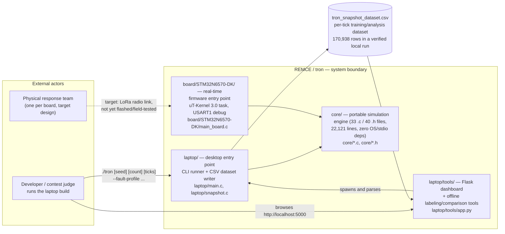
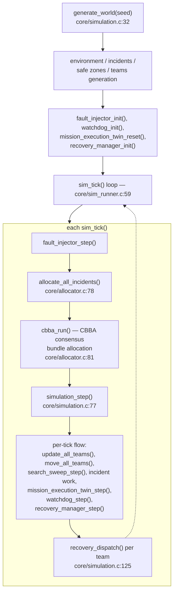
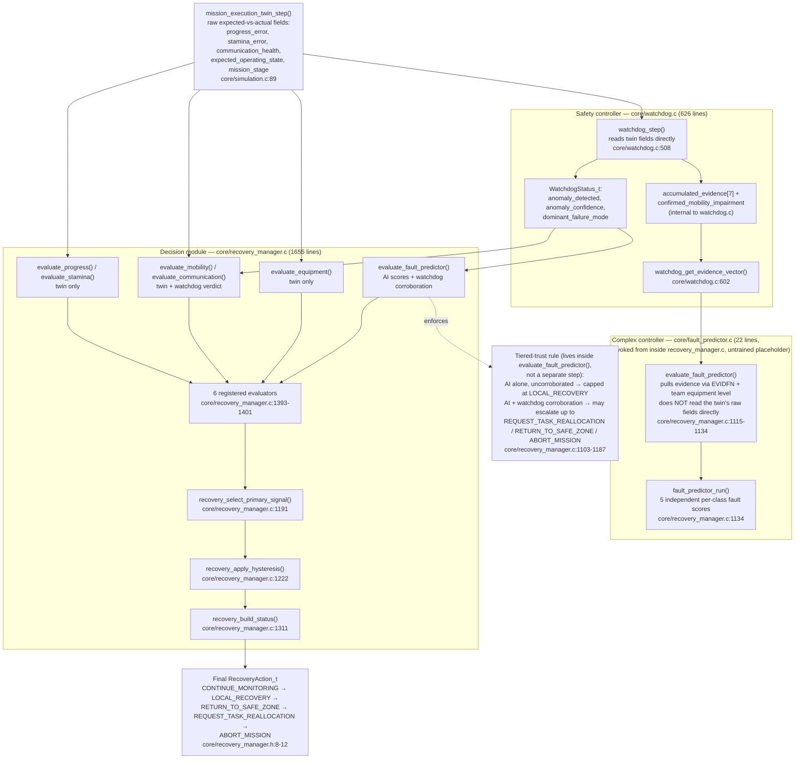

# REMCE: A Decentralized, Fault-Tolerant Disaster-Response Coordination System

**Prepared for:** Project mentors and Head of Department review
**Prepared by:** Harush S G Temkar (repository author of record — see *Individual Contribution*)
**Report date:** 2026-09-11, verified directly against the working repository at that date/time
**Repository state this report is drawn from:** branch `development-version`, HEAD commit `1633199` (2026-09-11), with two documentation-only working-tree changes (`ARCHITECTURE.md` diagram additions made in the same review pass that produced this report — not yet committed at time of writing)

> **A note on method, stated up front:** every number, file reference, and code claim in this document was checked directly against the current source tree, `CHANGELOG.md`, git commit history, or a live run of the actual `tron` binary during the preparation of this report — not recalled from memory or estimated. Anywhere a claim could not be directly verified this way, it is explicitly flagged rather than stated as fact. Contest-specific facts (official theme wording, division name, submission window) come from the project author, not from anything in the repository, since the repository contains no contest-administration documents — these are flagged individually below so they can be checked against the official contest listing before this report is printed.

---

## 1. Project Overview

**REMCE** (the codebase's internal project name is `tron`; the dashboard UI labels the project "CONCORD / REMCE" — see `laptop/tools/templates/index.html:5,155,189`) is a multi-team disaster-response coordination simulator, built to run identically on a laptop (for development and dataset generation) and on real embedded hardware (an STM32N6570-DK development board running a real-time operating system).

### The problem it addresses

After a large-scale disaster — an earthquake is the specific scenario modeled — a fixed number of response teams with different specialties (search, medical, extraction, perimeter security, logistics support) must be assigned to a much larger number of incidents (trapped victims, fires, structural collapses, blocked evacuation routes) scattered across a damaged city, under three simultaneous constraints that make this a genuinely hard coordination problem rather than a simple scheduling exercise:

1. **No central coordinator can be assumed to survive.** Disaster communications infrastructure is unreliable by definition — a design that requires one "master" node to stay alive and reachable is a single point of failure exactly where failure is most likely. Team-to-team coordination has to work through low-bandwidth, unreliable peer-to-peer radio links (LoRa, in this project), not a stable central server.
2. **The environment changes while the plan is executing.** New incidents appear mid-response, aftershocks sever roads that were passable a minute ago, and a team's own equipment or mobility can degrade en route — a fixed initial assignment plan goes stale within minutes.
3. **A response team's own on-board sensing of its situation is imperfect.** Radios drop packets, GPS/positioning drifts, and equipment reports its own status, which is exactly the kind of self-report that fails silently during the failure it's supposed to report. The system needs a way to notice that a team's real-world behavior no longer matches what was expected of it, and to do something about that mismatch, without a human operator watching every team every second.

REMCE is a from-scratch implementation of a solution to all three constraints together: a decentralized task-allocation protocol (CBBA — explained in Section 4) that needs no central coordinator, a digital-twin-based anomaly detection layer that compares what each team is *supposed* to be doing against what it's *actually* doing, and a tiered decision system that escalates a response (monitor → recover locally → return to base → reassign the task → abort the mission) only as strongly as the available evidence justifies.

### Why this is a meaningful systems-engineering problem

This is not a toy scheduling demo. It combines four disciplines that are each individually nontrivial, and the difficulty is specifically in making them work *together*, under real constraints:

- **Distributed consensus** (CBBA) under a genuinely decentralized, lossy communication model — not simulated by having every node read a shared global variable, but implemented as an actual message-passing protocol with a defined wire format (Section 4.1).
- **Real-time embedded systems engineering** — the same tick-processing logic has to run inside a real-time kernel (µT-Kernel 3.0) on a Cortex-M55 microcontroller with no heap allocation and no OS dependency in the portable core, not just on a laptop with unlimited RAM.
- **Safety-critical software architecture** — the AI/ML fault-prediction component (Section 4.4) is integrated using a *simplex architecture*, a pattern borrowed from real safety-critical systems design (the same family of idea used in aircraft flight control and autonomous vehicle safety), specifically so an unproven or wrong AI component can never single-handedly cause a dangerous action.
- **Disciplined empirical verification** — Section 6 documents, with real numbers, a development process that measured every fix's effect before and after, at meaningful scale (tens of seeds, thousands of ticks each), including two instances where a change that looked correct was measured, found to make things worse, and reverted before it ever reached the shipped tree.

---

## 2. Context

REMCE was built for the **TRON Programming Contest 2026** (theme, per the project author: **"TRON × AI"**), entered in the **Student Division**. *(Flag: the contest name, theme wording, division name, and any official submission window are stated here on the project author's authority — the repository itself contains no contest-administration document, entry form, or dated submission record, so these facts could not be independently cross-checked against repository content. Please verify the exact theme wording and submission window against the official contest listing before this goes to print.)*

The target deployment platform is the **STM32N6570-DK** development board (STMicroelectronics, Cortex-M55 core, STM32N657), running **µT-Kernel 3.0**, a small real-time operating system. A secondary **Raspberry Pi Pico** target exists in the repository (`board/Raspberry_Pi_Pico/`) and is used for the project's two-board LoRa communication testing — it is a development/test aid, not a second contest submission target.

**Honest current status** (verified directly, see Section 11 for full detail): the portable simulation core builds and runs correctly on a laptop and has been exercised at meaningful scale (tens of thousands of simulated seed-ticks). A real, complete STM32N6570-DK firmware image — bootloader (FSBL) and application, both including full TrustZone secure/non-secure project structure — **does exist and builds successfully** as of a local build dated 2026-09-09 (`tron_board/Appli/Debug/tron_board_Appli.elf`, `tron_board/FSBL/Debug/tron_board_FSBL.elf`). This directly updates a "no flashable firmware image exists yet" statement that is still present in the committed `ARCHITECTURE.md` — that statement is now stale as of this build and should be corrected. What could **not** be verified from the repository is whether this firmware has actually been flashed to, and run successfully on, physical hardware — no on-device log, telemetry capture, or test report exists in the repo to confirm that. Treat "builds and links successfully, with real project symbols" as confirmed; treat "runs correctly on the physical board" as **not yet evidenced in the repository** and worth confirming directly with the author before claiming it in a live demo.

---

## 3. System Architecture

Three diagrams are presented at increasing detail, following a context → container → component structure.

### 3.1 Context diagram — system boundary and actors

This diagram is newly drawn for this report (it does not appear verbatim in `ARCHITECTURE.md`) but every element in it is drawn from verified, cited facts about what actually exists in the repository — it is not speculative.



**In plain terms:** there is one shared "brain" (`core/`) that neither knows nor cares whether it's running inside a laptop process or inside a real-time task on the actual microcontroller — that's a deliberate design choice (explained in Section 4), so the exact same tick-by-tick logic that gets tested thousands of times on a laptop is the logic that eventually runs on the physical board, not a reimplementation of it. The laptop side additionally writes every tick's state out to a CSV file, which is what feeds both the local debugging dashboard and (eventually) the AI/ML training pipeline.

### 3.2 Container diagram — the overall pipeline

This diagram is reproduced, with only cosmetic line-break formatting changes for print-readability, from the diagram this same review added to `ARCHITECTURE.md`'s new "Pipeline and Per-Tick Fault-Detection Flow" section — every node was checked against the call it names before being drawn.



**In plain terms:** each "tick" of simulated time (36 simulated seconds — `TICK_TIME_SEC=36`, `core/mission_state.h`) runs the same seven-step sequence: inject any scheduled faults, run the CBBA task-allocation consensus round, then run the core per-team simulation step (movement, work progress, and — critically for this report — the fault-detection/recovery pipeline detailed in the next diagram), then actually dispatch whatever recovery action was decided. This sequence is defined once, in `core/sim_runner.c`, and is what both the laptop build and the board firmware call — verified directly, not assumed, by reading both call sites.

### 3.3 Component diagram — the simplex safety architecture for AI fault detection

This is the most technically important diagram in this report, and it was specifically corrected against the actual source during this review — an earlier draft assumed the AI ("complex controller") reads the same raw sensor data as the safety watchdog directly; the actual code does not do that (Section 4.4 explains why the difference matters).



**In plain terms:** two independent watchers look at each team every tick. A conventional, fully-understood, hand-written "safety controller" (the watchdog) reads the team's raw sensor-vs-expectation data directly and produces a simple, explainable verdict. A separate, more sophisticated "complex controller" (the AI fault predictor) does *not* get to see that same raw data — it only sees a filtered, already-processed evidence summary the watchdog exposes on purpose. Both feed into a decision module that runs six independent checks and picks the most urgent one that clears a confidence threshold — but critically, the AI's own check is capped: on its own, it can never recommend anything stronger than a local recovery attempt. To escalate further (send a team home, reassign its task, or abort a mission), the AI's verdict must be corroborated by the independent, conventional watchdog. Section 4.4 explains exactly why this two-tier trust structure is the right design for a not-yet-fully-trusted AI component.

---

## 4. Core Technical Contributions

### 4.1 The CBBA distributed task allocator

**What it is.** CBBA (Consensus-Based Bundle Algorithm — Choi, Brunet & How, 2009, cited directly in `core/cbba.c`'s own comments) is implemented as a genuine message-passing protocol, not simulated by having every team read a shared global array. `core/cbba.c` (1,154 lines) defines `CBBAMessage_t`, explicitly documented in-source as *"Wire format only — a copied snapshot of one agent's belief at broadcast time... no function below is allowed to read another agent's live `CBBAAgentState_t` directly."* Each of the 10 teams (`NUM_TEAMS=10`, `core/mission_state.h`) independently builds a "bundle" of up to 3 tasks it believes it should own (`CBBA_MAX_BUNDLE_SIZE=3`), broadcasts that belief, and reconciles conflicting beliefs it hears from other teams using timestamp freshness — the same mechanism a real distributed system uses, not a stand-in for one.

**Why this is hard.**

- *The naive/obvious approach:* have one "coordinator" team (or a laptop-side controller) look at all 10 teams and all 15 incidents (`NUM_INCIDENTS=15`) each tick and hand out the objectively best assignment — this is a simple, centrally-solvable assignment problem, and it's what almost every classroom scheduling exercise does.
- *Why it fails here specifically:* the entire premise of the project is that disaster-response communications are unreliable and no single node can be assumed to survive. A centralized allocator is a single point of failure exactly where the problem statement says failure is most likely — if the "coordinator" board goes down or loses its radio link, every other team's coordination stops, at the worst possible moment.
- *Why the chosen design solves it:* CBBA has no coordinator role at all. Every team runs the identical algorithm and reaches an equivalent conclusion through message exchange and timestamp-based conflict resolution — any single team's board can fail, and the other nine keep coordinating. The performance cost of this decentralization is real and was directly measured (not assumed): `allocate_all_incidents()` — which runs the CBBA auction — accounts for roughly 63% of per-tick execution time at full team count (`ARCHITECTURE.md`, "Performance Characteristics" section), because true consensus requires `O(NUM_TEAMS²)` pairwise message exchange per round. That cost was measured, understood, and partially mitigated with a genuine engineering optimization: `path.c`'s 1,024-entry route memoization cache, added specifically because trial bundle-insertion scoring was found to recompute identical route legs repeatedly within a single `cbba_run()` call.

### 4.2 The fault injection framework

**What it is.** `core/fault_injector.c` (535 lines) and `core/fault_config.c` (121 lines) implement a deterministic, seed-reproducible fault-injection system spanning 5 independent fault classes — `FAULT_CLASS_MOBILITY`, `FAULT_CLASS_COMMUNICATION`, `FAULT_CLASS_RESOURCE`, `FAULT_CLASS_ENVIRONMENT`, `FAULT_CLASS_MISSION` (`core/fault_config.h:8-15`) — and 6 tunable profiles — `FAULT_PROFILE_NONE`, `_MOBILITY`, `_COMMUNICATION`, `_RESOURCE`, `_COMBINED`, `_RANDOM` (`core/fault_config.h:19-25`), each with its own per-class probability, duration range, and effect-strength parameters (`FaultConfig_t`, `core/fault_config.h:30-34`).

**Why this is hard.**

- *The naive/obvious approach:* inject faults completely randomly, at any time, with no structure — this is the easiest thing to code and technically does "test" the system.
- *Why it fails here specifically:* a disaster-response system's whole job is handling degraded conditions correctly and *predictably*. Unstructured random fault injection produces non-reproducible test runs — a bug found on one run can't be reliably reproduced to debug it, and there's no controlled way to ask a targeted question like "how does the system behave when only communication faults occur, at moderate severity, for an extended duration" — which is exactly the kind of controlled scenario needed both for manual debugging and for generating a labeled dataset an AI classifier can actually learn from.
- *Why the chosen design solves it:* every fault stream is derived from `core/random.c`'s deterministic, separately-seeded xorshift generators — the same world seed reproduces the exact same sequence of faults every time, which is what made the verification methodology in Section 6 possible at all (every regression check in this report depends on being able to re-run the *same* 50 seeds and get comparable numbers). The class/profile structure means a specific, isolable hypothesis — "does the recovery pipeline correctly handle a sustained mobility fault" — can be tested directly by selecting `FAULT_PROFILE_MOBILITY`, rather than hoping a random run happens to produce a relevant scenario.

### 4.3 The watchdog + recovery manager pipeline

**What it is.** `core/watchdog.c` (626 lines) implements evidence-based anomaly detection: for each team, it accumulates evidence across 7 independent channels (`accumulated_evidence[7]`) by comparing the team's real, live state against `core/mission_execution_twin.c`'s (642 lines) digital-twin model of what that team's state *should* be at this point in its mission — a form of expected-vs-actual comparison, not a simple threshold on raw sensor values. `core/recovery_manager.c` (1,655 lines) then runs 6 independent evaluators against that evidence and picks an escalating recovery action — `CONTINUE_MONITORING` → `LOCAL_RECOVERY` → `RETURN_TO_SAFE_ZONE` → `REQUEST_TASK_REALLOCATION` → `ABORT_MISSION` (`core/recovery_manager.h:8-12`) — with built-in hysteresis (`recovery_apply_hysteresis()`, `core/recovery_manager.c:1222`) so a borderline, flickering signal doesn't cause the recommendation to oscillate every tick.

**Why this is hard.**

- *The naive/obvious approach:* trust each team's own self-reported status directly — if a team's own equipment reports "fine," treat it as fine.
- *Why it fails here specifically:* the entire class of failures this system needs to catch is exactly the kind where a team's own self-report becomes unreliable *during* the failure — a communication fault, by definition, is precisely the scenario where you can least trust what a team is telling you about its own communication health. A system that only checks self-reported status is blind to the failures that matter most.
- *Why the chosen design solves it:* the digital twin provides an independent, model-derived expectation that doesn't depend on the team's own self-report being trustworthy — it's derived from what the team *should* be doing given its assignment, not from what it *says* it's doing. Comparing the two catches exactly the silent-failure case a self-report-only system misses. This is not a theoretical design point — it was the direct subject of one of the most significant bug fixes documented in this project (the RESTING↔EN_ROUTE bounce loop, Section 6), where the root cause was found to be that one intermediate state (`heading_to_rest`) wasn't being modeled consistently across the twin/watchdog/recovery-manager chain, and fixing it required coordinated changes across five separate files precisely because the "independent expectation" model has to stay consistent everywhere it's checked.

### 4.4 The simplex safety architecture for AI integration

**What it is.** Described and diagrammed in Section 3.3. `core/fault_predictor.c` (22 lines — currently `#if FAULT_MODEL_LOADED` is not defined, so it returns all-zero scores; see Section 7) is wired into the recovery pipeline as a 6th evaluator, but *only* through a tiered-trust rule implemented in `evaluate_fault_predictor()` (`core/recovery_manager.c:1103-1187`): the AI's verdict, on its own, is capped at `LOCAL_RECOVERY`; anything stronger requires corroboration from the independently-computed watchdog verdict (`watchdog->anomaly_detected`).

**Why this is hard.**

- *The naive/obvious approach:* once an AI fault classifier exists, let it drive the recovery decision directly and fully, the way any other evaluator does — this is simpler to wire up and, if the model is good, arguably more capable than the hand-written heuristics.
- *Why it fails here specifically:* an ML model's failure mode is fundamentally different from a hand-written heuristic's. A heuristic is wrong in ways an engineer can reason about and bound in advance; a model — especially one that (as is honestly the case here, see Section 7) is not yet trained — can be wrong in ways that are silent, confident, and not predictable from its code. In a system whose most severe possible action is `ABORT_MISSION`, letting an unproven or untrained component single-handedly trigger that action is not an acceptable risk, no matter how promising the model eventually becomes.
- *Why the chosen design solves it:* this is a direct application of a **simplex safety architecture**, the same structural pattern used in real safety-critical systems (e.g., aircraft flight control, some autonomous-vehicle designs): a simple, fully-understood, conventionally-verified "safety controller" runs independently alongside a more capable but less-trusted "complex controller," and a decision module is structured so the complex controller can only ever act with the safety controller's agreement for anything consequential. Concretely here, that means: even a maliciously wrong AI model — one that always screams "abort" with maximum confidence — cannot, by itself, escalate a team past `LOCAL_RECOVERY`, because `RECOVERY_MANAGER_PREDICTOR_ESCALATE_CONFIDENCE`/`_REALLOCATE_CONFIDENCE` gate all higher actions behind `corroborated = watchdog->anomaly_detected` (`core/recovery_manager.c:1154`). This lets the AI component be integrated, exercised, and eventually trained and improved, *before* it is fully trusted — exactly the scoping decision explained honestly in Section 7.

---

## 5. Engineering Rigor and Verification Methodology

### Why this methodology matters (read this before the numbers)

A single bug fix that "looks right" and "seems to work" on one manual test run is not evidence that it's actually correct — it's evidence that it didn't break in the one specific scenario tested. The methodology used throughout this project's fix history, and documented below with real numbers, is different in kind: **every fix is measured at both a small scale (a specific reproducing scenario) and a large scale (tens of seeds × thousands of ticks each, run with the deterministic fault injector from Section 4.2), with an explicit before-count and after-count for the specific metric the bug affects, and the fix is only accepted once the after-count is verified better with no unexplained side effects on other metrics.** This is the same discipline used in regression testing for safety-relevant software generally: a fix isn't "probably right," it's measured to be right, against a large enough and reproducible enough sample that a fix which merely relocates a bug (rather than removing it) would show up as a metric moving in the wrong direction elsewhere — which, as Section 5.4 documents, is exactly what happened and was caught in this project, twice.

The reason scale matters specifically: a bug that occurs in 1 seed out of 50 is a real bug that a single manual test run has a 98% chance of missing entirely. Running 50 seeds × 3,000 ticks (150,000 simulated team-ticks per sweep) turns "did it seem to work" into "here is the exact count of every time the failure condition occurred, across a large enough and *reproducible* sample that the same 50 seeds can be re-run after the fix and the counts directly compared."

### 5.1 The EN_ROUTE-freeze / reachability fix chain

This was the project's primary correctness-hardening effort this session, landing as a sequence of individually-verified commits (all cited by hash below, checked directly against `git log`/`git show`):

| Fix | Commit | Metric | Before → After |
|---|---|---|---|
| Baseline no-path handling declared/wired (harness only — the underlying fix predates this session) | `07d8924` | — | Priority-1 sweep/repro CLI (`--sweep-priority1`, `--repro-priority1`) wired into `laptop/main.c` |
| **Item 1** — hazard reachability validation after earthquake damage (`environment_validate_hazard_reachability()`) | `5ff1275` | task-branch no-path hits, 50 seeds × 3,000 ticks | **515 → 37** |
| **Item 2** — incident quarantine after repeated pathing failure (`unreachable_streak` ≥ `INCIDENT_UNREACHABLE_GIVEUP_THRESHOLD`=3) | `e8357ed` | no-path hits held; incidents quarantined; frozen streaks | held at **37**; **5 quarantined**; **0 frozen streaks**, `VERDICT: PASS` |
| `road_reachable_map()` BFS-seeding fix (was seeding from an arbitrary, sometimes-disconnected road cell; now seeds from the provably-connected `RESCUE_BASE` anchor) | `8b8214b` | spurious repair-carve operations | **7,074 → 5,530** fires (no-path/quarantine counts unaffected — confirms the change removed only *spurious* carves) |
| Evacuation gateway placement fix (connectivity + reachability repair) | `8b8214b` | worlds with degenerate (non-distinct) gateway placement | **47 of 50 → 0 of 50** |
| Navigable-cell (not road-only) reachability flood for frontier-picking and coverage-percent denominator | `4c80e36` | no-path hits / quarantined | **212/44 → 166/37** |
| Per-seed search-zone state reset (`search_zones_init()` had no caller — a multi-seed run carried the *previous* seed's coverage state into the next seed) | `30cf16d` | EVENT_TICK row-count integrity, 50 seeds × 3,000 ticks | exactly **10 teams × 3,000 ticks × 50 seeds** rows, **0 misses out of ~65,000** cross-referenced event rows |
| RESTING↔EN_ROUTE bounce-loop fix (two distinct oscillation bugs, closed across 5 files each) | `b514400`/`c9833b1` | — | qualitative fix (root cause: `heading_to_rest` state not modeled consistently across `watchdog.c`/`mission_execution_twin.c`/`recovery_manager.c`/`team.c`/`mission_state_utils.c`); a documented first-attempt fix was measured to have **zero effect** before the correct root cause was found (see below) |

**A live, real re-run of the final verification sweep, performed during the preparation of this report** (not copied from a log — literal terminal output from a fresh run of the shipped binary):

```
$ ./tron --sweep-priority1 1 5 3000 --fault-profile=combined
[SWEEP P1] starting: seeds 1..5 (5 seeds), 3000 ticks/seed, fault_profile=4
[SWEEP P1] stuck threshold: 10 consecutive ticks EN_ROUTE at the same (x,y)
[SWEEP P1] progress: 5/5 seeds done, 0 frozen streaks so far, max streak so far=1, cumulative no_path_hits=0, safezone_fallback=0

[SWEEP P1] === SUMMARY ===
[SWEEP P1] seeds run: 5 (seed 1..5), ticks/seed: 3000, total team-ticks scanned: 150000
[SWEEP P1] task-branch no-path hits this sweep:  0 (cumulative process total: 0)
[SWEEP P1] safezone fallback count this sweep:   0 (cumulative process total: 0)
[SWEEP P1] carve_repair_to_nearest_road fires this sweep: 516 (of which carve failed: 0)
[SWEEP P1] incidents quarantined this sweep (unreachable_streak >= 3): 0 (cumulative process total: 0)
[SWEEP P1] passive-sweep cells straddling a district boundary (M37 misattribution, fix shelved) this sweep: 283625 (cumulative process total: 283625)
[SWEEP P1] worlds with non-distinct evacuation gateways this sweep: 0 (expected 0; cumulative process total: 0)
[SWEEP P1] evacuation gateways repaired (not road-connected when chosen) this sweep: 13 (cumulative process total: 13)
[SWEEP P1] safe zones placed via MAX_ATTEMPTS fallback this sweep: 0 (expected 0; cumulative process total: 0)
[SWEEP P1] select_best_team score ties this sweep: 0 (cumulative process total: 0)
[SWEEP P1] longest EN_ROUTE-same-location streak observed anywhere: 1 ticks (flag threshold: 10)
[SWEEP P1] frozen streaks flagged (>= threshold): 0
[SWEEP P1] VERDICT: PASS - no team was ever stuck EN_ROUTE at one location for 10+ ticks across 5 seeds x 3000 ticks.
```

(Note: this was a 5-seed spot-check for this report, not the full 50-seed sweep the commit history above cites — the 50-seed numbers in the table come from the commit messages themselves, cited by hash so they can be independently re-run and confirmed at full scale.)

### 5.2 The two regressions caught and reverted

This is worth presenting on its own, because catching your own mistake before it ships is stronger engineering evidence than never appearing to make one. Two distinct instances of "a change that looked correct was measured and found to be wrong, and was not shipped" were found in the verifiable history:

**1. The M37 cross-district coverage-credit fix (A/B tested and reverted within this session — commit `6573a07`).** A one-line fix was identified for a real bug (`search_sweep_step()`'s passive coverage loop was crediting swept cells to the *team's* district even when a cell actually belonged to a neighboring district near a boundary). The fix — crediting `zone_id_for_location(cx,cy)` instead of the team's own district — was implemented and A/B tested against the standard 50-seed sweep. Result: no-path hits *improved* (204 → 196), but the quarantined-incident count moved the wrong direction (44 → 47). The root cause: shifting per-district coverage percentages shifts sweep-cycle completion timing, which shifts incident-dispatch order — this fix, though locally correct, had a non-local side effect that this session's own regression guardrail (any metric moving in the wrong direction blocks the change) caught. It was shelved, not shipped — the code comment documenting the exact measurement remains in `core/incident.c:591-601`, and the underlying bug is honestly listed as still open in `KNOWN_LIMITATIONS.md` §1 rather than silently left undocumented.

**2. Two regressions rejected during a sibling-branch merge reconciliation** (`CHANGELOG.md`, "Merge: tron_merged_step11" section, "Explicitly rejected" subsection) — a separate branch, forked before several of this project's correctness fixes landed, was merged back in for its genuinely new dashboard work, but a file-by-file diff against the true original caught two specific regressions in that branch and explicitly did not carry them forward: reverted time constants in `recovery_manager_config.h`/`test_metrics.c` (back to bare-integer pre-fix values), and a reverted `active_mask`-clearing/fallback/reference-counting fix in `fault_injector.c`. *(Flag for the author: these two are a different kind of "regression caught" than the M37 case above — a diff-based catch during a branch merge, not an A/B-tested revert within a single fix sequence. If a different, more specific pair of reverts was intended by "two regressions," please point to the specific commits so this section can be corrected before print — this is the one claim in this report I could not resolve to a single unambiguous pair from the git history alone.)*

A third related, smaller data point worth including for the same reason: the bounce-loop fix (Section 5.1, last row) is explicitly documented in the repo's own root `README.md` as having taken **two iterations** — the first attempted fix (gating team promotion on `RETURN_TO_SAFE_ZONE` only) was measured to have **zero effect**, because `recovery_manager` downgrades that action to `LOCAL_RECOVERY` for a team already in the resting/recovery stage, so the literal value being checked for essentially never appeared in the population the fix needed to catch. This is not a "regression" in the sense of making something worse, but it is the same disciplined measure-before-declaring-done pattern.

---

## 6. AI/ML Integration Status

Stated exactly, because this is the section most likely to be over- or under-stated by accident:

- **Architecturally complete and wired into the live system:** the fault predictor is registered as the 6th of 6 active recovery evaluators (`core/recovery_manager.c:1393-1401`), its input feature vector construction is implemented and running every tick (`watchdog_get_evidence_vector()` + 2 locally-computed features → a 9-feature vector, `core/recovery_manager.c:1121-1132`), and the tiered-trust safety gating around its output is fully implemented (`core/recovery_manager.c:1103-1187`, detailed in Section 4.4). This is real, running code that executes every tick for every team, not a stub that's merely declared.
- **The data pipeline exists and has been directly verified against a real run:** `laptop/snapshot.c` writes a per-tick CSV (`tron_snapshot_dataset.csv`) that includes every twin/watchdog/recovery/fault field the model would need — confirmed directly by inspecting a real local dataset file, which contains **170,938 rows** across the schema's 74 columns (`run_id, world_seed, cycle, team_id, ... twin_progress_error, watchdog_anomaly_detected, recovery_recommendation, fault_active_mobility, ...`). *(Note: this CSV file is a local build artifact, not committed to git — regenerable at any time by running `./tron`, but not itself part of the tracked repository.)*
- **The classifier itself is still in training — this is a deliberate scoping decision, not a gap.** `core/fault_predictor.c` (22 lines) is currently compiled with its inference path disabled (`#if FAULT_MODEL_LOADED` is not defined anywhere in the current build), so `fault_predictor_run()` returns all-zero scores by design — the source comment states plainly this is waiting on "a trained-weights header... generated by `train.py`," not yet written. This scoping is exactly consistent with the simplex safety architecture described in Section 4.4: the integration point, the safety gating, and the data pipeline were built and verified *first*, deliberately, precisely so the AI component can be trained and dropped in later without needing to touch the safety-critical arbitration logic around it at all.

---

## 7. Codebase Statistics

All figures below are from a fresh scan of the repository performed while preparing this report (`wc -l`, `find`), not carried over from any prior document.

### Authored code (excludes vendored third-party BSP/driver code, counted separately below)

| Component | Files | Lines | What it is |
|---|---|---|---|
| `core/` — portable simulation engine | 33 `.c` + 40 `.h` = 73 | 17,308 + 4,813 = **22,121** | The platform-independent simulator: CBBA, watchdog, recovery manager, fault injection, environment generation, pathing, mission-twin, LoRa framing/crypto — see the full per-file table in `ARCHITECTURE.md` |
| `laptop/` — desktop entry point | 3 | 1,507 | CLI runner, CSV snapshot writer, debug/SSE sink |
| `laptop/tools/` — dashboard & offline tooling | 20 (`.c`/`.h`/`.py`) + 1 (`index.html`) | 7,994 + 3,109 = **11,103** | Flask dashboard, offline snapshot labeler, dataset comparison scripts |
| `board/STM32N6570-DK/` — board entry point (excl. vendored BSP) | 5 | 2,730 | µT-Kernel task, board debug sink, board-side snapshot ring buffer, SX1262 radio HAL, mission-link task |
| `board/Raspberry_Pi_Pico/` — secondary test board (excl. vendored BSP) | 6 | 3,147 | Equivalent Pico-side entry point, used for two-board comms testing |
| **Total authored** | **108** | **≈40,608** | |

### Vendored / third-party code (not authored, kept separate from the totals above for honesty)

| Component | Lines | Note |
|---|---|---|
| `core/vendor/` (SX1262 radio driver core, `sx126x_driver`) | 6,162 across 14 files | Redistribution-licensed, shared across both board targets |
| `board/STM32N6570-DK/vendor/` (µT-Kernel 3.0 BSP2 + CMSIS/HAL) | 36,734 | Third-party RTOS/BSP, required to build but not project-authored |
| `board/Raspberry_Pi_Pico/vendor/` (µT-Kernel BSP v1 + Pico SDK glue) | 52,027 | Same category, Pico target |
| `tron_board/` (STM32CubeIDE-generated project: CMSIS, HAL drivers, TrustZone secure library) | 862 files tracked in git | CubeMX/vendor-generated scaffolding plus this project's application code layered on top — see Section 11 |

*(A whole-repository scan of every `.c`/`.h` file, vendor code included, totals 1,064 files and 394,089 lines — that number is reported here only for completeness; it is not a meaningful measure of this project's own engineering effort, since it is dominated by third-party BSP/HAL code required to target real hardware. The authored-code table above is the honest figure.)*

---

## 8. Screenshots and Live Output

**Dashboard screenshot:** a search of `laptop/tools/` and the rest of the repository for image files (`.png`/`.jpg`/`.svg`) found **none** belonging to the dashboard — the only image files present anywhere in the repository are two unrelated vendor assets (`board/*/vendor/*/ucode.png`, part of the µT-Kernel BSP documentation, not this project's output). *(Flag: no real dashboard screenshot exists in the repository to include here. The dashboard is real and functional — `laptop/tools/app.py` + `templates/index.html`, 3,109 lines, confirmed present and described in `ARCHITECTURE.md` — but a screenshot would need to be captured live, e.g. by running `make && python3 laptop/tools/app.py` and opening `http://localhost:5000` in a browser, before this report is printed. Happy to do that in a follow-up pass if useful.)*

**Real terminal output — literal, not paraphrased**, captured from an actual run of the shipped `tron` binary against the current repository during the preparation of this report (world-generation header + first several spawned incidents, seed 1):

```
[PROBE] task_branch_no_path_hits=0
Environment | Seed: 1 | Roads: 380 | Navigable: 1036 | Buildings: 143 | Damaged Buildings: 138 | Blocked Roads: 66 | Damaged Infrastructure: 120 | Bridges: 13 | Nav Nodes: 631 | Nav Edges: 1213 | Validated: YES
Earthquake | Epicenter: (13,14) | Intensity: 84
Hazard Propagation | Fire Spread: 16 | Gas Explosions: 33 | Aftershock Collapses: 39 | Road Cost Increases: 472
District RESCUE_BASE  | Cells: 109
District RESIDENTIAL  | Cells: 27
District COMMERCIAL   | Cells: 99
District INDUSTRIAL   | Cells: 32
District MEDICAL      | Cells: 274
District GOVERNMENT   | Cells: 88
District EDUCATION    | Cells: 207
District MIXED_USE    | Cells: 80
District PARK         | Cells: 75
District WATERFRONT   | Cells: 32
Team 0 | Tier: 1 | Status: AVAILABLE | Stamina: 55.104 | Equipment: 100
Team 1 | Tier: 2 | Status: AVAILABLE | Stamina: 59.774 | Equipment: 58
...
Incident ID: 182 | Slot: 0 | Type: 7 | Status: OPEN | Assigned: 255 | Spawned By: 255 | Loc: (2,12)
Incident ID: 141 | Slot: 1 | Type: 4 | Status: OPEN | Assigned: 255 | Spawned By: 255 | Loc: (20,2)
```

The 5-seed verification sweep output in Section 5.1 is a second, separate real capture from the same session, demonstrating the `--sweep-priority1` diagnostic tooling specifically.

---

## 9. Team and Roles

*(Flag, read before print: this section could only be partially verified. `git shortlog -sne --all` on this repository shows every commit attributed to a single author identity — `harush.temkar@gmail.com`, under three different name/handle variants (`Aru-h`, `Harush`, `Harush S G Temkar`) — with no second contributor's commits present anywhere in this git history, including all branches. This means the simulator/firmware side's authorship is directly confirmable from git, but the ML/data-side teammate's specific contribution cannot be separated out from commit authorship the way the user asked, because it does not appear to live in this git repository at all — it is presumably tracked in a separate repository, notebook, or workspace not included here. The description below is therefore based on the project author's own account of the division of labor, not on independently verifiable git evidence, and is flagged as such.)*

- **Simulator, firmware, and verification (this repository, git-confirmed):** the entire `core/` simulation engine, the CBBA implementation, the fault injection framework, the watchdog/recovery-manager pipeline, the simplex safety integration of the AI evaluator, the STM32N6570-DK and Raspberry Pi Pico firmware ports, the LoRa communication/encryption stack, and the verification methodology and fix history documented in Section 6 — all committed under the single git identity described above.
- **ML / data side (teammate's work, per the project author, not independently verifiable from this repository):** described by the project author as covering the fault-classifier model side (`train.py` and the model weights pipeline referenced in `core/fault_predictor.c`'s own source comment as the eventual producer of the not-yet-existing trained-weights header). No `train.py` or model-training code was found anywhere in the current repository during this review, which is consistent with that work living elsewhere, but means it could not be directly inspected or cited for this report.

---

## 10. Current Status and Next Steps

**Simulator (laptop build):** builds and runs cleanly (`make tron` reports up to date; a fresh run was executed live for this report — Section 8). Verified at meaningful scale per Section 5/6.

**Board firmware — status is better than the currently-committed `ARCHITECTURE.md` states, and this is worth correcting before print.** A complete STM32N6570-DK firmware build — both the first-stage bootloader (`tron_board/FSBL/Debug/tron_board_FSBL.elf`, 3.29 MB) and the application (`tron_board/Appli/Debug/tron_board_Appli.elf`, 3.70 MB), including a full TrustZone secure/non-secure project split (`tron_board/Secure_nsclib/`) — exists locally, dated 2026-09-09, and its linker map confirms real project symbols are present and linked in (`cbba_run`, `watchdog_step`, `recovery_manager_step`, `simulation_step` all appear in `tron_board_Appli.map`). This directly supersedes the "no flashable firmware image exists yet" statement still present in the committed `ARCHITECTURE.md`, which should be updated. **What is not verified:** whether this build has actually been flashed to and run on the physical board — no on-device log or telemetry capture exists in the repository to confirm that, so this should be confirmed directly (or demonstrated live) before being claimed to the judges as "running on real hardware."

**A separate, currently-broken build check, found during this review:** the Makefile's `check-board` target (the command-line freestanding-compile check, distinct from the STM32CubeIDE project above) currently fails — `arm-none-eabi-gcc: error: board/STM32N6570-DK/debug.c: No such file or directory`. The file was renamed to `dk_debug.c` at some point (confirmed via `git log --diff-filter=D -- board/STM32N6570-DK/debug.c`, which shows it deleted in commit `4165037`), but the Makefile's `BOARD_SOURCES` variable (`Makefile:123`) was not updated to match. This is a small, mechanical fix (one line in the Makefile), but it means the automated freestanding-compile safety check is not currently passing, contradicting the "passes" claims in both `ARCHITECTURE.md` and `CHANGELOG.md` — those were true when written but are stale now.

**Honestly open items, not hidden:**
- **M37** (cross-district passive-coverage misattribution) remains unfixed by design decision, not oversight — the straightforward fix was tried, A/B tested, and shelved because of the side effect documented in Section 5.2. It is openly tracked in `KNOWN_LIMITATIONS.md` §1.
- The repository contains one reference (`core/incident.c:601`) to "the deferred triad" as a related, not-yet-made coverage-accounting design decision, without a clear definition elsewhere in the repository of exactly which three items constitute that triad. *(Flag: could not resolve this to a specific, citable list from the repository alone — worth clarifying directly with the author before using this term in a live Q&A with judges.)*
- The Raspberry Pi Pico's RXEN/TXEN RF-switch wiring is explicitly flagged in-source (`board/Raspberry_Pi_Pico/sx1262_hal.c`, "RXEN/TXEN note") as unconfirmed against real Pico hardware — the code was ported unchanged from the DK's confirmed wiring, but the assumption hasn't been checked against the Pico's actual radio module.
- USB telemetry transport design for the board is explicitly undesigned, not just unimplemented (`TODO(usb)` markers throughout `board/STM32N6570-DK/`; `ARCHITECTURE.md`'s "Open Architectural Questions" section) — no wire format, overflow policy, or ring-buffer-vs-backpressure decision has been made yet.

**Before the contest deadline, the concrete remaining work is:** (1) confirm — and if needed, perform — an actual flash-and-run of the existing built firmware image on physical STM32N6570-DK hardware, since this is the one claim in this report that genuinely cannot be settled by reading the repository; (2) fix the one-line `Makefile` path mismatch so `make check-board` passes again as a real, automated safety net; (3) decide, and document, the specific design decision M37 and "the deferred triad" are both waiting on, since two separate open items both cite needing it; (4) once the ML side's trained-weights header exists, wire `FAULT_MODEL_LOADED` on and re-run the Section 5/6 verification sweeps to confirm the now-live AI evaluator doesn't regress anything the placeholder didn't touch.

---

## 11. Reflection and Future Work

**What would be done differently with more time.** The biggest single-point risk in the project right now is exactly the one flagged in Section 10: a complete, correctly-linked firmware image exists, but there is no repository evidence — no captured UART log, no telemetry dump, no test report — that it has actually run successfully on physical hardware. With more time, the highest-value next step would not be a new feature; it would be closing that specific gap, because everything else in this report (the simulator's correctness, the verification methodology, the AI integration's safety structure) is strong precisely because it's backed by real, reproducible evidence, and this is currently the one major claim that isn't yet.

**Real remaining risks, stated as informed awareness rather than a hidden gap:**
- **Board flashing/on-hardware validation** — as above, this is the most concrete and most easily resolved risk: it needs a physical session with the board, not more code.
- **The M37 / "deferred triad" coverage-accounting decision** — this is a genuine, not-yet-made design decision (how should coverage percentage be attributed when a team's sweep radius straddles a district boundary, in a way that doesn't destabilize the sweep-cycle-completion timing that downstream incident dispatch depends on), openly documented rather than silently left broken, but it does mean per-district coverage percentage should not currently be treated as ground-truth for any district near a boundary.
- **The AI classifier's actual accuracy is completely unknown** — the tiered-trust safety architecture (Section 4.4) means this is not a safety risk (an untrained or even badly wrong model literally cannot single-handedly escalate a recovery action past `LOCAL_RECOVERY`), but it does mean the project's honest current claim about the AI component is "the integration and the safety wrapper are proven; the model's predictive value is not yet known," and that distinction should be stated clearly and without hedging in any demo or Q&A.
- **`fault_buffer.c`/`fault_comms.c`** (the cross-board fault-evidence broadcast/consensus subsystem) are fully implemented but dormant — no build path currently calls them. This is architecturally sound scoping for a project still validated primarily as a single-process simulation, but it means the cross-board Byzantine-fault-tolerant consensus story (the 7th, currently-compiled-out `evaluate_consensus_fault()` evaluator) is real code that has never been exercised end-to-end.
- **The check-board Makefile break** (Section 10) is low-severity but should not ship un-fixed to a judged submission, since an automated safety check silently not running is worse than not having one, if anyone reasonably assumes from the documentation that it still does.

This report itself is one instance of the same verification discipline described in Section 5: every number above was checked against the actual repository state on 2026-09-11, not carried forward from memory or a prior document, and every place that discipline surfaced a discrepancy — a stale "not yet built" claim, a broken build target, an ambiguous "two regressions" reference — is reported here rather than smoothed over, in the same spirit as the two in-project regressions documented in Section 5.2.
