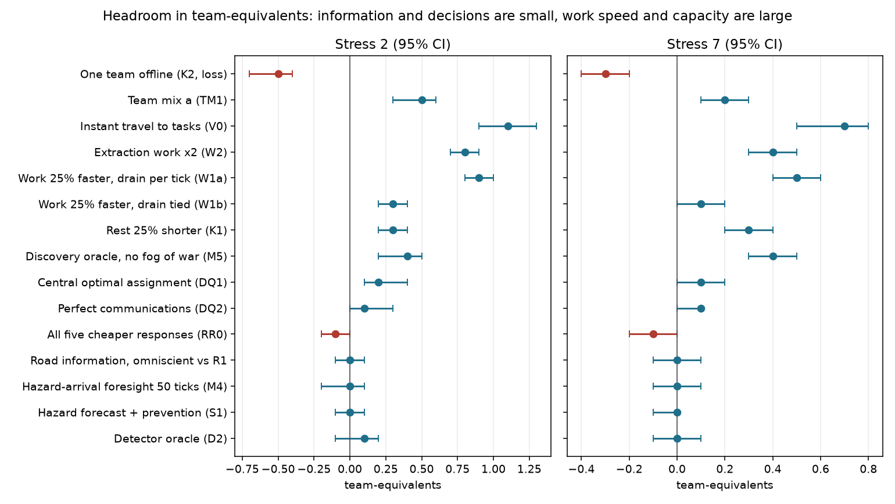
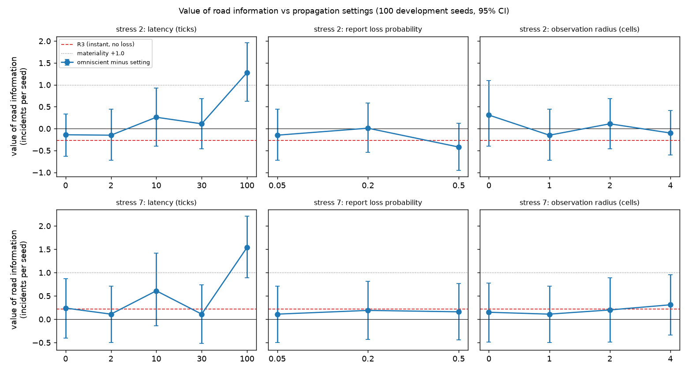
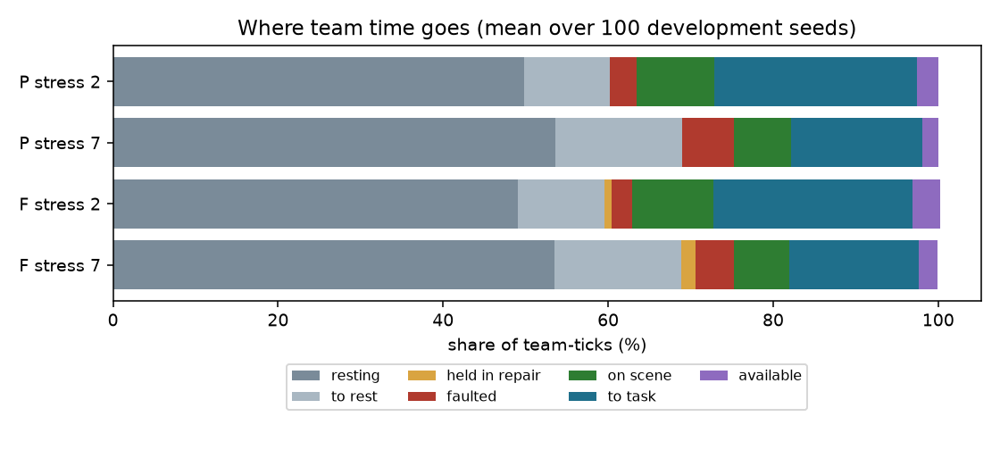

# Headroom map (Step 5)

**Status: complete (v1 world, frozen).** Pre-registration: `docs/HEADROOM_MAP_PREREG.md` (commits `1a3a3d3`, `6a08143`,
`b94ded0`, `c577ce7`, Addendum D, Addendum E). Scale audit: `docs/SCALE_AUDIT.md`. Per-run data: `docs/data/headroom/`.

## Summary in plain language

We asked where an AI, better information, better decisions, or more capacity could make the rescue fleet resolve more
incidents or lose fewer victims. We measured it by giving the simulator a perfect version of each thing, one at a time, on
100 seeds, then repeating on 100 fresh seeds for the ones that looked real.

* **A perfect fault detector is worth about nothing:** +0.28 incidents per run at stress 2 and +0.01 at stress 7 (out of about 42
  and 35), with an upper bound of +0.9. The Step 4 stress-7 figure (+1.75) was a small-sample result and does not replicate. The
  gates miss many short communication and resource faults, but catching them does not change the outcome. Delay, false
  alarms and removing evidence from the baseline make no difference either.
* **Forecasting hazards, better urgency, cheaper prevention, road information, perfect communications and the five cheaper
  responses (relief, support repair, a lane through blocked roads, degraded mode, autonomy) are all at or near zero.** The
  best central assignment is worth about one incident and does not survive the multiple-testing correction.
* **The one information channel with real headroom is discovery:** finding incidents the moment they appear is worth
  +1.7 incidents (stress 2) and +3.1 (stress 7) per run. The incident gain is confirmed on fresh seeds at stress 1, 2, 3.5
  and 7 (+1.7 to +3.1); fewer victims lost (+1.1 to +1.8) has the same sign everywhere and an interval above 0 in seven of
  eight seed sets (held-out stress 7 ends at -0.09), but did not pass the multiple-testing correction. That is about **0.4 team-equivalent**. It is a search, reporting and sensing problem, not a
  fault-forecasting one.
* **The large headroom is in capacity:** work speed (25 percent faster work is +4.4 incidents, 0.9 team-equivalent, if it costs no
  extra stamina; a quarter to a third of that if effort per unit of work is unchanged), travel (instant travel to tasks
  +5.6, 1.1 team-equivalents), rest and stamina (25 percent shorter rests +1.7, 0.3 team-equivalent), and team mix (+2.4 incidents,
  victims not established). One team out of service costs about 2.5 incidents.
* **Time budget:** 60 to 69 percent of fleet time is rest-related, 16 to 25 percent is travel to tasks, 7 to 10 percent is working on
  scene. Detection and forecasting do not touch those shares.
* **Road knowledge:** the shared-picture simplification does not matter if news of damage reaches the fleet within about
  half an hour; at an hour it is worth about +1.3 incidents at stress 7 on both seed sets, but that is not confirmed after
  the multiple-testing correction and is partly extra arrivals.

**Recommendation.** Do not invest in more detection or forecasting for throughput in this world. Test the discovery channel
(first against a no-learning coverage rule, G.1), and treat equipment tiers (G.2) and rest and stamina logistics as the
levers. Read the caveats in H first: large capacity ceilings are partly extra arrivals.

**Contents.** A, A2 road-knowledge model; P provenance and integrity; B0 time budget and detector delay; B1a-B1d information,
supply, demand, decisions, capacity yardstick and M5 at all stresses; B2, B2b work, travel and mix; B3 road information;
B4 propagation sensitivity; B5, B5b cheaper responses; C road-propagation design note; D complete table; E capacity budget;
F realisable ceilings; G design notes; H scorecard and caveats.

## A. Road-knowledge propagation: the model as implemented (R1-R3 and Addendum C)

Source: `core/road_knowledge.c`, `core/road_knowledge.h`. Hooks: `core/path.c` (`get_movement_cost`, `can_traverse_cell`
ask the planning view), `core/causal_actions.c` (`causal_actions_crossing_stall` stops a team whose planned step enters
a truly blocked cell; the action layer sees only fleet-known damage), `core/sim_runner.c` (once per tick).

* **One shared table**, not a per-team map. `s_belief[x][y]` holds the believed kind (clear, partial debris, blocked) and
  the tick it was learned. The pathfinder, the CBBA bids, the reachability checks and the rest-zone choice all read it
  (the pathfinder has no team argument, so a per-team picture is not possible without a core change).
* **Observation.** Every tick each team observes the cells within Chebyshev distance `radius` of itself (default 1: its
  own cell and 8 neighbours; the strict variant R1s uses 0). A team that plans a step into a truly blocked cell is
  stopped there and observes it that tick; a team that steps onto unknown partial debris observes it on entry.
* **Report.** If the observed kind differs from the table and no report of that kind is pending, a report is made. It is
  **lost** if the observing team has an active communication-class fault (this flag is the only link to the comms layer)
  or with probability `loss` (default 0.05, the consensus bus default of decision D4; a hash of seed, tick, team and
  cell, never a shared RNG stream). Otherwise it is **delivered at tick + `latency`** (default 2) to every team at once
  (due-tick delivery; one pending slot per cell). R3 sets latency 0, loss 0 and lets communication-faulted teams report.
* **Belief.** The table is overwritten by later reports of either kind (damage or clear), and a believed damage that
  nobody re-observes expires after **2400 ticks** (the longest unattended damage lasts). Stale beliefs (a cell believed
  damaged that has cleared) are therefore possible and counted (`stale_cell_ticks`).
* **R2 prior.** Unknown cells are planned at base cost plus `round(pi x 12)` where `pi` comes from the Omori rate of the
  last 1500 ticks spread over the grid; in this simulator it rounds to 0 to 2 cost units and carries no spatial
  information, because the causal model places damage at hashed epicentres on teams' routes (no intensity or
  building-density structure).
* Laptop-only. The board build links stubs that always return the true map. It does not use `comms_transport`, `vbus`
  or any frame, and it does not change any wire format, enum or schema.

**What it does not model:** per-team maps; hop-by-hop relaying or any dependence on who can hear whom; distance- or
terrain-dependent delay; scouting (sending a team to look); aerial observation; smoke or terrain visibility; reports that
carry a timestamp and are merged by recency; and the road information that already travels on the mission link (see C.5).

Because everybody knows everything after `latency` ticks, **the value of road information measured with it is a lower
bound** (the real propagation is slower and lossier). The Addendum C sensitivity (latency 0-100, loss 0.05-0.5, radius
0-4) measures how much the lower bound moves; its result goes in section B when it has run.

## A2. The shared road picture understates ignorance

Road knowledge is one fleet-wide table in which everybody learns everything `latency` ticks after one team sees it
(section A). Real teams would learn more slowly, unevenly and with errors, so **the model understates how little the
fleet knows, and the measured "value of road information" (omniscient minus the shared-picture setting) is a lower bound**
on what road information is worth. The Addendum C sensitivity measures how much the lower bound moves with latency,
loss and radius.

## P. Provenance and integrity of the results

* **Binaries are frozen per tier** (`build/headroom/frozen/<name>/`) and the runner records the binary's md5 in every
  result and in the CSV. Tier 0 and Tier 1 use **B1** = the tree committed as `ac72fd1` (hooks for D, S, M, K, W, V, TM,
  DQ1 and the road-knowledge module, no recovery-repertoire code), `noai` md5 `63a3f3bfb95f`, `ai` md5 `a6bbe7c30172`,
  built with `-O2`. Results written before the runner recorded the hash are tagged B1 in the CSV because their file time
  is after the B1 build.
* **Build environment of each frozen binary** (so a rebuild can be checked later; all built on this machine, the
  same compiler, flags and OS for both). A rebuild on another machine is only valid if it reproduces the md5.

  | Name | Source commit | `noai` md5 | `ai` md5 | Used for |
  |---|---|---|---|---|
  | B1 | `ac72fd1` | `63a3f3bfb95f94e20ef919d2cadb1ebf` | `a6bbe7c30172177e486f4db63b03dbd1` | Tiers 0-3, Addendum C |
  | B2 | `98fd08c` | `7e33412a46a9...` (full md5 in `build/headroom/frozen/B2_98fd08c/BUILD.txt`) | `d40bd5d785b6...` | Tier 4 |

  Compiler `cc (Ubuntu 13.3.0-6ubuntu2~24.04.1) 13.3.0`; flags `-std=gnu11 -O2 -w -DCOMMS_TRANSPORT_TEAMS_PER_BOARD=NUM_TEAMS
  -DVIRTUAL_BUS_ENABLED=1 -DCONSENSUS_ENFORCE=1 -Icore -Ilaptop` over `core/*.c laptop/main.c laptop/debug.c
  laptop/snapshot.c laptop/mission_feed.c laptop/mission_mirror.c -lm` (the `ai` binary adds `-DFAULT_MODEL_LOADED=1`);
  OS Ubuntu 24.04.4 LTS, kernel Linux 6.18.44-fc-v153 x86_64, glibc 2.39, Python 3.11.15 for the runner and analysis.
  The binaries and their `BUILD.txt` files are kept under `build/headroom/frozen/` (not committed: binaries).
* **Run policy (decided with you):** one machine, exactly 4 worker processes at a time and nothing else running; no
  second session; baselines already run on the same binary are reused (for example PD is also D2 at delay 0, R1 is the
  default of the Addendum C sensitivity), and baselines are re-run only when the binary differs (Tier 4 re-runs P and PD
  on B2); the pre-registered sample sizes are not reduced and there is no early stopping.
* **Checks done on the results written so far (Tier 0 baselines, before the Tier 1 sweep):** (1) run counts per
  condition: 100 per (stress, configuration) for P, F (both stresses) and the no-fault reference, seeds 1001-1100
  contiguous; (2) no duplicates (one file per seed, the `config` field of each file equals its directory); (3) no
  partial runs (no `.tmp` files, every file has incidents, victims and the time budget); (4) **no mixing of binaries:
  54 of the 100 stress-2 P results had been written by an earlier build** (before the W, V, K2, DQ1 and TM1 hooks
  existed). I re-ran 8 of them with B1 (8 of 8 identical in incidents, victims, spawned and the time budget), then
  deleted all 54 and re-ran them with B1, so every Tier 0 result comes from B1; (5) the queue that stalled for about 20
  minutes had run nothing, so no result was affected; (6) the 16 Step 4 reference runs (P, PD, PA, F, seeds 1001-1004,
  stress 2) reproduce the Step 4 numbers exactly with the -O2 build.
* **Full `make check-*` suite before Tier 4 (tree `98fd08c`, 53 targets run, board link targets excluded here and run
  separately).** 47 pass. Six failed to link, and I compared each against the frozen Step 4 tree `c7408be` in a separate
  worktree: **four fail identically at `c7408be`** (`check-consensus-selftest`, `check-fault-predictor-features-selftest`,
  `check-zone-parity`, `check-zone-refresh`: their stub link sets lack symbols added in Step 3.x such as
  `causal_actions_debris_held_at` and `fault_profile_causal_fix`; pre-existing, not touched here). **Two were caused by
  my hooks** (`check-realloc-gate`, `check-recovery-predictor-stress`: their stub link sets lack the new `probe_*`
  symbols); fixed in `laptop/tools/causal_link_stubs.inc` only (tools, no core change), both pass now. The ARM
  single-board compile, link and symbol checks pass (`check-board-single`), with the central allocator compiled out of
  the board build. The multi-board `check-board-link` is the known pre-existing failure (vendored BSP folder missing).
  Byte-identity of the default output against `c7408be`: six profiles, C1 md5 `b248bea72ce2ceb81389762dccc0a749`, and
  the causal variants with the planner (oracle and hazard), recovery actions on, and hold-repair: identical.
* **Per-run tables** are committed in `docs/data/headroom/` (one CSV per tier: stress, configuration, seed, incidents,
  victims lost and seen, spawned, priority-1 outcomes, teams in service, key counters, wall time, binary hash); the
  analysis scripts run from them. The D1 inputs (datasets of 30 seeds) are large and not committed; `detection_delay.py`
  regenerates the table from `headroom_run.py run --configs F --keep`.

## B0. Tier 0 results (read-only; 100 development seeds for the time budget, 30 for D1)

### B0.1 Time budget (TB)

Shares of team-ticks, mean over seeds 1001-1100, planner P and fixed gates F in the v1 world. The categories are
mutually exclusive in the priority order resting, heading to rest, held in a field repair, faulted (mobility or
resource fault active), on scene, en route to a task, available. "In service" = on scene + to task + available, in teams
out of 10. The no-fault reference has no probe diagnostics; the one-seed figures in `docs/SCALE_AUDIT.md` (resting 43.9,
en route 33.7, on scene 17.7, available 4.8 percent) stand in for it and match the brief.

| Condition | resting | to rest | held in repair | faulted | on scene | to task | available | in service (of 10) |
|---|---|---|---|---|---|---|---|---|
| P stress 2 | 49.8% | 10.4% | 0.0% | 3.2% | 9.5% | 24.5% | 2.6% | 3.66 |
| P stress 7 | 53.6% | 15.4% | 0.0% | 6.2% | 7.0% | 15.9% | 1.9% | 2.48 |
| F stress 2 | 49.1% | 10.4% | 0.9% | 2.5% | 9.9% | 24.1% | 3.3% | 3.72 |
| F stress 7 | 53.5% | 15.4% | 1.7% | 4.6% | 6.8% | 15.6% | 2.3% | 2.47 |

Per specialization (P, stress 2 / stress 7), in teams in service of 2: SEARCH 4.32 / 2.81 (per 10), MEDICAL 3.63 / 2.39,
EXTRACTION 3.90 / 2.70, PERIMETER 3.55 / 2.43, SUPPORT 2.91 / 2.08. The full per-specialization table is produced by
`headroom_report.py budget`.

Findings (descriptive):

* **About half of all team time is spent resting in every condition** (49-54 percent), and 10-15 percent more is spent
  travelling to rest: roughly 60 to 69 percent of the fleet's time is rest-related, against 7 to 10 percent on scene doing
  work. The stress-2 world already has fewer teams in service (3.7) than the no-fault world (about 4.8).
* The time-on-scene share falls from 17.7 percent (no faults) to 9.5 percent (stress 2) and 7.0 percent (stress 7).
  Travel to tasks (24.5 percent at stress 2) is two to three times the time spent working. Travel and rest, not work, is
  where the fleet's time goes, which is why the W (work) and V (travel) probes of Tier 2 matter.
* Held in a field repair is 0.0 percent under the planner (it almost never starts one, as in Step 3.6) and 0.9 and 1.7
  percent under the fixed gates at stress 2 and 7. Faulted-but-not-held time is 2-6 percent.
* SUPPORT teams spend the most time resting (60-62 percent) and the least in service.

### B0.2 Gates' detection delay and miss rate (D1)

Fixed-gate system F, stress 2 and 7, development seeds 1001-1030. An episode is one team's consecutive ticks with a
class's fault active; detected at the first tick of the episode at which the gates' logged recommendation is at least
LOCAL_RECOVERY (first row of each pair) or RETURN_TO_SAFE_ZONE (second row). The recommendation can come from another
evaluator, so the last column shows how often it was already set at the onset tick (0-6 percent, so attribution is
mostly clean).

| Stress | Class | Episodes | Mean length (ticks) | Level | Missed | Delay median [p10, p90] (ticks) | Detected within 5 / 10 / 40 ticks | Already recommended at onset |
|---|---|---|---|---|---|---|---|---|
| 2 | mobility | 1571 | 66 | >= LOCAL | 38% | 2 [1, 23] | 67% / 80% / 97% | 3% |
| 2 | mobility | 1571 | 66 | >= RETURN | 40% | 6 [3, 26] | 43% / 72% / 96% | 0% |
| 2 | communication | 3375 | 4 | >= LOCAL | 86% | 3 [0, 12] | 81% / 88% / 100% | 4% |
| 2 | communication | 3375 | 4 | >= RETURN | 93% | 7 [4, 22] | 36% / 74% / 100% | 0% |
| 2 | resource | 1255 | 41 | >= LOCAL | 63% | 11 [0, 57] | 32% / 50% / 81% | 6% |
| 2 | resource | 1255 | 41 | >= RETURN | 71% | 15 [2, 62] | 22% / 38% / 76% | 1% |
| 7 | mobility | 3385 | 70 | >= LOCAL | 43% | 2 [1, 23] | 66% / 80% / 97% | 1% |
| 7 | mobility | 3385 | 70 | >= RETURN | 44% | 6 [3, 27] | 45% / 73% / 96% | 0% |
| 7 | communication | 2292 | 4 | >= LOCAL | 85% | 3 [0, 12] | 73% / 87% / 100% | 2% |
| 7 | communication | 2292 | 4 | >= RETURN | 91% | 7 [4, 19] | 37% / 75% / 100% | 0% |
| 7 | resource | 3208 | 43 | >= LOCAL | 67% | 9 [0, 51] | 34% / 53% / 85% | 5% |
| 7 | resource | 3208 | 43 | >= RETURN | 74% | 13 [3, 55] | 21% / 39% / 83% | 1% |

Findings:

* **When the gates detect a mobility fault they do it fast: median 2 ticks (72 s), 97 percent within 40 ticks.** But
  **38-43 percent of mobility episodes are never flagged at all** before they end (mean length 66-70 ticks).
* **Communication faults are short (mean 4 ticks) and the gates miss 85-86 percent of them** (they act on a window of
  several ticks); the median delay is 3 ticks when they do fire.
* **Resource faults are the slowest and most often missed:** median 9-11 ticks, 63-67 percent never flagged.
* The brief's premise that "gates already confirm and act within a few ticks" holds for the faults they catch; the
  headroom for a better detector is the **missed episodes**, not the delay of the caught ones. Whether catching them
  matters is what D2/D3 and the detector-oracle contrasts of Tier 1 measure.

## B1a. Tier 1, information chunk (screen: 100 development seeds 1001-1100, stress 2 and 7)

Headroom = probe minus matched baseline (P, or P at the same dropout), paired by seed, bootstrap 95% CI (20000
resamples). Victims lost is shown as baseline minus probe (positive = fewer lost). Survival needs a CI lower bound above
0 **and** a point estimate of at least +1.0 incident or 1.0 victim. Per-run data: `docs/data/headroom/tier1a_information.csv`
(binary B1). Team-equivalents are blank until the K1 capacity runs (end of Tier 1) provide the yardstick.

| Probe | Stress | Incidents / seed [95% CI] | Team-equiv. | Victims lost / seed (positive = fewer) [95% CI] | Spawned | Survives |
|---|---|---|---|---|---|---|
| context: shipped AI on the planner (PA minus P) | 2 | -0.05 [-0.60, +0.50] |  | -0.09 [-0.82, +0.67] | -0.2 | (not a probe) |
| context: shipped AI on the planner (PA minus P) | 7 | +0.14 [-0.47, +0.73] |  | +0.07 [-0.81, +0.93] | -0.1 | (not a probe) |
| context: fixed gates minus planner (F minus P) | 2 | -0.26 [-0.92, +0.41] |  | -0.13 [-1.11, +0.85] | -0.2 | (not a probe) |
| context: fixed gates minus planner (F minus P) | 7 | -0.28 [-1.02, +0.48] |  | +0.07 [-1.13, +1.30] | -0.1 | (not a probe) |
| D2 detector oracle, no delay (PD) | 2 | +0.28 [-0.33, +0.89] |  | -0.30 [-1.28, +0.70] | +0.3 | no |
| D2 detector oracle, no delay (PD) | 7 | +0.01 [-0.84, +0.85] |  | -0.57 [-1.69, +0.58] | +0.4 | no |
| D2 detector oracle delayed 5 ticks | 2 | +0.21 [-0.44, +0.86] |  | -0.52 [-1.52, +0.50] | +0.2 | no |
| D2 detector oracle delayed 5 ticks | 7 | -0.07 [-0.88, +0.74] |  | -0.36 [-1.49, +0.77] | -0.0 | no |
| D2 detector oracle delayed 10 ticks | 2 | +0.25 [-0.41, +0.91] |  | -0.66 [-1.62, +0.32] | +0.2 | no |
| D2 detector oracle delayed 10 ticks | 7 | +0.32 [-0.50, +1.14] |  | +0.13 [-0.92, +1.20] | +0.6 | no |
| D2 detector oracle delayed 20 ticks | 2 | +0.05 [-0.69, +0.79] |  | -0.62 [-1.54, +0.31] | +0.2 | no |
| D2 detector oracle delayed 20 ticks | 7 | -0.27 [-1.09, +0.55] |  | -0.38 [-1.62, +0.86] | +0.2 | no |
| D2 detector oracle delayed 40 ticks | 2 | +0.06 [-0.67, +0.78] |  | -0.56 [-1.50, +0.39] | +0.0 | no |
| D2 detector oracle delayed 40 ticks | 7 | -0.53 [-1.36, +0.28] |  | -0.01 [-1.18, +1.16] | +0.0 | no |
| D3a oracle, 30% misses / 1% false alarms | 2 | +0.26 [-0.43, +0.95] |  | -0.46 [-1.48, +0.57] | +0.1 | no |
| D3a oracle, 30% misses / 1% false alarms | 7 | +0.01 [-0.72, +0.73] |  | -0.70 [-1.77, +0.38] | +0.3 | no |
| D3b baseline evidence dropout 25% (effect on P) | 2 | +0.33 [-0.42, +1.05] |  | +0.59 [-0.16, +1.38] | -0.1 | (not a probe) |
| D3b baseline evidence dropout 25% (effect on P) | 7 | -0.08 [-0.79, +0.64] |  | +0.16 [-0.79, +1.11] | +0.2 | (not a probe) |
| D3b oracle headroom at dropout 25% | 2 | -0.25 [-1.03, +0.53] |  | -1.46 [-2.37, -0.56] | +0.4 | no |
| D3b oracle headroom at dropout 25% | 7 | +0.05 [-0.81, +0.91] |  | +0.42 [-0.74, +1.60] | -0.2 | no |
| D3b shipped-AI gain at dropout 25% | 2 | -0.02 [-0.60, +0.57] |  | -0.15 [-0.74, +0.43] | -0.0 | no |
| D3b shipped-AI gain at dropout 25% | 7 | -0.02 [-0.62, +0.57] |  | +0.47 [-0.44, +1.38] | -0.4 | no |
| D3b baseline evidence dropout 50% (effect on P) | 2 | +0.10 [-0.52, +0.72] |  | +0.01 [-0.92, +0.96] | -0.1 | (not a probe) |
| D3b baseline evidence dropout 50% (effect on P) | 7 | -0.03 [-0.73, +0.67] |  | +0.17 [-0.81, +1.15] | -0.3 | (not a probe) |
| D3b oracle headroom at dropout 50% | 2 | +0.25 [-0.52, +1.02] |  | -0.50 [-1.48, +0.49] | +0.2 | no |
| D3b oracle headroom at dropout 50% | 7 | -0.48 [-1.19, +0.24] |  | -0.21 [-1.44, +1.07] | -0.0 | no |
| D3b shipped-AI gain at dropout 50% | 2 | +0.16 [-0.39, +0.69] |  | +0.47 [-0.29, +1.23] | -0.1 | no |
| D3b shipped-AI gain at dropout 50% | 7 | -0.11 [-0.76, +0.53] |  | +0.80 [-0.15, +1.75] | +0.1 | no |
| D3b baseline evidence dropout 75% (effect on P) | 2 | +0.27 [-0.44, +0.97] |  | -0.09 [-0.96, +0.78] | -0.0 | (not a probe) |
| D3b baseline evidence dropout 75% (effect on P) | 7 | +0.24 [-0.42, +0.91] |  | +0.14 [-0.84, +1.13] | +0.2 | (not a probe) |
| D3b oracle headroom at dropout 75% | 2 | -0.33 [-1.10, +0.44] |  | -0.38 [-1.20, +0.45] | -0.0 | no |
| D3b oracle headroom at dropout 75% | 7 | -0.15 [-0.96, +0.65] |  | -0.20 [-1.29, +0.82] | -0.1 | no |
| D3b shipped-AI gain at dropout 75% | 2 | -0.26 [-0.83, +0.30] |  | -0.19 [-0.98, +0.59] | -0.0 | no |
| D3b shipped-AI gain at dropout 75% | 7 | -0.14 [-0.73, +0.44] |  | +0.85 [-0.06, +1.74] | -0.4 | no |

**Result: nothing survives; every incidents CI includes 0.** (The one interval that excludes 0, "oracle headroom at
dropout 25%, stress 2, victims", is **negative**: the perfect detector lost 1.5 more victims than P there; it is not a
benefit and fails the screen.)

* **A perfect detector (PD) adds +0.28 [-0.33, +0.89] incidents at stress 2 and +0.01 [-0.84, +0.85] at stress 7.**
  Step 4 (40 pooled seeds) had measured +0.35 and **+1.75** [+0.47, +2.98]. The stress-7 figure **does not replicate on
  100 seeds**: with 2.5 times the seeds the estimate is 0. The same is true of the shipped AI (Step 4: +1.23 on the planner
  at stress 7; now +0.14 [-0.47, +0.73]). The Step 4 stress-7 headline was a small-sample result and should be
  withdrawn; the honest statement is that the headroom of detection is **indistinguishable from zero at both stresses**,
  with a 95% upper bound of +0.9 incidents (about 2 percent of throughput).
* **Detection delay does not matter** (D2): the oracle delayed 5, 10, 20 and 40 ticks is as good as, or as bad as, the
  undelayed one; all within +-0.5 incidents of P. Detection **earliness** has no measurable value here.
* **Realistic false alarms and misses do not matter** (D3a, 30 percent misses and 1 percent false alarms): +0.26 and
  +0.01, the same as the perfect oracle.
* **Dropping the baseline's evidence does not hurt it** (D3b): removing 25, 50 or 75 percent of the watchdog and twin
  evidence changes P's incidents by +0.1 to +0.3 (no effect). The hook works: go-home events at stress 7 fall from 181 per
  seed to 129 (-29 percent) at 75 percent dropout, with no change in outcome. So **a large share of the gates' go-home
  trips contributes nothing**, and the information channels the baseline reads are not what limits it. With dropout, the
  perfect oracle (-0.3 to +0.25) and the shipped AI (-0.3 to +0.2) are still worth nothing: the AI does not matter when
  the baseline sees less.
* **Context:** the shipped AI on the planner (PA minus P) is -0.05 and +0.14; the fixed gates are indistinguishable from
  the planner (-0.26, -0.28).

**Scorecard (Addendum B, section 10.5, and Addendum A).**

| Prediction | Outcome |
|---|---|
| D1 median delay above 10 ticks, miss rate above 30 percent for communication, resource slowest | Partly: the median delay is 2-3 ticks for mobility and communication (not above 10); communication missed 85-86 percent (held); resource slowest (held) |
| D2 headroom falls as the delay grows (Spearman -0.5 or lower at stress 7) | **Not testable**: headroom is zero at k = 0, so there is nothing to fall |
| D3a keeps at least half of the PD headroom at stress 7 | Vacuous: PD headroom is 0 |
| D3b P falls with dropout (about -0.5 at 25 percent, -2 at 75); oracle headroom and AI gain grow with dropout | **Not held**: P does not fall; oracle headroom and AI gain stay at 0 |
| Overall: no information probe survives at stress 2 | **Held**; and none survives at stress 7 either |

Caveat for all of these: they run on the **planner (P) as baseline**, whose own information use is the thing being
tested. Even so, the fixed gates and the planner are indistinguishable, and so are all oracle variants.

## B1b. Tier 1, supply, demand and decision chunk (screen: 100 development seeds; confirmation: 100 held-out seeds)

Same conventions as B1a. Per-run data: `docs/data/headroom/tier1b_supply_demand_decision.csv` (binary B1).

| Probe | Stress | Incidents / seed [95% CI] | Team-equiv. | Victims lost / seed (positive = fewer) [95% CI] | Spawned | Survives screen |
|---|---|---|---|---|---|---|
| S1 hazard forecast + prevention x1 (level ii) | 2 | +0.02 [-0.31, +0.35] |  | -0.12 [-0.42, +0.19] | -0.1 | no |
| S1 hazard forecast + prevention x1 (level ii) | 7 | -0.19 [-0.68, +0.30] |  | +0.21 [-0.47, +0.88] | -0.1 | no |
| S1 draw-aware forecast + prevention x1 (level i) | 2 | -0.17 [-0.73, +0.40] |  | +0.35 [-0.42, +1.16] | -0.2 | no |
| S1 draw-aware forecast + prevention x1 (level i) | 7 | -0.38 [-1.10, +0.33] |  | +0.18 [-0.70, +1.04] | +0.0 | no |
| S1 hazard forecast + prevention x0.5 (level ii) | 2 | +0.02 [-0.31, +0.35] |  | -0.12 [-0.42, +0.19] | -0.1 | no |
| S1 hazard forecast + prevention x0.5 (level ii) | 7 | -0.19 [-0.68, +0.30] |  | +0.21 [-0.47, +0.88] | -0.1 | no |
| S1 draw-aware forecast + prevention x0.5 (level i) | 2 | +0.37 [-0.28, +1.02] |  | -0.04 [-0.86, +0.79] | +0.0 | no |
| S1 draw-aware forecast + prevention x0.5 (level i) | 7 | -0.54 [-1.23, +0.16] |  | +0.09 [-0.88, +1.04] | -0.1 | no |
| S1 hazard forecast + prevention x0.25 (level ii) | 2 | +0.02 [-0.31, +0.35] |  | -0.12 [-0.42, +0.19] | -0.1 | no |
| S1 hazard forecast + prevention x0.25 (level ii) | 7 | -0.19 [-0.68, +0.30] |  | +0.21 [-0.47, +0.88] | -0.1 | no |
| S1 draw-aware forecast + prevention x0.25 (level i) | 2 | +0.20 [-0.41, +0.82] |  | +0.04 [-0.80, +0.90] | -0.0 | no |
| S1 draw-aware forecast + prevention x0.25 (level i) | 7 | -0.63 [-1.36, +0.09] |  | -0.12 [-1.09, +0.81] | -0.1 | no |
| M1 survival-rate urgency (level ii) | 2 | -0.19 [-0.80, +0.41] |  | +0.27 [-0.55, +1.07] | -0.1 | no |
| M1 survival-rate urgency (level ii) | 7 | -0.35 [-0.92, +0.23] |  | +0.41 [-0.45, +1.30] | -0.4 | no |
| M1 realised-death urgency (level i) | 2 | -0.32 [-0.86, +0.22] |  | -0.21 [-1.01, +0.59] | -0.3 | no |
| M1 realised-death urgency (level i) | 7 | -0.47 [-1.11, +0.16] |  | -0.05 [-1.03, +0.90] | -0.6 | no |
| M2 fire-spread foresight, 50 ticks | 2 | +0.04 [-0.65, +0.73] |  | -0.53 [-1.38, +0.32] | +0.1 | no |
| M2 fire-spread foresight, 50 ticks | 7 | -0.11 [-0.81, +0.58] |  | -0.11 [-1.19, +0.97] | -0.1 | no |
| M3 aftershock-collapse foresight, 50 ticks | 2 | -0.01 [-0.71, +0.68] |  | -0.06 [-0.93, +0.79] | +0.1 | no |
| M3 aftershock-collapse foresight, 50 ticks | 7 | -0.49 [-1.27, +0.28] |  | +0.55 [-0.46, +1.57] | -0.4 | no |
| M4 hazard-arrival foresight, 10 ticks | 2 | +0.52 [-0.04, +1.10] |  | +0.66 [-0.17, +1.51] | +0.1 | no |
| M4 hazard-arrival foresight, 10 ticks | 7 | -0.15 [-0.73, +0.43] |  | +0.22 [-0.64, +1.07] | +0.2 | no |
| M4 hazard-arrival foresight, 50 ticks | 2 | -0.15 [-0.76, +0.46] |  | -0.33 [-1.20, +0.54] | -0.0 | no |
| M4 hazard-arrival foresight, 50 ticks | 7 | +0.15 [-0.57, +0.88] |  | +0.65 [-0.48, +1.79] | +0.1 | no |
| M4 hazard-arrival foresight, 200 ticks | 2 | -0.18 [-0.79, +0.43] |  | -0.26 [-1.12, +0.60] | -0.1 | no |
| M4 hazard-arrival foresight, 200 ticks | 7 | +0.16 [-0.56, +0.89] |  | +0.70 [-0.43, +1.83] | +0.1 | no |
| M5 discovery oracle (no fog of war) | 2 | +1.89 [+1.15, +2.63] |  | +1.82 [+0.93, +2.71] | +0.1 | incidents, victims |
| M5 discovery oracle (no fog of war) | 7 | +3.23 [+2.41, +4.08] |  | +1.79 [+0.83, +2.73] | +0.3 | incidents, victims |
| DQ1 central optimal assignment | 2 | +1.23 [+0.65, +1.82] |  | +0.96 [+0.10, +1.82] | +0.8 | incidents |
| DQ1 central optimal assignment | 7 | +0.82 [+0.17, +1.47] |  | +1.51 [+0.51, +2.52] | +0.5 | victims |
| DQ2 perfect comms (no comm faults, no bus loss) | 2 | +0.70 [+0.10, +1.38] |  | +0.39 [-0.31, +1.10] | +0.1 | no |
| DQ2 perfect comms (no comm faults, no bus loss) | 7 | +0.54 [-0.01, +1.10] |  | +0.51 [-0.28, +1.31] | +0.2 | no |

### Confirmation (held-out seeds 3001-3100, Holm over the whole screened family, m = 112 at this point)

| Probe | Stress | Metric | Screen | Held-out [95% CI] | p | Holm p | Confirmed |
|---|---|---|---|---|---|---|---|
| M5 discovery oracle (no fog of war) | 2 | incidents | +1.89 [+1.15, +2.63] | +1.71 [+1.05, +2.40] | 0.0001 | 0.011 | yes |
| M5 discovery oracle (no fog of war) | 2 | victims | +1.82 [+0.93, +2.71] | +1.37 [+0.42, +2.34] | 0.0058 | 0.632 | no |
| M5 discovery oracle (no fog of war) | 7 | incidents | +3.23 [+2.41, +4.08] | +3.10 [+2.28, +3.95] | 0.0001 | 0.011 | yes |
| M5 discovery oracle (no fog of war) | 7 | victims | +1.79 [+0.83, +2.73] | +1.06 [-0.09, +2.23] | 0.0702 | 1.000 | no |
| DQ1 central optimal assignment | 2 | incidents | +1.23 [+0.65, +1.82] | +1.05 [+0.41, +1.70] | 0.0017 | 0.187 | no |
| DQ1 central optimal assignment | 7 | victims | +1.51 [+0.51, +2.52] | +1.30 [+0.35, +2.31] | 0.0087 | 0.940 | no |

**Result.**

* **M5, the discovery oracle (every incident revealed the tick it spawns), is the only confirmed headroom so far:
  +1.71 [+1.05, +2.40] incidents at stress 2 and +3.10 [+2.28, +3.95] at stress 7 on the held-out seeds, Holm-adjusted
  p = 0.011 for both.** That is 4 percent and 9 percent of throughput. It is not demand-driven (spawned incidents rise by
  only 0.1 and 0.3 per seed against gains of 1.9 and 3.2). The victims-lost gain (about 1.4 to 1.8 fewer per seed in the
  screen) has the right sign on the held-out seeds but does not pass the Holm correction. The Step 3 measurement that
  fog of war dominates the time to first response (spawn to discovery 226 ticks on average) agrees with this.
  **Realisable?** Not by a fault forecaster: it is search, reporting and sensing (more scouts, aerial survey, reports from
  the public, better coverage), i.e. information about *where incidents are*, not about *which team will fail*.
* **DQ1, the central optimal assignment (an upper bound on coordination, laptop-only), shows +1.05 [+0.41, +1.70]
  incidents at stress 2 and 1.30 fewer victims lost at stress 7 on the held-out seeds: the same sign with a CI that
  excludes 0, but it does not pass the Holm correction over this large family (adjusted p 0.19 and 0.94), so it is not
  confirmed.** At stress 2 the incident gain is also flagged demand-driven by the pre-registered rule (spawned
  incidents +0.8 against a gain of +1.2). Reading: the in-process auction (CBBA with bundles, already a converged
  greedy) is within about one incident of an optimal one-to-one assignment; better coordination is worth at most about
  that much.
* **Perfect communications (DQ2)** is worth +0.70 [+0.10, +1.38] and +0.54 [-0.01, +1.10]: positive but below the
  materiality threshold, so it does not survive.
* **Everything else is a null:** cheaper prevention (S1), the survival-based urgency rule (M1, both levels), and foresight
  of fire spread, collapse or hazard arrivals (M2, M3, M4 at 10, 50 and 200 ticks) are all within about +-0.7 incidents
  of 0 with CIs that include 0.
* **S1 at the hazard-rate level is a literal null, not a measurement of cheap prevention:** the three prevention
  prices give identical numbers because the in-field maintenance option (the only one whose price the probe scales) is
  **never chosen** at the hazard-rate forecast, even at a quarter of the cost (0 uses per seed against 9.3 rest-at-base
  preventions that the scaling does not touch). At the perfect-foresight level it is used (5.9 uses per seed at the
  full price, 24.9 at a quarter) and still gives no gain (-0.38 to -0.63 incidents at stress 7).

**Scorecard for this chunk.**

| Prediction (Addendum B, section 10.5) | Outcome |
|---|---|
| S1: no survivor at stress 2 | Held |
| M1 level ii: victims fall 0.5 to 2 at stress 7 | Not supported: +0.41 [-0.45, +1.30], CI includes 0 |
| M2, M3 under +0.5 | Held |
| M4: positive, rising to T = 50, up to +1.5 | Not held: null at every lead |
| M5: +1 to +4 incidents, victims down 1 to 4 | **Held** for incidents (confirmed); victims not confirmed |
| DQ1: CBBA within 1.0 incident of central | Borderline: +1.23 and +0.82 in the screen (above 1.0 at stress 2), not confirmed after Holm |
| DQ2: +0.5 to 2 at stress 7, about 0 at stress 2 | Magnitude held at stress 7 (+0.54, CI touches 0); at stress 2 it is +0.70, not about 0 |

M5 is also run at stress 1 and 3.5 on both seed sets (the pre-registered rule for confirmed survivors); that result is in B1d.

## B1c. Tier 1, capacity yardstick (K1, K2) and every Tier 1 probe in team-equivalents

Per-run data: `docs/data/headroom/tier1c_capacity.csv` (binary B1).

### Capacity sensitivity (what a team in service is worth)

| Capacity change | Stress | Incidents / seed [95% CI] | Mean teams in service (change) | Victims lost (positive = fewer) | Spawned |
|---|---|---|---|---|---|
| K1 rest duration x0.5 | 2 | +3.25 [+2.64, +3.87] | +0.6 [+0.5, +0.7] | +3.07 [+2.26, +3.89] | +2.4 |
| K1 rest duration x0.5 | 7 | +3.62 [+2.93, +4.32] | +0.4 [+0.4, +0.5] | +3.18 [+2.31, +4.06] | +2.1 |
| K1 stamina drain x0.5 | 2 | +3.93 [+3.19, +4.64] | +0.8 [+0.6, +0.9] | +2.38 [+1.63, +3.12] | +3.2 |
| K1 stamina drain x0.5 | 7 | +2.77 [+2.15, +3.40] | +0.3 [+0.3, +0.4] | +2.03 [+1.13, +2.94] | +1.9 |
| K1 rest duration x0.75 | 2 | +1.71 [+1.16, +2.27] | +0.3 [+0.2, +0.4] | +1.52 [+0.61, +2.45] | +1.1 |
| K1 rest duration x0.75 | 7 | +2.32 [+1.67, +2.97] | +0.3 [+0.2, +0.4] | +1.44 [+0.65, +2.23] | +1.0 |
| K1 stamina drain x0.75 | 2 | +2.19 [+1.68, +2.70] | +0.4 [+0.3, +0.5] | +1.53 [+0.81, +2.26] | +1.7 |
| K1 stamina drain x0.75 | 7 | +1.50 [+0.88, +2.11] | +0.2 [+0.1, +0.3] | +1.27 [+0.43, +2.11] | +1.0 |
| K1 rest duration x1.5 | 2 | -3.84 [-4.55, -3.15] | -0.8 [-0.9, -0.6] | -2.09 [-2.99, -1.14] | -2.5 |
| K1 rest duration x1.5 | 7 | -3.98 [-4.70, -3.25] | -0.5 [-0.6, -0.4] | -2.07 [-3.12, -1.01] | -2.1 |
| K1 stamina drain x1.5 | 2 | -4.42 [-5.00, -3.85] | -0.9 [-1.0, -0.8] | -2.49 [-3.30, -1.68] | -3.4 |
| K1 stamina drain x1.5 | 7 | -3.75 [-4.37, -3.13] | -0.5 [-0.5, -0.4] | -2.09 [-3.08, -1.09] | -2.0 |
| K1 rest duration x2 | 2 | -6.55 [-7.26, -5.83] | -1.3 [-1.4, -1.2] | -3.97 [-4.92, -2.96] | -4.1 |
| K1 rest duration x2 | 7 | -7.20 [-8.01, -6.39] | -0.9 [-1.0, -0.8] | -4.13 [-5.07, -3.22] | -3.6 |
| K1 stamina drain x2 | 2 | -8.35 [-9.01, -7.68] | -1.7 [-1.8, -1.6] | -5.00 [-5.92, -4.06] | -6.0 |
| K1 stamina drain x2 | 7 | -6.50 [-7.09, -5.93] | -0.8 [-0.9, -0.7] | -3.40 [-4.37, -2.43] | -4.1 |
| K2 1 team(s) offline | 2 | -2.73 [-3.49, -1.98] | -0.5 [-0.7, -0.4] | -1.55 [-2.53, -0.57] | -1.7 |
| K2 1 team(s) offline | 7 | -2.52 [-3.33, -1.71] | -0.3 [-0.4, -0.2] | -1.69 [-2.62, -0.77] | -1.1 |
| K2 2 team(s) offline | 2 | -5.73 [-6.45, -5.02] | -1.1 [-1.3, -1.0] | -3.24 [-4.24, -2.22] | -3.5 |
| K2 2 team(s) offline | 7 | -5.43 [-6.22, -4.65] | -0.7 [-0.8, -0.6] | -2.79 [-3.78, -1.81] | -2.5 |
| K2 3 team(s) offline | 2 | -9.71 [-10.67, -8.79] | -1.9 [-2.1, -1.8] | -5.09 [-6.15, -4.03] | -5.3 |
| K2 3 team(s) offline | 7 | -7.64 [-8.56, -6.70] | -0.9 [-1.1, -0.8] | -3.79 [-4.99, -2.61] | -3.6 |

(The team-equivalent column of this table is the change in mean teams in service measured by the time budget, not a
division by the slope.)

**Yardstick (least-squares fit of mean incidents on mean teams in service over the baseline and the eight K1 runs,
100 development seeds, seed-bootstrap 95% CI): 5.0 [4.7, 5.4] incidents per extra team in service at stress 2, and 8.1
[7.5, 8.6] at stress 7.** Take a team out of service entirely (K2) and the fleet loses 2.7 (stress 2) and 2.5 (stress 7)
incidents for one team, 5.7 and 5.4 for two, 9.7 and 7.6 for three: about 2.5 incidents for the first team and more
for each next one (the effect is convex), while one team offline removes only about 0.5 of a team-equivalent of
in-service time (a team is in service about 37 percent of the time at stress 2), which is consistent with the slope.
Making rest 25 percent shorter or stamina last 25 percent longer is worth 1.5 to 2.3 incidents per seed, and halving
either is worth 2.8 to 3.9. **Capacity is the strongest lever measured so far by an order of magnitude over
information or forecasting.** Caveat (Addendum A, item 2): arrivals respond to capacity (spawned incidents rise by
2 to 3 per seed with +3 to +4 incidents resolved), so the slope is inflated by demand response and team-equivalents are
**understated**.

### Every Tier 1 probe in team-equivalents (headroom divided by the slope of the same stress)

| Probe | Stress | Incidents / seed [95% CI] | Team-equivalents [95% CI] |
|---|---|---|---|
| D2 detector oracle, no delay (PD) | 2 | +0.28 [-0.33, +0.89] | +0.1 [-0.1, +0.2] |
| D2 detector oracle, no delay (PD) | 7 | +0.01 [-0.84, +0.85] | +0.0 [-0.1, +0.1] |
| D2 detector oracle delayed 5 ticks | 2 | +0.21 [-0.44, +0.86] | +0.0 [-0.1, +0.2] |
| D2 detector oracle delayed 5 ticks | 7 | -0.07 [-0.88, +0.74] | -0.0 [-0.1, +0.1] |
| D2 detector oracle delayed 10 ticks | 2 | +0.25 [-0.41, +0.91] | +0.0 [-0.1, +0.2] |
| D2 detector oracle delayed 10 ticks | 7 | +0.32 [-0.50, +1.14] | +0.0 [-0.1, +0.1] |
| D2 detector oracle delayed 20 ticks | 2 | +0.05 [-0.69, +0.79] | +0.0 [-0.1, +0.2] |
| D2 detector oracle delayed 20 ticks | 7 | -0.27 [-1.09, +0.55] | -0.0 [-0.1, +0.1] |
| D2 detector oracle delayed 40 ticks | 2 | +0.06 [-0.67, +0.78] | +0.0 [-0.1, +0.2] |
| D2 detector oracle delayed 40 ticks | 7 | -0.53 [-1.36, +0.28] | -0.1 [-0.2, +0.0] |
| D3a oracle, 30% misses / 1% false alarms | 2 | +0.26 [-0.43, +0.95] | +0.1 [-0.1, +0.2] |
| D3a oracle, 30% misses / 1% false alarms | 7 | +0.01 [-0.72, +0.73] | +0.0 [-0.1, +0.1] |
| S1 hazard forecast + prevention x1 (level ii) | 2 | +0.02 [-0.31, +0.35] | +0.0 [-0.1, +0.1] |
| S1 hazard forecast + prevention x1 (level ii) | 7 | -0.19 [-0.68, +0.30] | -0.0 [-0.1, +0.0] |
| S1 draw-aware forecast + prevention x1 (level i) | 2 | -0.17 [-0.73, +0.40] | -0.0 [-0.1, +0.1] |
| S1 draw-aware forecast + prevention x1 (level i) | 7 | -0.38 [-1.10, +0.33] | -0.0 [-0.1, +0.0] |
| S1 hazard forecast + prevention x0.5 (level ii) | 2 | +0.02 [-0.31, +0.35] | +0.0 [-0.1, +0.1] |
| S1 hazard forecast + prevention x0.5 (level ii) | 7 | -0.19 [-0.68, +0.30] | -0.0 [-0.1, +0.0] |
| S1 draw-aware forecast + prevention x0.5 (level i) | 2 | +0.37 [-0.28, +1.02] | +0.1 [-0.1, +0.2] |
| S1 draw-aware forecast + prevention x0.5 (level i) | 7 | -0.54 [-1.23, +0.16] | -0.1 [-0.2, +0.0] |
| S1 hazard forecast + prevention x0.25 (level ii) | 2 | +0.02 [-0.31, +0.35] | +0.0 [-0.1, +0.1] |
| S1 hazard forecast + prevention x0.25 (level ii) | 7 | -0.19 [-0.68, +0.30] | -0.0 [-0.1, +0.0] |
| S1 draw-aware forecast + prevention x0.25 (level i) | 2 | +0.20 [-0.41, +0.82] | +0.0 [-0.1, +0.2] |
| S1 draw-aware forecast + prevention x0.25 (level i) | 7 | -0.63 [-1.36, +0.09] | -0.1 [-0.2, +0.0] |
| M1 survival-rate urgency (level ii) | 2 | -0.19 [-0.80, +0.41] | -0.0 [-0.2, +0.1] |
| M1 survival-rate urgency (level ii) | 7 | -0.35 [-0.92, +0.23] | -0.0 [-0.1, +0.0] |
| M1 realised-death urgency (level i) | 2 | -0.32 [-0.86, +0.22] | -0.1 [-0.2, +0.0] |
| M1 realised-death urgency (level i) | 7 | -0.47 [-1.11, +0.16] | -0.1 [-0.1, +0.0] |
| M2 fire-spread foresight, 50 ticks | 2 | +0.04 [-0.65, +0.73] | +0.0 [-0.1, +0.2] |
| M2 fire-spread foresight, 50 ticks | 7 | -0.11 [-0.81, +0.58] | -0.0 [-0.1, +0.1] |
| M3 aftershock-collapse foresight, 50 ticks | 2 | -0.01 [-0.71, +0.68] | -0.0 [-0.1, +0.1] |
| M3 aftershock-collapse foresight, 50 ticks | 7 | -0.49 [-1.27, +0.28] | -0.1 [-0.2, +0.0] |
| M4 hazard-arrival foresight, 10 ticks | 2 | +0.52 [-0.04, +1.10] | +0.1 [-0.0, +0.2] |
| M4 hazard-arrival foresight, 10 ticks | 7 | -0.15 [-0.73, +0.43] | -0.0 [-0.1, +0.0] |
| M4 hazard-arrival foresight, 50 ticks | 2 | -0.15 [-0.76, +0.46] | -0.0 [-0.2, +0.1] |
| M4 hazard-arrival foresight, 50 ticks | 7 | +0.15 [-0.57, +0.88] | +0.0 [-0.1, +0.1] |
| M4 hazard-arrival foresight, 200 ticks | 2 | -0.18 [-0.79, +0.43] | -0.0 [-0.2, +0.1] |
| M4 hazard-arrival foresight, 200 ticks | 7 | +0.16 [-0.56, +0.89] | +0.0 [-0.1, +0.1] |
| M5 discovery oracle (no fog of war) | 2 | +1.89 [+1.15, +2.63] | +0.4 [+0.2, +0.5] |
| M5 discovery oracle (no fog of war) | 7 | +3.23 [+2.41, +4.08] | +0.4 [+0.3, +0.5] |
| DQ1 central optimal assignment | 2 | +1.23 [+0.65, +1.82] | +0.2 [+0.1, +0.4] |
| DQ1 central optimal assignment | 7 | +0.82 [+0.17, +1.47] | +0.1 [+0.0, +0.2] |
| DQ2 perfect comms (no comm faults, no bus loss) | 2 | +0.70 [+0.10, +1.38] | +0.1 [+0.0, +0.3] |
| DQ2 perfect comms (no comm faults, no bus loss) | 7 | +0.54 [-0.01, +1.10] | +0.1 [+0.0, +0.1] |

**Reading.** The confirmed information headroom, M5, is worth about 0.4 of a team-equivalent at both stresses ([0.2,
0.5] at stress 2 and [0.3, 0.5] at stress 7 on the development seeds), about as much as shortening every rest by a
quarter (rest x0.75 is +0.3 team-equivalents). The best coordination upper bound (DQ1) is about 0.2 at stress 2 and 0.1 at
stress 7, and a perfect detector (PD) is worth 0.1 [-0.1, +0.2] and 0.0 [-0.1, +0.1] team-equivalents: indistinguishable from
zero, with an upper bound of about 0.2. For scale, one team out of service costs about 0.5 team-equivalents of
in-service time.

## B1d. M5 (discovery oracle) at stress 1 and 3.5, development and held-out seeds

The pre-registered extra check for the confirmed survivor. M5 minus P, incidents and victims lost per seed (positive is better),
paired by seed, 100 seeds each.

| Stress | Seeds | Incidents / seed [95% CI] | Victims lost / seed [95% CI] |
|---|---|---|---|
| 1 | development | +1.76 [+0.97, +2.55] | +1.40 [+0.52, +2.29] |
| 1 | held-out | +2.21 [+1.57, +2.86] | +1.18 [+0.28, +2.07] |
| 2 | development | +1.89 [+1.15, +2.63] | +1.82 [+0.93, +2.71] |
| 2 | held-out | +1.71 [+1.05, +2.40] | +1.37 [+0.42, +2.34] |
| 3.5 | development | +2.64 [+1.97, +3.30] | +1.19 [+0.25, +2.13] |
| 3.5 | held-out | +1.69 [+0.95, +2.44] | +1.75 [+0.69, +2.81] |
| 7 | development | +3.23 [+2.41, +4.08] | +1.79 [+0.83, +2.73] |
| 7 | held-out | +3.10 [+2.28, +3.95] | +1.06 [-0.09, +2.23] |

**M5 helps at all four stress levels on both seed sets** (incidents +1.7 to +3.2, all intervals above 0; victims lost +1.1 to
+1.8, all above 0 except the held-out stress-7 interval, which ends at -0.09). The gain is larger on incidents at higher
stress and roughly constant on victims. This satisfies the pre-registered requirement that a survivor also hold at
stress 1 and 3.5. Absolute means (P versus M5, 200 seeds): stress 1, 44.6 versus 46.6 incidents, 11.2 versus 10.0 victims lost;
stress 3.5, 39.9 versus 42.1 and 13.1 versus 11.6.

## B2. Tier 2: work efficiency, travel and team mix (screen: 100 development seeds; confirmation follows in B2b)

Per-run data: `docs/data/headroom/tier2_work_travel_mix.csv` (binary B1). Same conventions as B1a. The last column applies the
pre-registered demand guard: **a row is flagged "demand-driven" when the rise in spawned incidents is at least half of the
rise in incidents resolved.** Most rows here are flagged, so the incidents column mixes real extra work with extra
arrivals; the **victims-lost column is the cleaner outcome** and the one to lean on for these probes.

| Probe | Stress | Incidents / seed [95% CI] | Team-equiv. | Victims lost / seed (positive = fewer) [95% CI] | Spawned | Survives screen | Demand-driven? |
|---|---|---|---|---|---|---|---|
| W1a work x1.25 (drain per tick unchanged) | 2 | +4.44 [+3.84, +5.05] | +0.9 [+0.8, +1.0] | +2.39 [+1.53, +3.25] | +3.7 | incidents, victims | yes |
| W1a work x1.25 (drain per tick unchanged) | 7 | +3.90 [+3.20, +4.60] | +0.5 [+0.4, +0.6] | +3.04 [+2.18, +3.89] | +2.5 | incidents, victims | yes |
| W1b work x1.25 (drain tied to work) | 2 | +1.62 [+1.10, +2.15] | +0.3 [+0.2, +0.4] | +0.02 [-0.93, +0.98] | +1.2 | incidents | yes |
| W1b work x1.25 (drain tied to work) | 7 | +0.60 [-0.14, +1.35] | +0.1 [-0.0, +0.2] | +0.94 [+0.06, +1.80] | +0.5 | no | yes |
| W1a work x1.5 (drain per tick unchanged) | 2 | +8.11 [+7.32, +8.91] | +1.6 [+1.4, +1.8] | +3.11 [+2.26, +3.96] | +7.0 | incidents, victims | yes |
| W1a work x1.5 (drain per tick unchanged) | 7 | +6.22 [+5.43, +7.03] | +0.8 [+0.7, +0.9] | +4.22 [+3.38, +5.07] | +4.5 | incidents, victims | yes |
| W1b work x1.5 (drain tied to work) | 2 | +2.26 [+1.56, +2.94] | +0.4 [+0.3, +0.6] | +1.08 [+0.29, +1.88] | +2.1 | incidents, victims | yes |
| W1b work x1.5 (drain tied to work) | 7 | +1.98 [+1.22, +2.75] | +0.2 [+0.2, +0.3] | +1.30 [+0.49, +2.13] | +1.2 | incidents, victims | yes |
| W1a work x2 (drain per tick unchanged) | 2 | +12.11 [+11.31, +12.89] | +2.4 [+2.3, +2.6] | +3.93 [+3.11, +4.75] | +10.9 | incidents, victims | yes |
| W1a work x2 (drain per tick unchanged) | 7 | +9.74 [+8.85, +10.63] | +1.2 [+1.1, +1.3] | +4.56 [+3.57, +5.53] | +7.5 | incidents, victims | yes |
| W1b work x2 (drain tied to work) | 2 | +3.41 [+2.71, +4.11] | +0.7 [+0.5, +0.8] | +1.12 [+0.21, +2.03] | +2.9 | incidents, victims | yes |
| W1b work x2 (drain tied to work) | 7 | +2.92 [+2.24, +3.64] | +0.4 [+0.3, +0.5] | +1.75 [+0.75, +2.75] | +2.4 | incidents, victims | yes |
| W1a work x3 (drain per tick unchanged) | 2 | +18.07 [+16.99, +19.10] | +3.6 [+3.4, +3.8] | +5.14 [+4.18, +6.11] | +16.6 | incidents, victims | yes |
| W1a work x3 (drain per tick unchanged) | 7 | +15.70 [+14.72, +16.68] | +1.9 [+1.8, +2.1] | +6.72 [+5.71, +7.69] | +12.8 | incidents, victims | yes |
| W1b work x3 (drain tied to work) | 2 | +4.93 [+4.34, +5.52] | +1.0 [+0.9, +1.1] | +1.64 [+0.80, +2.49] | +4.3 | incidents, victims | yes |
| W1b work x3 (drain tied to work) | 7 | +4.93 [+4.20, +5.66] | +0.6 [+0.5, +0.7] | +2.62 [+1.75, +3.49] | +3.8 | incidents, victims | yes |
| W1a work x4 (drain per tick unchanged) | 2 | +21.47 [+20.33, +22.61] | +4.3 [+4.0, +4.6] | +6.03 [+5.12, +6.94] | +20.3 | incidents, victims | yes |
| W1a work x4 (drain per tick unchanged) | 7 | +18.58 [+17.45, +19.73] | +2.3 [+2.1, +2.5] | +6.85 [+5.84, +7.84] | +15.9 | incidents, victims | yes |
| W1b work x4 (drain tied to work) | 2 | +6.55 [+5.78, +7.33] | +1.3 [+1.1, +1.5] | +1.48 [+0.59, +2.40] | +6.0 | incidents, victims | yes |
| W1b work x4 (drain tied to work) | 7 | +5.91 [+5.20, +6.60] | +0.7 [+0.6, +0.8] | +2.76 [+1.82, +3.68] | +4.6 | incidents, victims | yes |
| W2 search work x2 | 2 | +1.04 [+0.49, +1.60] | +0.2 [+0.1, +0.3] | +0.96 [+0.22, +1.70] | +0.5 | incidents |  |
| W2 search work x2 | 7 | +0.70 [+0.08, +1.30] | +0.1 [+0.0, +0.2] | -0.51 [-1.40, +0.37] | +0.8 | no | yes |
| W2 search work x3 | 2 | +2.19 [+1.56, +2.81] | +0.4 [+0.3, +0.6] | +0.21 [-0.63, +1.05] | +1.9 | incidents | yes |
| W2 search work x3 | 7 | +1.16 [+0.53, +1.79] | +0.1 [+0.1, +0.2] | +0.58 [-0.41, +1.56] | +1.0 | incidents | yes |
| W2 medical work x2 | 2 | +0.41 [-0.15, +0.97] | +0.1 [-0.0, +0.2] | +0.10 [-0.71, +0.90] | +0.2 | no |  |
| W2 medical work x2 | 7 | +0.53 [-0.16, +1.20] | +0.1 [-0.0, +0.1] | +0.08 [-0.77, +0.92] | +0.1 | no |  |
| W2 medical work x3 | 2 | +0.99 [+0.41, +1.56] | +0.2 [+0.1, +0.3] | +0.86 [+0.09, +1.64] | +0.6 | no | yes |
| W2 medical work x3 | 7 | +0.28 [-0.36, +0.93] | +0.0 [-0.0, +0.1] | +0.59 [-0.25, +1.42] | +0.0 | no |  |
| W2 extraction work x2 | 2 | +4.01 [+3.32, +4.69] | +0.8 [+0.7, +0.9] | +2.13 [+1.30, +2.96] | +3.8 | incidents, victims | yes |
| W2 extraction work x2 | 7 | +3.24 [+2.56, +3.92] | +0.4 [+0.3, +0.5] | +2.84 [+2.04, +3.66] | +2.6 | incidents, victims | yes |
| W2 extraction work x3 | 2 | +7.27 [+6.55, +8.01] | +1.4 [+1.3, +1.6] | +2.76 [+1.97, +3.57] | +6.6 | incidents, victims | yes |
| W2 extraction work x3 | 7 | +5.50 [+4.67, +6.36] | +0.7 [+0.6, +0.8] | +3.29 [+2.31, +4.27] | +4.4 | incidents, victims | yes |
| W2 perimeter work x2 | 2 | +3.34 [+2.69, +3.97] | +0.7 [+0.5, +0.8] | +1.23 [+0.35, +2.11] | +3.1 | incidents, victims | yes |
| W2 perimeter work x2 | 7 | +2.01 [+1.35, +2.69] | +0.2 [+0.2, +0.3] | +1.21 [+0.38, +2.05] | +1.7 | incidents, victims | yes |
| W2 perimeter work x3 | 2 | +5.40 [+4.65, +6.15] | +1.1 [+0.9, +1.2] | +0.98 [+0.21, +1.77] | +5.0 | incidents | yes |
| W2 perimeter work x3 | 7 | +4.31 [+3.60, +5.01] | +0.5 [+0.4, +0.6] | +1.79 [+0.97, +2.62] | +3.5 | incidents, victims | yes |
| W2 support work x2 | 2 | +2.81 [+2.22, +3.40] | +0.6 [+0.4, +0.7] | +1.16 [+0.34, +1.99] | +2.3 | incidents, victims | yes |
| W2 support work x2 | 7 | +1.72 [+1.02, +2.44] | +0.2 [+0.1, +0.3] | +1.48 [+0.57, +2.40] | +1.3 | incidents, victims | yes |
| W2 support work x3 | 2 | +4.16 [+3.53, +4.79] | +0.8 [+0.7, +0.9] | +1.70 [+0.93, +2.46] | +3.5 | incidents, victims | yes |
| W2 support work x3 | 7 | +3.77 [+3.15, +4.40] | +0.5 [+0.4, +0.5] | +1.96 [+1.03, +2.87] | +2.6 | incidents, victims | yes |
| W3 early stages x2 | 2 | +4.78 [+4.08, +5.48] | +0.9 [+0.8, +1.1] | +1.54 [+0.74, +2.37] | +4.1 | incidents, victims | yes |
| W3 early stages x2 | 7 | +3.68 [+2.96, +4.42] | +0.5 [+0.4, +0.5] | +1.44 [+0.49, +2.41] | +3.3 | incidents, victims | yes |
| W3 early stages x4 | 2 | +7.89 [+7.18, +8.62] | +1.6 [+1.4, +1.7] | +2.01 [+1.16, +2.86] | +6.8 | incidents, victims | yes |
| W3 early stages x4 | 7 | +6.52 [+5.88, +7.19] | +0.8 [+0.7, +0.9] | +2.59 [+1.48, +3.72] | +5.3 | incidents, victims | yes |
| W3 late stages x2 | 2 | +5.30 [+4.68, +5.95] | +1.1 [+0.9, +1.2] | +2.10 [+1.19, +3.06] | +4.4 | incidents, victims | yes |
| W3 late stages x2 | 7 | +3.52 [+2.86, +4.17] | +0.4 [+0.4, +0.5] | +2.49 [+1.58, +3.39] | +2.5 | incidents, victims | yes |
| W3 late stages x4 | 2 | +7.06 [+6.32, +7.80] | +1.4 [+1.3, +1.5] | +2.58 [+1.67, +3.50] | +6.3 | incidents, victims | yes |
| W3 late stages x4 | 7 | +5.64 [+4.95, +6.33] | +0.7 [+0.6, +0.8] | +3.68 [+2.68, +4.69] | +4.3 | incidents, victims | yes |
| W0 instant work | 2 | +38.77 [+36.60, +40.82] | +7.7 [+7.2, +8.2] | +6.98 [+5.97, +7.98] | +37.5 | incidents, victims | yes |
| W0 instant work | 7 | +31.75 [+30.15, +33.32] | +3.9 [+3.6, +4.2] | +8.76 [+7.49, +10.02] | +29.1 | incidents, victims | yes |
| V0 instant travel to tasks | 2 | +5.56 [+4.56, +6.55] | +1.1 [+0.9, +1.3] | +0.30 [-0.75, +1.32] | +7.1 | incidents | yes |
| V0 instant travel to tasks | 7 | +5.39 [+4.39, +6.37] | +0.7 [+0.5, +0.8] | +2.54 [+1.51, +3.59] | +5.8 | incidents, victims | yes |
| V0 instant travel to tasks and to rest | 2 | +13.17 [+11.91, +14.43] | +2.6 [+2.3, +2.9] | +1.07 [-0.12, +2.23] | +14.4 | incidents | yes |
| V0 instant travel to tasks and to rest | 7 | +16.75 [+15.32, +18.16] | +2.1 [+1.9, +2.3] | +4.04 [+2.73, +5.33] | +16.5 | incidents, victims | yes |
| V1 search/extraction x2 direct, perimeter x0.5 | 2 | -1.74 [-2.78, -0.74] | -0.3 [-0.6, -0.1] | -0.91 [-1.86, +0.04] | -0.6 | no |  |
| V1 search/extraction x2 direct, perimeter x0.5 | 7 | -0.35 [-1.29, +0.58] | -0.0 [-0.2, +0.1] | +0.24 [-0.91, +1.39] | +0.5 | no |  |
| V1 x2: planner task actions (clear road, reroute, reinforce, relay) on minus off | 2 | not run |  |  |  |  |  |
| V1 x2: planner task actions (clear road, reroute, reinforce, relay) on minus off | 7 | not run |  |  |  |  |  |
| V1 search/extraction x4 direct, perimeter x0.5 | 2 | +0.20 [-0.78, +1.18] | +0.0 [-0.2, +0.2] | -0.26 [-1.28, +0.77] | +1.2 | no | yes |
| V1 search/extraction x4 direct, perimeter x0.5 | 7 | +2.84 [+1.86, +3.80] | +0.4 [+0.2, +0.5] | +1.98 [+0.84, +3.12] | +2.5 | incidents, victims | yes |
| V1 x4: planner task actions (clear road, reroute, reinforce, relay) on minus off | 2 | not run |  |  |  |  |  |
| V1 x4: planner task actions (clear road, reroute, reinforce, relay) on minus off | 7 | not run |  |  |  |  |  |
| TM1 team mix a | 2 | +2.45 [+1.72, +3.16] | +0.5 [+0.3, +0.6] | +0.41 [-0.58, +1.40] | +2.4 | incidents | yes |
| TM1 team mix a | 7 | +1.35 [+0.60, +2.10] | +0.2 [+0.1, +0.3] | +0.99 [-0.08, +2.06] | +1.4 | incidents | yes |
| TM1 team mix b | 2 | +1.24 [+0.56, +1.91] | +0.2 [+0.1, +0.4] | +0.38 [-0.60, +1.36] | +1.4 | incidents | yes |
| TM1 team mix b | 7 | +0.73 [-0.16, +1.60] | +0.1 [-0.0, +0.2] | +0.04 [-1.18, +1.19] | +0.9 | no | yes |
| TM1 team mix c | 2 | +2.35 [+1.57, +3.11] | +0.5 [+0.3, +0.6] | -0.19 [-1.14, +0.75] | +2.0 | incidents | yes |
| TM1 team mix c | 7 | +1.22 [+0.43, +2.01] | +0.2 [+0.1, +0.2] | +0.47 [-0.59, +1.54] | +1.2 | incidents | yes |

**What this shows (descriptive; the confirmation is B2b).**

* **Work speed is the dominant lever, but only if it does not burn the consumables faster.** With stamina and equipment drain per tick
  unchanged (W1a), 25 percent more work per tick is worth +4.4 incidents at stress 2 (0.9 team-equivalent) and 1.5 times
  +8.1, 2 times +12.1, 3 times +18.1, 4 times +21.5; victims lost fall by 2.4 to 6.0 per seed. Tie the drain to the work done
  (W1b, a unit of work then costs the same stamina and equipment) and the same speed-ups give +1.6, +2.3, +3.4, +4.9 and
  +6.6: **about a quarter to a third of the benefit**, because a team that works faster also runs out of consumables
  faster. So a faster tool pays only to the extent it also saves stamina and equipment per unit of work.
* **Instant work (W0, the ceiling) is worth +38.8 incidents at stress 2 and +31.8 at stress 7 (7.7 and 3.9
  team-equivalents)**, but spawned incidents rise by almost the same amount (+37.5 and +29.1): the world generates new
  incidents as teams free up, so this is mostly more arrivals. The victims-lost gain, +7.0 and +8.8 per seed (about
  half of all victims lost), is the real benefit.
* **Which teams matter (W2, one specialization at a time, x2):** EXTRACTION +4.0 incidents (0.8 team-equivalent),
  PERIMETER +3.3, SUPPORT +2.8, SEARCH +1.0, MEDICAL +0.4 (not significant). This follows the stage load of
  `docs/SPECIALIZATION_LOAD.md` (EXTRACTION and PERIMETER finish most stages).
* **Which stage (W3):** early and late stages are worth the same (x2: +4.8 and +5.3; x4: +7.9 and +7.1). No stage
  dominates, as predicted.
* **Travel (V0).** Instant travel to tasks adds +5.6 incidents (1.1 team-equivalent) and instant travel to tasks and to rest
  +13.2 and +16.8: travel is worth less than work (W0). The victims-lost effect of instant task travel is small at
  stress 2 (+0.3, not significant) and +2.5 at stress 7.
* **Speed profiles (V1).** Search and extraction teams moving 2 cells per tick over debris, with perimeter teams at half
  speed, **lose** 1.7 incidents at stress 2 (the slow perimeter teams cost more than the fast ones gain); at x4 they are
  neutral at stress 2 (+0.2) and gain +2.8 incidents and 2.0 fewer victims lost at stress 7. The road-action contrast of V1 was
  vacuous and is redone (Addendum E).
* **Team mix (TM1).** Mixes a (1 SEARCH, 2 MEDICAL, 4 EXTRACTION, 3 PERIMETER, 0 SUPPORT) and c (1, 1, 3, 3, 2) gain
  about +2.4 incidents at stress 2 (0.5 team-equivalent) and +1.3 at stress 7; mix b about half. The victims-lost gains are
  not significant, and the incident gains are flagged demand-driven. A free reconfiguration, but the effect on victims is
  not established.

**Scorecard for Tier 2 (Addendum B, section 10.5).**

| Prediction | Outcome |
|---|---|
| W1: x2 gives +2 to +6 incidents; x4 less than twice x2; variant b below a | Magnitude **not held**: W1a x2 is +12.1, far above +2 to +6 (the on-scene share of 10-18 percent underestimates the benefit, because the time freed also reduces rest cycles). x4 is less than twice x2 (held); b below a (held) |
| W2: each under +1.5, EXTRACTION and PERIMETER the largest (+1 to +3) | Ordering held (EXTRACTION, PERIMETER largest); magnitudes higher (+4.0 and +3.3) |
| W3: no stage dominates | Held |
| W0: +6 to +15 | **Not held**: +38.8 and +31.8 (mostly extra arrivals) |
| V0: +8 to +20, larger than W0 | **Not held**: V0 (+5.6, +13.2) is smaller than W0 |
| V1: search/extraction x2 gives +1 to +3; perimeter x0.5 costs 1 to 4 | Net negative at x2 stress 2 (-1.7, consistent with the perimeter penalty); positive only at x4 stress 7 |
| TM1: all within +-1.5 | Not held for mixes a and c at stress 2 (+2.4); held at stress 7 for b |
| Overall: capacity and speed levers beat information levers by at least 3 times per team-equivalent | **Held, by a wide margin** (work speed: up to 4 team-equivalents; the best information lever, 0.4) |

## B2b. Tier 2 confirmation (held-out seeds 3001-3100; Holm over the whole screened family so far, m = 248)

Per-run data (screen and held-out): `docs/data/headroom/tier2_work_travel_mix.csv` (binary B1). Every Tier 2 survivor of the
screen was re-run on the held-out seeds at the stress where it survived; P on the held-out seeds comes from the earlier
runs (same binary).

**Result: 51 of 54 incident tests and 23 of 42 victims-lost tests are confirmed** (same sign, CI excludes 0, Holm
adjusted p below 0.05). All the work-rate and instant-work incident gains, the extraction, perimeter and support
specialization gains, both stage variants, instant travel, and the team mixes a (and b at stress 2) are confirmed. The
unconfirmed tests are mostly victims-lost effects of 1 to 2 victims per seed, which have the right sign on the held-out
seeds but are too small for a correction over this many tests (listed below), plus three incident tests
(SEARCH work x2 and x3 at stress 2, team mix c at stress 7) whose held-out estimate is positive with a CI above 0 but a
Holm p of 0.05 to 0.07. The V1 x4 stress-7 victims gain (+1.98 in the screen) **shrinks to -0.18 [-1.41, +1.04] on the
held-out seeds**: not confirmed.

**Corrected road-action contrast for the speed profiles (planner task actions on minus off, development seeds):** -0.38
and -0.68 incidents at V1 x2 (stress 2 and 7), -0.33 and -0.68 at V1 x4; one interval excludes 0 (-0.68 [-1.26, -0.10],
V1 x2 stress 7), none reaches the materiality threshold, and the sign is slightly negative everywhere (as in Tier 3). Even once
heavy teams cannot cross debris, the planner's road and task actions do not matter. (The two exact zeros reported in
the first Tier 2 screen were the vacuous contrast of Addendum E.)

| Probe | Stress | Metric | Screen | Held-out [95% CI] | p | Holm p | Confirmed |
|---|---|---|---|---|---|---|---|
| W1a work x1.25 (drain per tick unchanged) | 2 | incidents | +4.44 [+3.84, +5.05] | +4.54 [+3.84, +5.25] | 0.0001 | 0.025 | yes |
| W1a work x1.25 (drain per tick unchanged) | 2 | victims | +2.39 [+1.53, +3.25] | +1.82 [+0.95, +2.68] | 0.0001 | 0.025 | yes |
| W1a work x1.25 (drain per tick unchanged) | 7 | incidents | +3.90 [+3.20, +4.60] | +4.20 [+3.39, +5.01] | 0.0001 | 0.025 | yes |
| W1a work x1.25 (drain per tick unchanged) | 7 | victims | +3.04 [+2.18, +3.89] | +1.86 [+0.98, +2.73] | 0.0001 | 0.025 | yes |
| W1b work x1.25 (drain tied to work) | 2 | incidents | +1.62 [+1.10, +2.15] | +1.79 [+1.21, +2.38] | 0.0001 | 0.025 | yes |
| W1a work x1.5 (drain per tick unchanged) | 2 | incidents | +8.11 [+7.32, +8.91] | +8.02 [+7.30, +8.75] | 0.0001 | 0.025 | yes |
| W1a work x1.5 (drain per tick unchanged) | 2 | victims | +3.11 [+2.26, +3.96] | +2.18 [+1.27, +3.11] | 0.0001 | 0.025 | yes |
| W1a work x1.5 (drain per tick unchanged) | 7 | incidents | +6.22 [+5.43, +7.03] | +7.31 [+6.43, +8.19] | 0.0001 | 0.025 | yes |
| W1a work x1.5 (drain per tick unchanged) | 7 | victims | +4.22 [+3.38, +5.07] | +3.31 [+2.33, +4.29] | 0.0001 | 0.025 | yes |
| W1b work x1.5 (drain tied to work) | 2 | incidents | +2.26 [+1.56, +2.94] | +2.24 [+1.61, +2.88] | 0.0001 | 0.025 | yes |
| W1b work x1.5 (drain tied to work) | 2 | victims | +1.08 [+0.29, +1.88] | +0.96 [+0.08, +1.80] | 0.0356 | 1.000 | no |
| W1b work x1.5 (drain tied to work) | 7 | incidents | +1.98 [+1.22, +2.75] | +2.23 [+1.45, +3.04] | 0.0001 | 0.025 | yes |
| W1b work x1.5 (drain tied to work) | 7 | victims | +1.30 [+0.49, +2.13] | +0.83 [-0.08, +1.76] | 0.0745 | 1.000 | no |
| W1a work x2 (drain per tick unchanged) | 2 | incidents | +12.11 [+11.31, +12.89] | +12.01 [+11.16, +12.86] | 0.0001 | 0.025 | yes |
| W1a work x2 (drain per tick unchanged) | 2 | victims | +3.93 [+3.11, +4.75] | +3.93 [+2.97, +4.89] | 0.0001 | 0.025 | yes |
| W1a work x2 (drain per tick unchanged) | 7 | incidents | +9.74 [+8.85, +10.63] | +9.42 [+8.46, +10.39] | 0.0001 | 0.025 | yes |
| W1a work x2 (drain per tick unchanged) | 7 | victims | +4.56 [+3.57, +5.53] | +3.60 [+2.59, +4.59] | 0.0001 | 0.025 | yes |
| W1b work x2 (drain tied to work) | 2 | incidents | +3.41 [+2.71, +4.11] | +3.50 [+2.85, +4.15] | 0.0001 | 0.025 | yes |
| W1b work x2 (drain tied to work) | 2 | victims | +1.12 [+0.21, +2.03] | +1.22 [+0.24, +2.19] | 0.0147 | 1.000 | no |
| W1b work x2 (drain tied to work) | 7 | incidents | +2.92 [+2.24, +3.64] | +3.25 [+2.47, +4.05] | 0.0001 | 0.025 | yes |
| W1b work x2 (drain tied to work) | 7 | victims | +1.75 [+0.75, +2.75] | +1.87 [+1.04, +2.73] | 0.0001 | 0.025 | yes |
| W1a work x3 (drain per tick unchanged) | 2 | incidents | +18.07 [+16.99, +19.10] | +18.61 [+17.50, +19.73] | 0.0001 | 0.025 | yes |
| W1a work x3 (drain per tick unchanged) | 2 | victims | +5.14 [+4.18, +6.11] | +4.90 [+3.94, +5.85] | 0.0001 | 0.025 | yes |
| W1a work x3 (drain per tick unchanged) | 7 | incidents | +15.70 [+14.72, +16.68] | +15.32 [+14.15, +16.47] | 0.0001 | 0.025 | yes |
| W1a work x3 (drain per tick unchanged) | 7 | victims | +6.72 [+5.71, +7.69] | +4.92 [+3.70, +6.10] | 0.0001 | 0.025 | yes |
| W1b work x3 (drain tied to work) | 2 | incidents | +4.93 [+4.34, +5.52] | +4.71 [+3.91, +5.45] | 0.0001 | 0.025 | yes |
| W1b work x3 (drain tied to work) | 2 | victims | +1.64 [+0.80, +2.49] | +0.78 [-0.19, +1.71] | 0.1144 | 1.000 | no |
| W1b work x3 (drain tied to work) | 7 | incidents | +4.93 [+4.20, +5.66] | +5.36 [+4.57, +6.16] | 0.0001 | 0.025 | yes |
| W1b work x3 (drain tied to work) | 7 | victims | +2.62 [+1.75, +3.49] | +1.59 [+0.66, +2.54] | 0.0004 | 0.068 | no |
| W1a work x4 (drain per tick unchanged) | 2 | incidents | +21.47 [+20.33, +22.61] | +22.67 [+21.47, +23.86] | 0.0001 | 0.025 | yes |
| W1a work x4 (drain per tick unchanged) | 2 | victims | +6.03 [+5.12, +6.94] | +5.80 [+4.94, +6.69] | 0.0001 | 0.025 | yes |
| W1a work x4 (drain per tick unchanged) | 7 | incidents | +18.58 [+17.45, +19.73] | +18.40 [+17.09, +19.72] | 0.0001 | 0.025 | yes |
| W1a work x4 (drain per tick unchanged) | 7 | victims | +6.85 [+5.84, +7.84] | +5.88 [+4.72, +7.01] | 0.0001 | 0.025 | yes |
| W1b work x4 (drain tied to work) | 2 | incidents | +6.55 [+5.78, +7.33] | +7.28 [+6.45, +8.10] | 0.0001 | 0.025 | yes |
| W1b work x4 (drain tied to work) | 2 | victims | +1.48 [+0.59, +2.40] | +0.85 [-0.20, +1.90] | 0.1147 | 1.000 | no |
| W1b work x4 (drain tied to work) | 7 | incidents | +5.91 [+5.20, +6.60] | +6.81 [+5.97, +7.67] | 0.0001 | 0.025 | yes |
| W1b work x4 (drain tied to work) | 7 | victims | +2.76 [+1.82, +3.68] | +2.26 [+1.19, +3.36] | 0.0001 | 0.025 | yes |
| W2 search work x2 | 2 | incidents | +1.04 [+0.49, +1.60] | +1.10 [+0.52, +1.67] | 0.0003 | 0.052 | no |
| W2 search work x3 | 2 | incidents | +2.19 [+1.56, +2.81] | +1.27 [+0.61, +1.93] | 0.0004 | 0.068 | no |
| W2 search work x3 | 7 | incidents | +1.16 [+0.53, +1.79] | +1.58 [+0.95, +2.22] | 0.0001 | 0.025 | yes |
| W2 extraction work x2 | 2 | incidents | +4.01 [+3.32, +4.69] | +4.66 [+4.00, +5.35] | 0.0001 | 0.025 | yes |
| W2 extraction work x2 | 2 | victims | +2.13 [+1.30, +2.96] | +2.26 [+1.45, +3.08] | 0.0001 | 0.025 | yes |
| W2 extraction work x2 | 7 | incidents | +3.24 [+2.56, +3.92] | +4.14 [+3.38, +4.89] | 0.0001 | 0.025 | yes |
| W2 extraction work x2 | 7 | victims | +2.84 [+2.04, +3.66] | +1.81 [+0.94, +2.68] | 0.0001 | 0.025 | yes |
| W2 extraction work x3 | 2 | incidents | +7.27 [+6.55, +8.01] | +6.69 [+5.85, +7.48] | 0.0001 | 0.025 | yes |
| W2 extraction work x3 | 2 | victims | +2.76 [+1.97, +3.57] | +2.32 [+1.38, +3.25] | 0.0001 | 0.025 | yes |
| W2 extraction work x3 | 7 | incidents | +5.50 [+4.67, +6.36] | +6.27 [+5.41, +7.11] | 0.0001 | 0.025 | yes |
| W2 extraction work x3 | 7 | victims | +3.29 [+2.31, +4.27] | +2.79 [+1.77, +3.80] | 0.0001 | 0.025 | yes |
| W2 perimeter work x2 | 2 | incidents | +3.34 [+2.69, +3.97] | +3.41 [+2.72, +4.10] | 0.0001 | 0.025 | yes |
| W2 perimeter work x2 | 2 | victims | +1.23 [+0.35, +2.11] | +0.84 [+0.00, +1.68] | 0.0513 | 1.000 | no |
| W2 perimeter work x2 | 7 | incidents | +2.01 [+1.35, +2.69] | +2.99 [+2.16, +3.82] | 0.0001 | 0.025 | yes |
| W2 perimeter work x2 | 7 | victims | +1.21 [+0.38, +2.05] | +1.33 [+0.33, +2.33] | 0.0098 | 1.000 | no |
| W2 perimeter work x3 | 2 | incidents | +5.40 [+4.65, +6.15] | +5.36 [+4.56, +6.16] | 0.0001 | 0.025 | yes |
| W2 perimeter work x3 | 7 | incidents | +4.31 [+3.60, +5.01] | +4.94 [+4.10, +5.81] | 0.0001 | 0.025 | yes |
| W2 perimeter work x3 | 7 | victims | +1.79 [+0.97, +2.62] | +1.20 [+0.27, +2.13] | 0.0106 | 1.000 | no |
| W2 support work x2 | 2 | incidents | +2.81 [+2.22, +3.40] | +2.49 [+1.89, +3.11] | 0.0001 | 0.025 | yes |
| W2 support work x2 | 2 | victims | +1.16 [+0.34, +1.99] | +1.03 [+0.18, +1.88] | 0.0155 | 1.000 | no |
| W2 support work x2 | 7 | incidents | +1.72 [+1.02, +2.44] | +2.71 [+1.96, +3.47] | 0.0001 | 0.025 | yes |
| W2 support work x2 | 7 | victims | +1.48 [+0.57, +2.40] | +0.90 [+0.12, +1.67] | 0.0243 | 1.000 | no |
| W2 support work x3 | 2 | incidents | +4.16 [+3.53, +4.79] | +4.73 [+4.04, +5.43] | 0.0001 | 0.025 | yes |
| W2 support work x3 | 2 | victims | +1.70 [+0.93, +2.46] | +1.66 [+0.79, +2.52] | 0.0004 | 0.068 | no |
| W2 support work x3 | 7 | incidents | +3.77 [+3.15, +4.40] | +3.94 [+3.24, +4.64] | 0.0001 | 0.025 | yes |
| W2 support work x3 | 7 | victims | +1.96 [+1.03, +2.87] | +2.26 [+1.30, +3.21] | 0.0001 | 0.025 | yes |
| W3 early stages x2 | 2 | incidents | +4.78 [+4.08, +5.48] | +4.95 [+4.35, +5.57] | 0.0001 | 0.025 | yes |
| W3 early stages x2 | 2 | victims | +1.54 [+0.74, +2.37] | +1.44 [+0.44, +2.45] | 0.0045 | 0.733 | no |
| W3 early stages x2 | 7 | incidents | +3.68 [+2.96, +4.42] | +3.83 [+3.02, +4.64] | 0.0001 | 0.025 | yes |
| W3 early stages x2 | 7 | victims | +1.44 [+0.49, +2.41] | +2.30 [+1.28, +3.33] | 0.0001 | 0.025 | yes |
| W3 early stages x4 | 2 | incidents | +7.89 [+7.18, +8.62] | +7.74 [+6.99, +8.48] | 0.0001 | 0.025 | yes |
| W3 early stages x4 | 2 | victims | +2.01 [+1.16, +2.86] | +1.08 [+0.17, +2.00] | 0.0218 | 1.000 | no |
| W3 early stages x4 | 7 | incidents | +6.52 [+5.88, +7.19] | +6.83 [+5.94, +7.72] | 0.0001 | 0.025 | yes |
| W3 early stages x4 | 7 | victims | +2.59 [+1.48, +3.72] | +2.43 [+1.49, +3.38] | 0.0001 | 0.025 | yes |
| W3 late stages x2 | 2 | incidents | +5.30 [+4.68, +5.95] | +4.32 [+3.65, +5.00] | 0.0001 | 0.025 | yes |
| W3 late stages x2 | 2 | victims | +2.10 [+1.19, +3.06] | +1.83 [+0.90, +2.74] | 0.0005 | 0.083 | no |
| W3 late stages x2 | 7 | incidents | +3.52 [+2.86, +4.17] | +4.09 [+3.36, +4.81] | 0.0001 | 0.025 | yes |
| W3 late stages x2 | 7 | victims | +2.49 [+1.58, +3.39] | +1.75 [+0.74, +2.76] | 0.0007 | 0.115 | no |
| W3 late stages x4 | 2 | incidents | +7.06 [+6.32, +7.80] | +6.43 [+5.67, +7.18] | 0.0001 | 0.025 | yes |
| W3 late stages x4 | 2 | victims | +2.58 [+1.67, +3.50] | +2.14 [+1.04, +3.20] | 0.0003 | 0.052 | no |
| W3 late stages x4 | 7 | incidents | +5.64 [+4.95, +6.33] | +6.04 [+5.33, +6.75] | 0.0001 | 0.025 | yes |
| W3 late stages x4 | 7 | victims | +3.68 [+2.68, +4.69] | +2.57 [+1.57, +3.55] | 0.0001 | 0.025 | yes |
| W0 instant work | 2 | incidents | +38.77 [+36.60, +40.82] | +39.11 [+37.08, +41.14] | 0.0001 | 0.025 | yes |
| W0 instant work | 2 | victims | +6.98 [+5.97, +7.98] | +5.85 [+4.68, +7.01] | 0.0001 | 0.025 | yes |
| W0 instant work | 7 | incidents | +31.75 [+30.15, +33.32] | +32.20 [+30.14, +34.20] | 0.0001 | 0.025 | yes |
| W0 instant work | 7 | victims | +8.76 [+7.49, +10.02] | +7.28 [+6.01, +8.53] | 0.0001 | 0.025 | yes |
| V0 instant travel to tasks | 2 | incidents | +5.56 [+4.56, +6.55] | +5.16 [+4.24, +6.07] | 0.0001 | 0.025 | yes |
| V0 instant travel to tasks | 7 | incidents | +5.39 [+4.39, +6.37] | +5.24 [+4.27, +6.22] | 0.0001 | 0.025 | yes |
| V0 instant travel to tasks | 7 | victims | +2.54 [+1.51, +3.59] | +1.27 [+0.17, +2.36] | 0.0236 | 1.000 | no |
| V0 instant travel to tasks and to rest | 2 | incidents | +13.17 [+11.91, +14.43] | +11.09 [+9.97, +12.17] | 0.0001 | 0.025 | yes |
| V0 instant travel to tasks and to rest | 7 | incidents | +16.75 [+15.32, +18.16] | +16.75 [+15.47, +18.01] | 0.0001 | 0.025 | yes |
| V0 instant travel to tasks and to rest | 7 | victims | +4.04 [+2.73, +5.33] | +2.62 [+1.49, +3.78] | 0.0001 | 0.025 | yes |
| V1 search/extraction x4 direct, perimeter x0.5 | 7 | incidents | +2.84 [+1.86, +3.80] | +2.78 [+1.73, +3.80] | 0.0001 | 0.025 | yes |
| V1 search/extraction x4 direct, perimeter x0.5 | 7 | victims | +1.98 [+0.84, +3.12] | -0.18 [-1.41, +1.04] | 0.7759 | 1.000 | no |
| TM1 team mix a | 2 | incidents | +2.45 [+1.72, +3.16] | +2.55 [+1.84, +3.26] | 0.0001 | 0.025 | yes |
| TM1 team mix a | 7 | incidents | +1.35 [+0.60, +2.10] | +1.82 [+0.96, +2.71] | 0.0001 | 0.025 | yes |
| TM1 team mix b | 2 | incidents | +1.24 [+0.56, +1.91] | +1.99 [+1.17, +2.86] | 0.0001 | 0.025 | yes |
| TM1 team mix c | 2 | incidents | +2.35 [+1.57, +3.11] | +2.43 [+1.75, +3.13] | 0.0001 | 0.025 | yes |
| TM1 team mix c | 7 | incidents | +1.22 [+0.43, +2.01] | +1.49 [+0.63, +2.41] | 0.0004 | 0.068 | no |

## B3. Tier 3: road information (R1, R2, R3 and the task actions; screen on 100 development seeds)

Per-run data: `docs/data/headroom/tier3_road_information.csv` (binary B1). Value of road information = omniscient (P)
minus the setting, so a positive number means that knowing less costs that much. The shared-picture simplification
makes every value here a **lower bound** (section A2). The task-action contrast is the planner's Layer B on minus off
(Addendum E; it covers REROUTE, CLEAR_ROAD, REINFORCE and RELAY together).

| Contrast | Stress | Incidents / seed [95% CI] | Team-equiv. | Victims lost / seed (positive = fewer) [95% CI] | Spawned | Survives |
|---|---|---|---|---|---|---|
| R1: value of road information (omniscient minus R1) | 2 | -0.15 [-0.72, +0.44] | -0.0 [-0.1, +0.1] | -0.68 [-1.44, +0.08] | +0.1 | no |
| R1: value of road information (omniscient minus R1) | 7 | +0.11 [-0.50, +0.71] | +0.0 [-0.1, +0.1] | -0.38 [-1.33, +0.56] | +0.2 | no |
| R1s: omniscient minus strict R1 (radius 0) | 2 | +0.31 [-0.40, +1.10] | +0.1 [-0.1, +0.2] | -0.41 [-1.15, +0.31] | +0.2 | no |
| R1s: omniscient minus strict R1 (radius 0) | 7 | +0.15 [-0.49, +0.78] | +0.0 [-0.1, +0.1] | -0.35 [-1.24, +0.55] | +0.2 | no |
| R2 minus R1: value of a damage predictor | 2 | +0.07 [-0.29, +0.44] | +0.0 [-0.1, +0.1] | -0.29 [-0.68, +0.11] | +0.0 | no |
| R2 minus R1: value of a damage predictor | 7 | +0.83 [+0.15, +1.49] | +0.1 [+0.0, +0.2] | +0.36 [-0.54, +1.27] | +0.7 | no |
| R3 minus R1: value of better sharing | 2 | +0.12 [-0.35, +0.61] | +0.0 [-0.1, +0.1] | -0.69 [-1.49, +0.11] | +0.1 | no |
| R3 minus R1: value of better sharing | 7 | -0.11 [-0.70, +0.46] | -0.0 [-0.1, +0.1] | -0.50 [-1.50, +0.49] | +0.4 | no |
| planner task actions on minus off, omniscient road knowledge | 2 | -0.34 [-0.89, +0.22] | -0.1 [-0.2, +0.0] | -1.03 [-1.74, -0.35] | -0.0 | no |
| planner task actions on minus off, omniscient road knowledge | 7 | -0.29 [-0.98, +0.39] | -0.0 [-0.1, +0.0] | -0.44 [-1.36, +0.48] | -0.0 | no |
| planner task actions on minus off, under R1 | 2 | +0.11 [-0.37, +0.59] | +0.0 [-0.1, +0.1] | +0.75 [+0.06, +1.47] | +0.1 | no |
| planner task actions on minus off, under R1 | 7 | +0.04 [-0.61, +0.70] | +0.0 [-0.1, +0.1] | +0.14 [-0.80, +1.06] | -0.2 | no |
| planner task actions on minus off, under R2 | 2 | +0.41 [-0.11, +0.97] | +0.1 [-0.0, +0.2] | +0.41 [-0.33, +1.15] | +0.2 | no |
| planner task actions on minus off, under R2 | 7 | -0.40 [-1.06, +0.25] | -0.0 [-0.1, +0.0] | -0.88 [-1.74, -0.04] | -0.2 | no |

**Result: nothing survives; every incidents CI includes 0 except one that is below the materiality threshold.**

* **Value of road information (omniscient minus R1): -0.15 [-0.72, +0.44] incidents at stress 2 and +0.11 [-0.50, +0.71]
  at stress 7; in team-equivalents indistinguishable from zero (0.0 [-0.1, +0.1]).** The strict variant (radius 0) is
  +0.31 and +0.15. Knowing every damaged road instantly is worth nothing measurable over learning it by
  observation, in this world.
* **Value of a damage predictor (R2 minus R1): +0.07 [-0.29, +0.44] at stress 2 and +0.83 [+0.15, +1.49] at stress 7.** The
  stress-7 interval excludes 0 but is below the +1.0 threshold, so it does not survive. The prior is flat (damage in
  this simulator has no spatial structure beyond team routes), adds at most 1 to 2 cost units, and only early in the
  run; read the stress-7 figure as a small, unexplained effect of a nearly constant cost, not as evidence that a damage
  map is worth building. The prediction (null, 0.85 confidence) held at stress 2 and was borderline at stress 7.
* **Value of better sharing (R3 minus R1): +0.12 and -0.11.** The reporting mechanism itself is worth nothing here.
* **The task actions (planner Layer B on minus off): within +-0.4 incidents** under omniscient, R1 and R2 knowledge. The
  victims-lost figures point in both directions (omniscient stress 2: 1.0 **more** victims lost with the actions on,
  [+0.35, +1.74] worse; under R1 stress 2: 0.75 fewer), which looks like noise across 14 tests, and none passes the
  materiality threshold. REROUTE and CLEAR_ROAD do not matter even once the fleet no longer knows the map (prediction
  held), and neither do the other two actions in aggregate.

**Mechanism diagnostics (means per seed, development seeds; "known within 2" = damaged cells the fleet learned within 2
ticks of onset).**

| Setting | Stress | Damaged cells | Known within 2 ticks | Mean onset-to-known (ticks) | Reports made / lost | Blocked stops | Unknown partial-debris entries | Stale cell-ticks | Stall ticks (all causes) |
|---|---|---|---|---|---|---|---|---|---|
| R1 (radius 1) | 2 | 10.0 | 6.4 | 6.8 | 55.9 / 37.7 | 18.1 | 7.4 | 812 | 121.8 |
| R1s (radius 0) | 2 | 10.2 | 6.1 | 10.3 | 287.4 / 273.6 | 180.3 | 9.0 | 5006 | 274.9 |
| R2 (prior) | 2 | 10.2 | 6.5 | 6.6 | 66.4 / 48.1 | 20.9 | 9.7 | 771 | 137.0 |
| R3 (instant) | 2 | 10.3 | 8.3 | 1.6 | 18.6 / 0.0 | 0.0 | 0.0 | 878 | 110.6 |
| omniscient (P) | 2 | | | | | | | | 104.9 |
| R1 | 7 | 16.9 | 11.4 | 6.4 | 58.0 / 29.4 | 7.5 | 15.2 | 1674 | 239.0 |
| R1s | 7 | 16.7 | 10.6 | 9.8 | 56.2 / 34.5 | 16.7 | 19.7 | 6930 | 249.0 |
| R2 | 7 | 16.7 | 11.6 | 5.7 | 106.3 / 77.8 | 22.4 | 12.1 | 1500 | 321.1 |
| R3 | 7 | 16.9 | 13.7 | 3.0 | 28.5 / 0.0 | 0.0 | 0.0 | 1706 | 239.9 |
| omniscient (P) | 7 | | | | | | | | 236.6 |

* **The world has few damaged cells (10 per seed at stress 2, 17 at stress 7), and about two thirds of them are learned
  within 2 ticks of onset**, because the damage lands on a team's own route, so the hit team is at or beside the cell
  (the mechanism anticipated in Addendum A, item 6). That is why observation-only knowledge is almost as good as omniscience.
* **The hook is working, not broken:** under R1 teams are stopped at truly blocked cells 18 times per seed at stress 2 and
  step onto unknown partial debris 7 to 15 times, and total stall time is within about 15 percent of omniscient (122
  against 105 ticks at stress 2); the stall false alarm behaviour (`go_home_near_stall`) is not changed measurably.
* **Most reports are lost (68 percent at stress 2, 51 percent at stress 7 for R1), far more than the 5 percent loss
  parameter**: a team beside damaged ground often has an active communication fault (rubble in the link budget), and a
  report from a communication-faulted team is always lost. The counters do not separate the two causes (I did not
  change the frozen binary to add one); the Addendum C sensitivity varies the hash loss, and the comm-fault gate
  remains in every setting except R3. Strict observation (radius 0) makes a team wait at a blocked cell while
  its repeated reports are lost: 180 blocked stops per seed and 5,000 stale cell-ticks at stress 2, yet still no
  measurable cost in incidents.
* Neither stall time nor `no_path` abandons (0.1 to 0.4 per seed) change much.

**Scorecard for Tier 3 (Addendum B, section 10.5).**

| Prediction | Outcome |
|---|---|
| R1: omniscience worth 0 to 1 incident at stress 2 (CI includes 0), 0.3 to 1.5 at stress 7; stall-hold ticks at least double; no-path abandons rise | Stress 2 null (held); stress 7 +0.11 (below the range); stall ticks rise 16 percent, not double (**not held**); no-path abandons rise from 0 to 0.1 (weak) |
| R2: null, CI includes 0, point under 0.3 | Held at stress 2; stress 7 +0.83 with CI excluding 0 (**not held**, but below materiality) |
| R3: at most 0.3, CI includes 0 | Held |
| REROUTE / CLEAR_ROAD under R1 and R2 under 0.5 at stress 2 | Held (+0.11 and +0.41, CIs include 0) |

## B4. Addendum C: how much does the shared-picture simplification matter? (propagation sensitivity, 100 development seeds)

Per-run data: `docs/data/headroom/addendumC_road_propagation.csv` (binary B1). One setting changed at a time around the R1
default (radius 1, latency 2, loss 0.05). Value of road information = omniscient (P) minus the setting; R3 (instant, no loss) is
the ceiling of this sensitivity. Figure: `docs/figures/road_value_sensitivity.png`.

| Setting | Stress | Incidents / seed [95% CI] | Team-equiv. | Victims lost (positive = fewer) [95% CI] | Spawned | Survives screen |
|---|---|---|---|---|---|---|
| latency 0 | 2 | -0.14 [-0.63, +0.33] | -0.0 [-0.1, +0.1] | +0.18 [-0.50, +0.88] | -0.1 | no |
| latency 0 | 7 | +0.24 [-0.40, +0.87] | +0.0 [-0.0, +0.1] | +0.22 [-0.69, +1.15] | -0.1 | no |
| latency 10 | 2 | +0.26 [-0.40, +0.93] | +0.1 [-0.1, +0.2] | +0.02 [-0.84, +0.85] | +0.3 | no |
| latency 10 | 7 | +0.61 [-0.14, +1.42] | +0.1 [-0.0, +0.2] | -0.43 [-1.34, +0.50] | +0.1 | no |
| latency 30 | 2 | +0.11 [-0.46, +0.69] | +0.0 [-0.1, +0.1] | +0.24 [-0.69, +1.16] | +0.2 | no |
| latency 30 | 7 | +0.11 [-0.52, +0.74] | +0.0 [-0.1, +0.1] | -0.89 [-1.72, -0.04] | +0.2 | no |
| latency 100 | 2 | +1.28 [+0.63, +1.96] | +0.3 [+0.1, +0.4] | +0.31 [-0.64, +1.25] | +1.1 | incidents |
| latency 100 | 7 | +1.54 [+0.89, +2.21] | +0.2 [+0.1, +0.3] | +0.31 [-0.65, +1.27] | +1.4 | incidents |
| loss 0.2 | 2 | +0.01 [-0.54, +0.58] | +0.0 [-0.1, +0.1] | -0.47 [-1.25, +0.29] | +0.2 | no |
| loss 0.2 | 7 | +0.19 [-0.43, +0.81] | +0.0 [-0.0, +0.1] | -0.40 [-1.37, +0.57] | +0.2 | no |
| loss 0.5 | 2 | -0.42 [-0.95, +0.12] | -0.1 [-0.2, +0.0] | -0.03 [-0.83, +0.76] | -0.1 | no |
| loss 0.5 | 7 | +0.16 [-0.44, +0.77] | +0.0 [-0.1, +0.1] | -0.39 [-1.31, +0.52] | +0.3 | no |
| radius 2 | 2 | +0.11 [-0.46, +0.69] | +0.0 [-0.1, +0.1] | -0.06 [-0.86, +0.74] | +0.2 | no |
| radius 2 | 7 | +0.20 [-0.49, +0.89] | +0.0 [-0.1, +0.1] | -0.49 [-1.47, +0.52] | -0.2 | no |
| radius 4 | 2 | -0.10 [-0.60, +0.41] | -0.0 [-0.1, +0.1] | -0.06 [-0.87, +0.79] | +0.0 | no |
| radius 4 | 7 | +0.31 [-0.34, +0.95] | +0.0 [-0.0, +0.1] | -0.39 [-1.34, +0.58] | +0.2 | no |

**Answer (decision rule of Addendum C, section 11.3).**

* **Over latency 0 to 30 ticks (0 to 18 minutes), report loss 0.05 to 0.5 and radius 0 to 4 cells, the value is flat and
  indistinguishable from zero:** every estimate is between -0.4 and +0.6 incidents per seed, every CI includes 0, and the
  largest spread between settings is 0.75 incidents (stress 7, latency), under the 1.0 materiality threshold. **For
  reports that reach the fleet within about half an hour, the shared-picture simplification does not matter at this
  world's damage rate (10 to 17 damaged road cells per seed).** The same holds for the task actions: planner Layer B on
  minus off stays within +-0.5 incidents at every setting (one interval, latency 10 at stress 7, is -1.09 [-1.91, -0.34], in the
  unhelpful direction).
* **At a latency of 100 ticks (one hour) the value rises to +1.28 [+0.63, +1.96] incidents at stress 2 and +1.54 [+0.89, +2.21]
  at stress 7** (0.3 and 0.2 team-equivalents), with no significant effect on victims lost. This is the only
  setting that passes the screen, and its incident gain is flagged demand-driven (spawned incidents rise +1.1 and +1.4). Held-out
  confirmation (seeds 3001-3100): stress 2 **+0.26 [-0.35, +0.84]** (does not replicate); stress 7 **+1.32 [+0.47, +2.17]**
  (unadjusted p 0.0023, Holm p 0.147 over m = 64, so **not confirmed**). Reading: at a one-hour latency the value is about +1.3
  incidents at stress 7 on both seed sets, but the Holm-adjusted test does not clear it and it is flagged demand-driven; treat it as
  suggestive, not established.
* **Reading.** Road information is worth something only when the news of a blocked road takes about an hour to reach the
  fleet. A real propagation model is therefore **not needed to say that road information is worth little in this world if
  reports take minutes**; it is needed before any statement about a slow channel (hourly reports, or reports that
  must be relayed hop by hop with long gaps). A beacon or a message on the existing bus would be minutes at most
  (a beacon is sent every tick, 36 s).
* **Two caveats.** (1) The comm-fault gate drops most reports whatever the hash loss is (for example 175 of 194 attempts at
  latency 0), because the team that sees the damage is often communication-faulted, so "loss" in the table is a lower
  bound on the real loss; this gate stays in every setting except R3. (2) The world has few damaged cells, so a
  slow channel costs little; the value would grow with the damage rate.

**Mechanism diagnostics (means per seed).**

| Setting | Stress | Mean onset-to-known (ticks) | Reports made / lost | Blocked stops | Unknown partial-debris entries | Stale cell-ticks | Stall ticks |
|---|---|---|---|---|---|---|---|
| R1 default (lat 2, loss .05, r 1) | 2 | 6.8 | 56 / 38 | 18.1 | 7.4 | 812 | 122 |
| R1 default (lat 2, loss .05, r 1) | 7 | 6.4 | 58 / 29 | 7.5 | 15.2 | 1674 | 239 |
| latency 0 | 2 | 2.9 | 194 / 175 | 68.7 | 1.2 | 906 | 182 |
| latency 0 | 7 | 3.8 | 71 / 43 | 18.8 | 0.7 | 1767 | 258 |
| latency 10 | 2 | 15.1 | 257 / 238 | 80.4 | 25.8 | 946 | 198 |
| latency 10 | 7 | 14.3 | 56 / 28 | 25.1 | 39.5 | 1992 | 263 |
| latency 30 | 2 | 33.7 | 74 / 57 | 78.1 | 51.9 | 1110 | 213 |
| latency 30 | 7 | 35.6 | 76 / 49 | 97.9 | 76.7 | 2040 | 365 |
| latency 100 | 2 | 105.6 | 280 / 263 | 417.6 | 104.6 | 1749 | 585 |
| latency 100 | 7 | 104.2 | 44 / 19 | 366.3 | 180.8 | 2832 | 696 |
| loss 0.2 | 2 | 7.3 | 61 / 43 | 18.8 | 8.0 | 894 | 123 |
| loss 0.2 | 7 | 7.4 | 58 / 31 | 5.4 | 14.8 | 1836 | 239 |
| loss 0.5 | 2 | 15.5 | 98 / 80 | 23.7 | 12.0 | 1024 | 135 |
| loss 0.5 | 7 | 8.5 | 86 / 59 | 4.3 | 22.8 | 1994 | 246 |
| radius 0 | 2 | 10.2 | 287 / 274 | 180.3 | 9.0 | 5006 | 275 |
| radius 0 | 7 | 9.8 | 56 / 35 | 16.7 | 19.7 | 6930 | 249 |
| radius 2 | 2 | 3.1 | 58 / 40 | 19.1 | 3.7 | 446 | 121 |
| radius 2 | 7 | 5.9 | 71 / 43 | 17.4 | 6.6 | 1165 | 233 |
| radius 4 | 2 | 2.6 | 22 / 3 | 1.0 | 2.5 | 254 | 104 |
| radius 4 | 7 | 2.4 | 35 / 5 | 1.6 | 4.0 | 603 | 220 |
| R3 instant | 2 | 1.6 | 19 / 0 | 0.0 | 0.0 | 877 | 111 |
| R3 instant | 7 | 3.0 | 29 / 0 | 0.0 | 0.0 | 1706 | 240 |

**Task actions (planner Layer B on minus off) at each setting, development seeds.**

| Setting | Stress | Task actions on minus off, incidents [95% CI] | Victims lost [95% CI] |
|---|---|---|---|
| latency 0 | 2 | +0.02 [-0.60, +0.62] | -0.65 [-1.50, +0.16] |
| latency 0 | 7 | -0.35 [-0.94, +0.24] | +0.02 [-0.86, +0.88] |
| latency 10 | 2 | -0.38 [-0.96, +0.18] | -0.25 [-0.94, +0.43] |
| latency 10 | 7 | -1.09 [-1.91, -0.34] | -0.18 [-1.17, +0.79] |
| latency 30 | 2 | -0.05 [-0.59, +0.51] | -0.60 [-1.44, +0.20] |
| latency 30 | 7 | +0.35 [-0.25, +0.94] | +0.24 [-0.54, +1.00] |
| latency 100 | 2 | -0.33 [-0.85, +0.19] | +0.01 [-0.78, +0.78] |
| latency 100 | 7 | -0.48 [-1.05, +0.08] | -0.05 [-0.89, +0.78] |
| loss 0.2 | 2 | +0.24 [-0.23, +0.70] | +0.60 [-0.13, +1.37] |
| loss 0.2 | 7 | +0.17 [-0.47, +0.80] | -0.02 [-1.03, +0.99] |
| loss 0.5 | 2 | +0.14 [-0.36, +0.65] | +0.16 [-0.59, +0.93] |
| loss 0.5 | 7 | -0.11 [-0.70, +0.47] | +0.36 [-0.52, +1.24] |
| radius 2 | 2 | -0.07 [-0.58, +0.46] | +0.16 [-0.56, +0.86] |
| radius 2 | 7 | -0.32 [-0.99, +0.34] | +0.06 [-0.87, +1.00] |
| radius 4 | 2 | -0.03 [-0.54, +0.49] | +0.03 [-0.72, +0.76] |
| radius 4 | 7 | -0.28 [-0.95, +0.39] | +0.02 [-0.93, +0.95] |

**Scorecard (Addendum C, section 11.3).**

| Prediction | Outcome |
|---|---|
| Latency 0 to 30: flat, under 0.5 spread | Held in substance (spread 0.4 at stress 2, 0.75 at stress 7, CIs overlap) |
| Latency 100: larger than at 0 to 30 by at least 0.5 at stress 7 | **Held** (+1.54 against +0.1 to +0.6) |
| Loss 0.05 to 0.5: flat at stress 2, a rise of 0.3 to 1.0 at stress 7 | Flat at both stresses (**rise not held**) |
| Radius 0 to 4: value falls with radius at stress 7 | **Not held**: flat |
| Actions: no setting moves incidents by more than 0.5 | Held except latency 10 at stress 7 (-1.09) |
| Overall: the simplification does not matter; value under +1.0 at stress 2 | Held for latency up to 30; **not** at latency 100 |

## B5. Tier 4: cheaper responses (RR1-RR5, RR0) and the key question (screen: 100 development seeds, binary B2)

Per-run data: `docs/data/headroom/tier4_responses.csv`. Design: pre-registration Addendum D. Own P and PD baselines were run on the
same binary (B2). Held-out confirmation of the only survivor is in B5b.

| Probe | Stress | Incidents / seed [95% CI] | Team-equiv. | Victims lost / seed (positive = fewer) [95% CI] | Spawned | Survives |
|---|---|---|---|---|---|---|
| RR1 relief, rate-aware trigger | 2 | -0.17 [-0.73, +0.39] |  | +0.60 [-0.09, +1.31] | -0.3 | no |
| RR1 relief, rate-aware trigger | 7 | +0.24 [-0.20, +0.67] |  | +0.13 [-0.50, +0.73] | +0.1 | no |
| RR1 relief, perfect-foresight trigger | 2 | -0.17 [-0.73, +0.39] |  | +0.60 [-0.09, +1.31] | -0.3 | no |
| RR1 relief, perfect-foresight trigger | 7 | +0.24 [-0.20, +0.67] |  | +0.13 [-0.50, +0.73] | +0.1 | no |
| RR2a SUPPORT-delivered repair (idle or priced preemption) | 2 | -0.05 [-0.16, +0.04] |  | +0.03 [-0.02, +0.11] | -0.0 | no |
| RR2a SUPPORT-delivered repair (idle or priced preemption) | 7 | -0.11 [-0.28, +0.02] |  | -0.15 [-0.47, +0.13] | -0.0 | no |
| RR3 lane first (CLEAR_ROAD is already on under the planner) vs P | 2 | +0.17 [-0.22, +0.57] |  | +0.17 [-0.33, +0.69] | +0.0 | no |
| RR3 lane first (CLEAR_ROAD is already on under the planner) vs P | 7 | -0.05 [-0.54, +0.40] |  | +0.24 [-0.42, +0.87] | +0.0 | no |
| RR4 degraded mode, capability-aware bids | 2 | -0.45 [-0.99, +0.08] |  | -0.05 [-0.81, +0.71] | -0.4 | no |
| RR4 degraded mode, capability-aware bids | 7 | -1.11 [-1.76, -0.45] |  | +0.33 [-0.54, +1.19] | -0.7 | no |
| RR5 autonomy on communication loss | 2 | +0.22 [-0.20, +0.66] |  | -0.48 [-1.11, +0.15] | -0.2 | no |
| RR5 autonomy on communication loss | 7 | -0.02 [-0.34, +0.30] |  | +0.25 [-0.22, +0.76] | -0.1 | no |
| RR0 all five responses (not jointly priced) | 2 | -0.59 [-1.18, +0.02] |  | +0.15 [-0.76, +1.05] | -0.5 | no |
| RR0 all five responses (not jointly priced) | 7 | -0.73 [-1.45, -0.03] |  | +1.00 [+0.11, +1.87] | -0.9 | victims |
| KEY: detector-oracle headroom with RR0 on (PD+RR0 minus P+RR0) | 2 | +0.19 [-0.52, +0.90] |  | -0.59 [-1.68, +0.50] | +0.5 | no |
| KEY: detector-oracle headroom with RR0 on (PD+RR0 minus P+RR0) | 7 | -0.27 [-0.98, +0.44] |  | -1.40 [-2.56, -0.24] | +0.4 | no |
| KEY: hazard-oracle + prevention with RR0 on (minus P+RR0) | 2 | -0.09 [-0.45, +0.26] |  | -0.13 [-0.45, +0.18] | -0.0 | no |
| KEY: hazard-oracle + prevention with RR0 on (minus P+RR0) | 7 | +0.56 [+0.01, +1.14] |  | -0.29 [-0.85, +0.28] | +0.5 | no |

**How often each response actually fired (mean per seed, development seeds).**

| Response | Stress 2 | Stress 7 |
|---|---|---|
| RR1 relief assignments / swaps | 1.95 / 0.36 | 1.07 / 0.22 |
| RR2a repair commits / preemptions done (considered) | 0.14 / 0.06 (96) | 0.16 / 0.08 (258) |
| RR2a work forgone by the preempted SUPPORT task (units) | 2.98 | 2.25 |
| RR3 lanes opened | 1.42 | 1.81 |
| RR4, RR5 | no counter (they change bids and caps, not discrete events) | same |
| RR0 all: relief / repair / preempt / lanes | 1.70 / 0.07 / 0.02 / 1.40 | 0.82 / 0.12 / 0.07 / 1.65 |

**Answer in plain words.**

* **None of the five cheaper responses adds value on its own.** Every incident estimate is within -0.6 to +0.3 per seed with the
  interval including 0, except RR4 (degraded mode) at stress 7, which is **harmful**: -1.11 [-1.76, -0.45] incidents. The
  one screen survivor is RR0 (all five together) on victims lost at stress 7, +1.00 [+0.11, +1.87], where incidents move the
  other way (-0.73 [-1.45, -0.03]); it is read as a trade between incidents and victims, not a gain, and is
  confirmed or not in B5b.
* **RR1 relief and its perfect-foresight variant give identical results** (same assignments, same outcomes). The
  foresight trigger never differed from the rate-aware trigger, so the foresight upgrade carries no information here.
* **RR2a (SUPPORT delivers repair) does fire, rarely:** about 0.15 repairs per seed, with 0.06 to 0.08 priced preemptions of
  SUPPORT's own task per seed, costing 2 to 3 work units. The effect is zero (-0.05, -0.11). This is the null the plan allowed
  for: SUPPORT is almost never free, so a repair costs the task it replaces.
* **RR3 (open a lane at about 30% of the clearing work)** opens 1.4 to 1.8 lanes per seed and changes nothing (+0.17, -0.05).
* **Key question: does the headroom of a perfect detector or a hazard oracle grow when cheaper responses exist?**
  **No for the detector.** With RR0 on, detector-oracle minus P is +0.19 [-0.52, +0.90] at stress 2 and -0.27 [-0.98, +0.44]
  at stress 7 (victims lost -1.40 [-2.56, -0.24], i.e. worse), against about +0.3 and 0.0 without RR0 (B1a). **The hazard oracle with
  prevention** reaches +0.56 [+0.01, +1.14] at stress 7 (below the 1.0 materiality threshold, not a survivor), against the
  near-zero prevention result in B1b. Cheaper responses do not unlock more value from information.
* **Caveat.** RR0 is the five responses together without joint pricing, which is why it can be worse than its parts (it moves
  incidents down while victims improve at stress 7). A jointly priced version was outside the pre-registered list and was not tried.

### B5b. Tier 4 confirmation (held-out seeds 3001-3100, m = 36)

| Probe | Stress | Metric | Screen | Held-out [95% CI] | Holm p | Confirmed |
|---|---|---|---|---|---|---|
| RR0 all five responses | 7 | victims lost | +1.00 [+0.11, +1.87] | -0.62 [-1.72, +0.49] | 1.000 | **no** (sign flips) |

The only Tier 4 screen survivor does not replicate. **Tier 4 result: no cheaper-response probe is confirmed; the headroom of a
perfect detector does not grow with cheaper responses.** The Tier 4 survivor rule also required stress 1 and 3.5 runs
only for confirmed survivors, so none were run.

## C. Design note (no implementation): how a real road-knowledge version would propagate

### C.1 What is in the code today (budgets found, not assumed)

| Item | Value | Where |
|---|---|---|
| Consensus beacon | 12-byte header + 2 votes x 2 classes x 10 teams = **52 bytes** payload, one broadcast per team per tick | `core/consensus.h` `CONSENSUS_BEACON_SIZE`; sent in `consensus.c` (`vbus_send(... CONSENSUS_FRAME_BEACON ...)`) |
| Frame limit | payload at most **144 bytes**; wire = 7 header + payload + 21 trailer (16-byte tag, 4-byte counter, 1-byte checksum) = 172 bytes at most | `core/lora_frame.h` |
| Beacon on air | 80 bytes on the wire; SF7, BW 125 kHz, CR 4/5 gives about **144 ms**, 0.40 percent of a 36 s tick per team, 4 percent of the channel for 10 teams (computed, `vbus` charges the same formula) | `core/lora_radio_params.h`, `core/vbus.h` |
| Spare room in a beacon frame | 144 - 52 = **92 bytes**, i.e. 23 road reports of 4 bytes | computed |
| Full frame on air | 172 bytes gives about **277 ms**, 0.77 percent of a tick per team, 7.7 percent of the channel for 10 teams (computed) | |
| Bus | broadcast, IID loss default 5 percent, inbox 16 frames, **collisions not modelled** | `core/vbus.h` |
| Map to the boards today | the **true** map, one 37-byte row payload (40 bytes with magic and checksum) per grid row, sent at start, on any change in the row, and periodically | `core/mission_link.h` section 5c |
| Duty cycle | the code says the IN865 conditions are duty-cycle and power limited; the numeric limit is not in the repository (to verify; 1 percent is the usual figure) | `core/lora_radio_params.h` |
| State hash | **none found** (searched core/ and laptop/); the nearest equivalents are the dataset and `make check-evaluate-determinism` | |

### C.2 Route 1: piggyback road reports on the consensus beacon

* **Format.** Append `n` reports after the 52 bytes: `x` (6 bits), `y` (6 bits), `kind` (2 bits), `tick` (low 10 bits, ticks
  are 36 s so 10 bits is 10 hours, ample against the 2400-tick belief expiry once unwrapped by the receiver) = 3-4 bytes.
  A count byte and a version bump (`CONSENSUS_BEACON_VERSION` 2) make old receivers reject the frame rather than
  misread it; this is a **wire change** and so needs your decision.
* **Per-team map.** `kind` (2 bits) plus the learned tick (16 bits) per cell: 36 x 36 x 3 bytes = about **3.9 kB per team,
  39 kB for 10 teams** in RAM (the DK has far more), or 1.3 kB per team if the tick is stored at 8-bit resolution.
  Merge rule: **latest timestamp wins**, ties by team id (commutative, idempotent, so lost and duplicated beacons are
  harmless). A team re-sends the last few reports it received (gossip), so information spreads beyond one radio hop
  even though the bus is a single broadcast domain (here every team hears every beacon with probability 0.95, so the
  spread is the loss, not the range).
* **Budget.** Up to 23 reports per beacon fit with no new frame and no new airtime beyond the longer frame (144 ms to
  277 ms per team per tick, 4 to 7.7 percent of the channel). A world with 10-20 damaged cells per 3000 ticks needs
  far fewer than one report per beacon on average, so the typical beacon grows by a few bytes. The risk is the
  collision rate, which the bus does not model (pure ALOHA at 7.7 percent offered load loses about 14 percent of
  frames against the 5 percent assumed), and the duty-cycle limit (to verify).
* **Determinism.** Everything is a function of the received beacons, which are already deterministic (hash-based
  loss, ascending delivery order). The merge needs no randomness.
* **Code changes.** `core/consensus.c` and `consensus.h` (pack, unpack, static assert on size), a new per-team belief
  table, `core/path.c` (see C.4), `core/causal_actions.c` (the stop-and-observe hook is per team already), the board
  build (the table is static and fits).

### C.3 Route 2: a dedicated road-report message over `comms_transport`

* **Format.** A new frame type (the frame-type enum has room: 0-7 used, bit mask `COMMS_FRAME_TYPE_BIT`), payload
  `n x 4` bytes plus a header; 144 bytes holds 30 reports. Sent only when a team has something new (event driven), so
  the airtime is zero on quiet ticks, against 144 ms every tick for the beacon.
* **Cost.** One frame of 28 + 4 n bytes: 40 bytes on the wire for one report (about 82 ms, computed), a full frame
  277 ms. At 10-20 reports per seed this is under 0.1 percent of the channel. It needs an ACK or a periodic
  re-broadcast (as the mission-link map rows do) because a lost report is not retried by a beacon cadence.
* **Mission link.** The existing map rows carry the true map from the laptop to the boards. In a knowledge version
  the laptop must send the **believed** map to a board (or none, with boards building their own), which changes what the
  map-row frame means (**a semantic change with no format change**) and must be decided with the dashboard.
* **Cost of the route.** A new frame type is an enum and wire addition (your rule: stop and ask).

### C.4 Common requirements for either route

* **`path.c` team argument.** The pathfinder keeps file-scope statics and a cache keyed by (start, destination,
  equipment flags); a per-team view needs `team_id` threaded through `find_path_cost`, `find_next_path_step*` and every
  caller (CBBA bid, allocator reachability, `find_nearest_safe_zone`, the movement code, the aftershock route scan), and
  the path cache key must include the team (or the cache must be per team). That is a core change beyond a hook. The
  planning-view function already exists (`road_knowledge_planning_view`) and would take the team.
* **Per-team memory and merge cost.** 39 kB (or 13 kB) total; a merge per received report, trivial.
* **State hash / determinism.** No state hash exists to extend; the new table would be added to the dataset or sidecar
  (not the 75-feature contract) so the check targets can compare runs.
* **Mission-link wire format.** Unchanged for route 1 (it rides in the beacon, which is a vbus/consensus frame, not a
  mission-link frame). Route 2 adds a frame type. Either way the laptop's world authority must stop sending the true
  map to the boards for the belief to mean anything.
* **Board build.** `ENVIRONMENT_HAS_WORLD_STORAGE` is 0 on the board, so the truth side stays on the laptop; the belief
  table is plain static arrays and fits.
* **Dashboard.** `route.js` rebuilds a route from the true `STATICMAP`. To show what each team knows: emit the believed
  kind and learned tick per changed cell per team (change-only, expected tens of events per seed), a per-team belief
  revision counter, and observation events (team, cell, tick); render a "known vs true" overlay (cells the team plans
  through that are damaged but unknown; stale beliefs), and reconstruct a team's route from its own belief, not the
  global map. The map-render layer needs a team selector.

### C.5 Recommendation and the value that would justify it

**Route 1 (beacon piggyback)** if the sensitivity shows that road information is worth building: it adds no new frame
type, rides a message every team already sends and every team already hears, and gives the merge semantics (latest
timestamp wins) for free. Route 2 is cheaper on airtime but is a new wire message and needs ACK logic.

**What ceiling would justify building it.** The cost is a core change (the team argument in the pathfinder), a beacon
version bump, 39 kB of RAM, 4 to 8 percent more channel load and a dashboard layer. I would not build it for a value
under the materiality threshold of this map (+1.0 incident or -1.0 victim per seed, about 2.5 percent of throughput).
The R1 value (omniscient minus the shared-picture belief) is the upper limit of what any road-information system can add
in the **current** world; if the confirmed value at stress 2 (the realistic setting) is below that threshold, building
a real propagation model is not justified by this world, and the justification would have to come from a world with
more road damage than the v1 world produces (11-18 damaged cells per 3000 ticks at stress 7). The results of
section B decide this; they are not yet in.

## D. Complete table of probes (all tiers, screen on 100 development seeds)

Regenerate with `python3 laptop/tools/headroom_report.py screen --res x --csv docs/data/headroom/*.csv --tiers 1,2,3,4,5`
(comma-separated list of the committed CSVs). Headroom = probe minus matched baseline, paired by seed, bootstrap 95% CI
(20000 resamples, seed 0). "Team-equiv." divides the incident headroom by the K1 slope of the same stress (5.0 incidents per
team in service at stress 2, 8.1 at stress 7); because arrivals respond to capacity, the slope is inflated and **team-equivalents
are understated**. Victims lost is baseline minus probe (positive = fewer lost). "Spawned" is the change in incidents that
appeared, the demand-response guard: when it is at least half the incident gain, the incident gain is mostly more arrivals
(for example W0 instant work: +38.8 resolved against +37.5 spawned). Rows marked "(not a probe)" are context or sensitivity
runs, not screened.

Development seeds 1001-1100, every probe of every tier (Tier 0 reads are in B0).

| Probe | Stress | Incidents / seed [95% CI] | Team-equiv. | Victims lost / seed (positive = fewer) [95% CI] | Spawned | Survives |
|---|---|---|---|---|---|---|
| context: shipped AI on the planner (PA minus P) | 2 | -0.05 [-0.60, +0.50] | -0.0 [-0.1, +0.1] | -0.09 [-0.82, +0.67] | -0.2 | (not a probe) |
| context: shipped AI on the planner (PA minus P) | 7 | +0.14 [-0.47, +0.73] | +0.0 [-0.1, +0.1] | +0.07 [-0.81, +0.93] | -0.1 | (not a probe) |
| context: fixed gates minus planner (F minus P) | 2 | -0.26 [-0.92, +0.41] | -0.1 [-0.2, +0.1] | -0.13 [-1.11, +0.85] | -0.2 | (not a probe) |
| context: fixed gates minus planner (F minus P) | 7 | -0.28 [-1.02, +0.48] | -0.0 [-0.1, +0.1] | +0.07 [-1.13, +1.30] | -0.1 | (not a probe) |
| D2 detector oracle, no delay (PD) | 2 | +0.28 [-0.33, +0.89] | +0.1 [-0.1, +0.2] | -0.30 [-1.28, +0.70] | +0.3 | no |
| D2 detector oracle, no delay (PD) | 7 | +0.01 [-0.84, +0.85] | +0.0 [-0.1, +0.1] | -0.57 [-1.69, +0.58] | +0.4 | no |
| D2 detector oracle delayed 5 ticks | 2 | +0.21 [-0.44, +0.86] | +0.0 [-0.1, +0.2] | -0.52 [-1.52, +0.50] | +0.2 | no |
| D2 detector oracle delayed 5 ticks | 7 | -0.07 [-0.88, +0.74] | -0.0 [-0.1, +0.1] | -0.36 [-1.49, +0.77] | -0.0 | no |
| D2 detector oracle delayed 10 ticks | 2 | +0.25 [-0.41, +0.91] | +0.0 [-0.1, +0.2] | -0.66 [-1.62, +0.32] | +0.2 | no |
| D2 detector oracle delayed 10 ticks | 7 | +0.32 [-0.50, +1.14] | +0.0 [-0.1, +0.1] | +0.13 [-0.92, +1.20] | +0.6 | no |
| D2 detector oracle delayed 20 ticks | 2 | +0.05 [-0.69, +0.79] | +0.0 [-0.1, +0.2] | -0.62 [-1.54, +0.31] | +0.2 | no |
| D2 detector oracle delayed 20 ticks | 7 | -0.27 [-1.09, +0.55] | -0.0 [-0.1, +0.1] | -0.38 [-1.62, +0.86] | +0.2 | no |
| D2 detector oracle delayed 40 ticks | 2 | +0.06 [-0.67, +0.78] | +0.0 [-0.1, +0.2] | -0.56 [-1.50, +0.39] | +0.0 | no |
| D2 detector oracle delayed 40 ticks | 7 | -0.53 [-1.36, +0.28] | -0.1 [-0.2, +0.0] | -0.01 [-1.18, +1.16] | +0.0 | no |
| D3a oracle, 30% misses / 1% false alarms | 2 | +0.26 [-0.43, +0.95] | +0.1 [-0.1, +0.2] | -0.46 [-1.48, +0.57] | +0.1 | no |
| D3a oracle, 30% misses / 1% false alarms | 7 | +0.01 [-0.72, +0.73] | +0.0 [-0.1, +0.1] | -0.70 [-1.77, +0.38] | +0.3 | no |
| D3b baseline evidence dropout 25% (effect on P) | 2 | +0.33 [-0.42, +1.05] | +0.1 [-0.1, +0.2] | +0.59 [-0.16, +1.38] | -0.1 | (not a probe) |
| D3b baseline evidence dropout 25% (effect on P) | 7 | -0.08 [-0.79, +0.64] | -0.0 [-0.1, +0.1] | +0.16 [-0.79, +1.11] | +0.2 | (not a probe) |
| D3b oracle headroom at dropout 25% | 2 | -0.25 [-1.03, +0.53] | -0.0 [-0.2, +0.1] | -1.46 [-2.37, -0.56] | +0.4 | no |
| D3b oracle headroom at dropout 25% | 7 | +0.05 [-0.81, +0.91] | +0.0 [-0.1, +0.1] | +0.42 [-0.74, +1.60] | -0.2 | no |
| D3b shipped-AI gain at dropout 25% | 2 | -0.02 [-0.60, +0.57] | -0.0 [-0.1, +0.1] | -0.15 [-0.74, +0.43] | -0.0 | no |
| D3b shipped-AI gain at dropout 25% | 7 | -0.02 [-0.62, +0.57] | -0.0 [-0.1, +0.1] | +0.47 [-0.44, +1.38] | -0.4 | no |
| D3b baseline evidence dropout 50% (effect on P) | 2 | +0.10 [-0.52, +0.72] | +0.0 [-0.1, +0.1] | +0.01 [-0.92, +0.96] | -0.1 | (not a probe) |
| D3b baseline evidence dropout 50% (effect on P) | 7 | -0.03 [-0.73, +0.67] | -0.0 [-0.1, +0.1] | +0.17 [-0.81, +1.15] | -0.3 | (not a probe) |
| D3b oracle headroom at dropout 50% | 2 | +0.25 [-0.52, +1.02] | +0.0 [-0.1, +0.2] | -0.50 [-1.48, +0.49] | +0.2 | no |
| D3b oracle headroom at dropout 50% | 7 | -0.48 [-1.19, +0.24] | -0.1 [-0.1, +0.0] | -0.21 [-1.44, +1.07] | -0.0 | no |
| D3b shipped-AI gain at dropout 50% | 2 | +0.16 [-0.39, +0.69] | +0.0 [-0.1, +0.1] | +0.47 [-0.29, +1.23] | -0.1 | no |
| D3b shipped-AI gain at dropout 50% | 7 | -0.11 [-0.76, +0.53] | -0.0 [-0.1, +0.1] | +0.80 [-0.15, +1.75] | +0.1 | no |
| D3b baseline evidence dropout 75% (effect on P) | 2 | +0.27 [-0.44, +0.97] | +0.1 [-0.1, +0.2] | -0.09 [-0.96, +0.78] | -0.0 | (not a probe) |
| D3b baseline evidence dropout 75% (effect on P) | 7 | +0.24 [-0.42, +0.91] | +0.0 [-0.1, +0.1] | +0.14 [-0.84, +1.13] | +0.2 | (not a probe) |
| D3b oracle headroom at dropout 75% | 2 | -0.33 [-1.10, +0.44] | -0.1 [-0.2, +0.1] | -0.38 [-1.20, +0.45] | -0.0 | no |
| D3b oracle headroom at dropout 75% | 7 | -0.15 [-0.96, +0.65] | -0.0 [-0.1, +0.1] | -0.20 [-1.29, +0.82] | -0.1 | no |
| D3b shipped-AI gain at dropout 75% | 2 | -0.26 [-0.83, +0.30] | -0.1 [-0.2, +0.1] | -0.19 [-0.98, +0.59] | -0.0 | no |
| D3b shipped-AI gain at dropout 75% | 7 | -0.14 [-0.73, +0.44] | -0.0 [-0.1, +0.1] | +0.85 [-0.06, +1.74] | -0.4 | no |
| S1 hazard forecast + prevention x1 (level ii) | 2 | +0.02 [-0.31, +0.35] | +0.0 [-0.1, +0.1] | -0.12 [-0.42, +0.19] | -0.1 | no |
| S1 hazard forecast + prevention x1 (level ii) | 7 | -0.19 [-0.68, +0.30] | -0.0 [-0.1, +0.0] | +0.21 [-0.47, +0.88] | -0.1 | no |
| S1 draw-aware forecast + prevention x1 (level i) | 2 | -0.17 [-0.73, +0.40] | -0.0 [-0.1, +0.1] | +0.35 [-0.42, +1.16] | -0.2 | no |
| S1 draw-aware forecast + prevention x1 (level i) | 7 | -0.38 [-1.10, +0.33] | -0.0 [-0.1, +0.0] | +0.18 [-0.70, +1.04] | +0.0 | no |
| S1 hazard forecast + prevention x0.5 (level ii) | 2 | +0.02 [-0.31, +0.35] | +0.0 [-0.1, +0.1] | -0.12 [-0.42, +0.19] | -0.1 | no |
| S1 hazard forecast + prevention x0.5 (level ii) | 7 | -0.19 [-0.68, +0.30] | -0.0 [-0.1, +0.0] | +0.21 [-0.47, +0.88] | -0.1 | no |
| S1 draw-aware forecast + prevention x0.5 (level i) | 2 | +0.37 [-0.28, +1.02] | +0.1 [-0.1, +0.2] | -0.04 [-0.86, +0.79] | +0.0 | no |
| S1 draw-aware forecast + prevention x0.5 (level i) | 7 | -0.54 [-1.23, +0.16] | -0.1 [-0.2, +0.0] | +0.09 [-0.88, +1.04] | -0.1 | no |
| S1 hazard forecast + prevention x0.25 (level ii) | 2 | +0.02 [-0.31, +0.35] | +0.0 [-0.1, +0.1] | -0.12 [-0.42, +0.19] | -0.1 | no |
| S1 hazard forecast + prevention x0.25 (level ii) | 7 | -0.19 [-0.68, +0.30] | -0.0 [-0.1, +0.0] | +0.21 [-0.47, +0.88] | -0.1 | no |
| S1 draw-aware forecast + prevention x0.25 (level i) | 2 | +0.20 [-0.41, +0.82] | +0.0 [-0.1, +0.2] | +0.04 [-0.80, +0.90] | -0.0 | no |
| S1 draw-aware forecast + prevention x0.25 (level i) | 7 | -0.63 [-1.36, +0.09] | -0.1 [-0.2, +0.0] | -0.12 [-1.09, +0.81] | -0.1 | no |
| M1 survival-rate urgency (level ii) | 2 | -0.19 [-0.80, +0.41] | -0.0 [-0.2, +0.1] | +0.27 [-0.55, +1.07] | -0.1 | no |
| M1 survival-rate urgency (level ii) | 7 | -0.35 [-0.92, +0.23] | -0.0 [-0.1, +0.0] | +0.41 [-0.45, +1.30] | -0.4 | no |
| M1 realised-death urgency (level i) | 2 | -0.32 [-0.86, +0.22] | -0.1 [-0.2, +0.0] | -0.21 [-1.01, +0.59] | -0.3 | no |
| M1 realised-death urgency (level i) | 7 | -0.47 [-1.11, +0.16] | -0.1 [-0.1, +0.0] | -0.05 [-1.03, +0.90] | -0.6 | no |
| M2 fire-spread foresight, 50 ticks | 2 | +0.04 [-0.65, +0.73] | +0.0 [-0.1, +0.2] | -0.53 [-1.38, +0.32] | +0.1 | no |
| M2 fire-spread foresight, 50 ticks | 7 | -0.11 [-0.81, +0.58] | -0.0 [-0.1, +0.1] | -0.11 [-1.19, +0.97] | -0.1 | no |
| M3 aftershock-collapse foresight, 50 ticks | 2 | -0.01 [-0.71, +0.68] | -0.0 [-0.1, +0.1] | -0.06 [-0.93, +0.79] | +0.1 | no |
| M3 aftershock-collapse foresight, 50 ticks | 7 | -0.49 [-1.27, +0.28] | -0.1 [-0.2, +0.0] | +0.55 [-0.46, +1.57] | -0.4 | no |
| M4 hazard-arrival foresight, 10 ticks | 2 | +0.52 [-0.04, +1.10] | +0.1 [-0.0, +0.2] | +0.66 [-0.17, +1.51] | +0.1 | no |
| M4 hazard-arrival foresight, 10 ticks | 7 | -0.15 [-0.73, +0.43] | -0.0 [-0.1, +0.0] | +0.22 [-0.64, +1.07] | +0.2 | no |
| M4 hazard-arrival foresight, 50 ticks | 2 | -0.15 [-0.76, +0.46] | -0.0 [-0.2, +0.1] | -0.33 [-1.20, +0.54] | -0.0 | no |
| M4 hazard-arrival foresight, 50 ticks | 7 | +0.15 [-0.57, +0.88] | +0.0 [-0.1, +0.1] | +0.65 [-0.48, +1.79] | +0.1 | no |
| M4 hazard-arrival foresight, 200 ticks | 2 | -0.18 [-0.79, +0.43] | -0.0 [-0.2, +0.1] | -0.26 [-1.12, +0.60] | -0.1 | no |
| M4 hazard-arrival foresight, 200 ticks | 7 | +0.16 [-0.56, +0.89] | +0.0 [-0.1, +0.1] | +0.70 [-0.43, +1.83] | +0.1 | no |
| M5 discovery oracle (no fog of war) | 2 | +1.89 [+1.15, +2.63] | +0.4 [+0.2, +0.5] | +1.82 [+0.93, +2.71] | +0.1 | incidents, victims |
| M5 discovery oracle (no fog of war) | 7 | +3.23 [+2.41, +4.08] | +0.4 [+0.3, +0.5] | +1.79 [+0.83, +2.73] | +0.3 | incidents, victims |
| DQ1 central optimal assignment | 2 | +1.23 [+0.65, +1.82] | +0.2 [+0.1, +0.4] | +0.96 [+0.10, +1.82] | +0.8 | incidents |
| DQ1 central optimal assignment | 7 | +0.82 [+0.17, +1.47] | +0.1 [+0.0, +0.2] | +1.51 [+0.51, +2.52] | +0.5 | victims |
| DQ2 perfect comms (no comm faults, no bus loss) | 2 | +0.70 [+0.10, +1.38] | +0.1 [+0.0, +0.3] | +0.39 [-0.31, +1.10] | +0.1 | no |
| DQ2 perfect comms (no comm faults, no bus loss) | 7 | +0.54 [-0.01, +1.10] | +0.1 [+0.0, +0.1] | +0.51 [-0.28, +1.31] | +0.2 | no |
| K1 rest duration x0.5 | 2 | +3.25 [+2.64, +3.87] | +0.6 [+0.5, +0.7] | +3.07 [+2.26, +3.89] | +2.4 | (not a probe) |
| K1 rest duration x0.5 | 7 | +3.62 [+2.93, +4.32] | +0.4 [+0.4, +0.5] | +3.18 [+2.31, +4.06] | +2.1 | (not a probe) |
| K1 stamina drain x0.5 | 2 | +3.93 [+3.19, +4.64] | +0.8 [+0.6, +0.9] | +2.38 [+1.63, +3.12] | +3.2 | (not a probe) |
| K1 stamina drain x0.5 | 7 | +2.77 [+2.15, +3.40] | +0.3 [+0.3, +0.4] | +2.03 [+1.13, +2.94] | +1.9 | (not a probe) |
| K1 rest duration x0.75 | 2 | +1.71 [+1.16, +2.27] | +0.3 [+0.2, +0.4] | +1.52 [+0.61, +2.45] | +1.1 | (not a probe) |
| K1 rest duration x0.75 | 7 | +2.32 [+1.67, +2.97] | +0.3 [+0.2, +0.4] | +1.44 [+0.65, +2.23] | +1.0 | (not a probe) |
| K1 stamina drain x0.75 | 2 | +2.19 [+1.68, +2.70] | +0.4 [+0.3, +0.5] | +1.53 [+0.81, +2.26] | +1.7 | (not a probe) |
| K1 stamina drain x0.75 | 7 | +1.50 [+0.88, +2.11] | +0.2 [+0.1, +0.3] | +1.27 [+0.43, +2.11] | +1.0 | (not a probe) |
| K1 rest duration x1.5 | 2 | -3.84 [-4.55, -3.15] | -0.8 [-0.9, -0.6] | -2.09 [-2.99, -1.14] | -2.5 | (not a probe) |
| K1 rest duration x1.5 | 7 | -3.98 [-4.70, -3.25] | -0.5 [-0.6, -0.4] | -2.07 [-3.12, -1.01] | -2.1 | (not a probe) |
| K1 stamina drain x1.5 | 2 | -4.42 [-5.00, -3.85] | -0.9 [-1.0, -0.8] | -2.49 [-3.30, -1.68] | -3.4 | (not a probe) |
| K1 stamina drain x1.5 | 7 | -3.75 [-4.37, -3.13] | -0.5 [-0.5, -0.4] | -2.09 [-3.08, -1.09] | -2.0 | (not a probe) |
| K1 rest duration x2 | 2 | -6.55 [-7.26, -5.83] | -1.3 [-1.4, -1.2] | -3.97 [-4.92, -2.96] | -4.1 | (not a probe) |
| K1 rest duration x2 | 7 | -7.20 [-8.01, -6.39] | -0.9 [-1.0, -0.8] | -4.13 [-5.07, -3.22] | -3.6 | (not a probe) |
| K1 stamina drain x2 | 2 | -8.35 [-9.01, -7.68] | -1.7 [-1.8, -1.6] | -5.00 [-5.92, -4.06] | -6.0 | (not a probe) |
| K1 stamina drain x2 | 7 | -6.50 [-7.09, -5.93] | -0.8 [-0.9, -0.7] | -3.40 [-4.37, -2.43] | -4.1 | (not a probe) |
| K2 1 team(s) offline | 2 | -2.73 [-3.49, -1.98] | -0.5 [-0.7, -0.4] | -1.55 [-2.53, -0.57] | -1.7 | (not a probe) |
| K2 1 team(s) offline | 7 | -2.52 [-3.33, -1.71] | -0.3 [-0.4, -0.2] | -1.69 [-2.62, -0.77] | -1.1 | (not a probe) |
| K2 2 team(s) offline | 2 | -5.73 [-6.45, -5.02] | -1.1 [-1.3, -1.0] | -3.24 [-4.24, -2.22] | -3.5 | (not a probe) |
| K2 2 team(s) offline | 7 | -5.43 [-6.22, -4.65] | -0.7 [-0.8, -0.6] | -2.79 [-3.78, -1.81] | -2.5 | (not a probe) |
| K2 3 team(s) offline | 2 | -9.71 [-10.67, -8.79] | -1.9 [-2.1, -1.8] | -5.09 [-6.15, -4.03] | -5.3 | (not a probe) |
| K2 3 team(s) offline | 7 | -7.64 [-8.56, -6.70] | -0.9 [-1.1, -0.8] | -3.79 [-4.99, -2.61] | -3.6 | (not a probe) |
| W1a work x1.25 (drain per tick unchanged) | 2 | +4.44 [+3.84, +5.05] | +0.9 [+0.8, +1.0] | +2.39 [+1.53, +3.25] | +3.7 | incidents, victims |
| W1a work x1.25 (drain per tick unchanged) | 7 | +3.90 [+3.20, +4.60] | +0.5 [+0.4, +0.6] | +3.04 [+2.18, +3.89] | +2.5 | incidents, victims |
| W1b work x1.25 (drain tied to work) | 2 | +1.62 [+1.10, +2.15] | +0.3 [+0.2, +0.4] | +0.02 [-0.93, +0.98] | +1.2 | incidents |
| W1b work x1.25 (drain tied to work) | 7 | +0.60 [-0.14, +1.35] | +0.1 [-0.0, +0.2] | +0.94 [+0.06, +1.80] | +0.5 | no |
| W1a work x1.5 (drain per tick unchanged) | 2 | +8.11 [+7.32, +8.91] | +1.6 [+1.4, +1.8] | +3.11 [+2.26, +3.96] | +7.0 | incidents, victims |
| W1a work x1.5 (drain per tick unchanged) | 7 | +6.22 [+5.43, +7.03] | +0.8 [+0.7, +0.9] | +4.22 [+3.38, +5.07] | +4.5 | incidents, victims |
| W1b work x1.5 (drain tied to work) | 2 | +2.26 [+1.56, +2.94] | +0.4 [+0.3, +0.6] | +1.08 [+0.29, +1.88] | +2.1 | incidents, victims |
| W1b work x1.5 (drain tied to work) | 7 | +1.98 [+1.22, +2.75] | +0.2 [+0.2, +0.3] | +1.30 [+0.49, +2.13] | +1.2 | incidents, victims |
| W1a work x2 (drain per tick unchanged) | 2 | +12.11 [+11.31, +12.89] | +2.4 [+2.3, +2.6] | +3.93 [+3.11, +4.75] | +10.9 | incidents, victims |
| W1a work x2 (drain per tick unchanged) | 7 | +9.74 [+8.85, +10.63] | +1.2 [+1.1, +1.3] | +4.56 [+3.57, +5.53] | +7.5 | incidents, victims |
| W1b work x2 (drain tied to work) | 2 | +3.41 [+2.71, +4.11] | +0.7 [+0.5, +0.8] | +1.12 [+0.21, +2.03] | +2.9 | incidents, victims |
| W1b work x2 (drain tied to work) | 7 | +2.92 [+2.24, +3.64] | +0.4 [+0.3, +0.5] | +1.75 [+0.75, +2.75] | +2.4 | incidents, victims |
| W1a work x3 (drain per tick unchanged) | 2 | +18.07 [+16.99, +19.10] | +3.6 [+3.4, +3.8] | +5.14 [+4.18, +6.11] | +16.6 | incidents, victims |
| W1a work x3 (drain per tick unchanged) | 7 | +15.70 [+14.72, +16.68] | +1.9 [+1.8, +2.1] | +6.72 [+5.71, +7.69] | +12.8 | incidents, victims |
| W1b work x3 (drain tied to work) | 2 | +4.93 [+4.34, +5.52] | +1.0 [+0.9, +1.1] | +1.64 [+0.80, +2.49] | +4.3 | incidents, victims |
| W1b work x3 (drain tied to work) | 7 | +4.93 [+4.20, +5.66] | +0.6 [+0.5, +0.7] | +2.62 [+1.75, +3.49] | +3.8 | incidents, victims |
| W1a work x4 (drain per tick unchanged) | 2 | +21.47 [+20.33, +22.61] | +4.3 [+4.0, +4.6] | +6.03 [+5.12, +6.94] | +20.3 | incidents, victims |
| W1a work x4 (drain per tick unchanged) | 7 | +18.58 [+17.45, +19.73] | +2.3 [+2.1, +2.5] | +6.85 [+5.84, +7.84] | +15.9 | incidents, victims |
| W1b work x4 (drain tied to work) | 2 | +6.55 [+5.78, +7.33] | +1.3 [+1.1, +1.5] | +1.48 [+0.59, +2.40] | +6.0 | incidents, victims |
| W1b work x4 (drain tied to work) | 7 | +5.91 [+5.20, +6.60] | +0.7 [+0.6, +0.8] | +2.76 [+1.82, +3.68] | +4.6 | incidents, victims |
| W2 search work x2 | 2 | +1.04 [+0.49, +1.60] | +0.2 [+0.1, +0.3] | +0.96 [+0.22, +1.70] | +0.5 | incidents |
| W2 search work x2 | 7 | +0.70 [+0.08, +1.30] | +0.1 [+0.0, +0.2] | -0.51 [-1.40, +0.37] | +0.8 | no |
| W2 search work x3 | 2 | +2.19 [+1.56, +2.81] | +0.4 [+0.3, +0.6] | +0.21 [-0.63, +1.05] | +1.9 | incidents |
| W2 search work x3 | 7 | +1.16 [+0.53, +1.79] | +0.1 [+0.1, +0.2] | +0.58 [-0.41, +1.56] | +1.0 | incidents |
| W2 medical work x2 | 2 | +0.41 [-0.15, +0.97] | +0.1 [-0.0, +0.2] | +0.10 [-0.71, +0.90] | +0.2 | no |
| W2 medical work x2 | 7 | +0.53 [-0.16, +1.20] | +0.1 [-0.0, +0.1] | +0.08 [-0.77, +0.92] | +0.1 | no |
| W2 medical work x3 | 2 | +0.99 [+0.41, +1.56] | +0.2 [+0.1, +0.3] | +0.86 [+0.09, +1.64] | +0.6 | no |
| W2 medical work x3 | 7 | +0.28 [-0.36, +0.93] | +0.0 [-0.0, +0.1] | +0.59 [-0.25, +1.42] | +0.0 | no |
| W2 extraction work x2 | 2 | +4.01 [+3.32, +4.69] | +0.8 [+0.7, +0.9] | +2.13 [+1.30, +2.96] | +3.8 | incidents, victims |
| W2 extraction work x2 | 7 | +3.24 [+2.56, +3.92] | +0.4 [+0.3, +0.5] | +2.84 [+2.04, +3.66] | +2.6 | incidents, victims |
| W2 extraction work x3 | 2 | +7.27 [+6.55, +8.01] | +1.4 [+1.3, +1.6] | +2.76 [+1.97, +3.57] | +6.6 | incidents, victims |
| W2 extraction work x3 | 7 | +5.50 [+4.67, +6.36] | +0.7 [+0.6, +0.8] | +3.29 [+2.31, +4.27] | +4.4 | incidents, victims |
| W2 perimeter work x2 | 2 | +3.34 [+2.69, +3.97] | +0.7 [+0.5, +0.8] | +1.23 [+0.35, +2.11] | +3.1 | incidents, victims |
| W2 perimeter work x2 | 7 | +2.01 [+1.35, +2.69] | +0.2 [+0.2, +0.3] | +1.21 [+0.38, +2.05] | +1.7 | incidents, victims |
| W2 perimeter work x3 | 2 | +5.40 [+4.65, +6.15] | +1.1 [+0.9, +1.2] | +0.98 [+0.21, +1.77] | +5.0 | incidents |
| W2 perimeter work x3 | 7 | +4.31 [+3.60, +5.01] | +0.5 [+0.4, +0.6] | +1.79 [+0.97, +2.62] | +3.5 | incidents, victims |
| W2 support work x2 | 2 | +2.81 [+2.22, +3.40] | +0.6 [+0.4, +0.7] | +1.16 [+0.34, +1.99] | +2.3 | incidents, victims |
| W2 support work x2 | 7 | +1.72 [+1.02, +2.44] | +0.2 [+0.1, +0.3] | +1.48 [+0.57, +2.40] | +1.3 | incidents, victims |
| W2 support work x3 | 2 | +4.16 [+3.53, +4.79] | +0.8 [+0.7, +0.9] | +1.70 [+0.93, +2.46] | +3.5 | incidents, victims |
| W2 support work x3 | 7 | +3.77 [+3.15, +4.40] | +0.5 [+0.4, +0.5] | +1.96 [+1.03, +2.87] | +2.6 | incidents, victims |
| W3 early stages x2 | 2 | +4.78 [+4.08, +5.48] | +0.9 [+0.8, +1.1] | +1.54 [+0.74, +2.37] | +4.1 | incidents, victims |
| W3 early stages x2 | 7 | +3.68 [+2.96, +4.42] | +0.5 [+0.4, +0.5] | +1.44 [+0.49, +2.41] | +3.3 | incidents, victims |
| W3 early stages x4 | 2 | +7.89 [+7.18, +8.62] | +1.6 [+1.4, +1.7] | +2.01 [+1.16, +2.86] | +6.8 | incidents, victims |
| W3 early stages x4 | 7 | +6.52 [+5.88, +7.19] | +0.8 [+0.7, +0.9] | +2.59 [+1.48, +3.72] | +5.3 | incidents, victims |
| W3 late stages x2 | 2 | +5.30 [+4.68, +5.95] | +1.1 [+0.9, +1.2] | +2.10 [+1.19, +3.06] | +4.4 | incidents, victims |
| W3 late stages x2 | 7 | +3.52 [+2.86, +4.17] | +0.4 [+0.4, +0.5] | +2.49 [+1.58, +3.39] | +2.5 | incidents, victims |
| W3 late stages x4 | 2 | +7.06 [+6.32, +7.80] | +1.4 [+1.3, +1.5] | +2.58 [+1.67, +3.50] | +6.3 | incidents, victims |
| W3 late stages x4 | 7 | +5.64 [+4.95, +6.33] | +0.7 [+0.6, +0.8] | +3.68 [+2.68, +4.69] | +4.3 | incidents, victims |
| W0 instant work | 2 | +38.77 [+36.60, +40.82] | +7.7 [+7.2, +8.2] | +6.98 [+5.97, +7.98] | +37.5 | incidents, victims |
| W0 instant work | 7 | +31.75 [+30.15, +33.32] | +3.9 [+3.6, +4.2] | +8.76 [+7.49, +10.02] | +29.1 | incidents, victims |
| V0 instant travel to tasks | 2 | +5.56 [+4.56, +6.55] | +1.1 [+0.9, +1.3] | +0.30 [-0.75, +1.32] | +7.1 | incidents |
| V0 instant travel to tasks | 7 | +5.39 [+4.39, +6.37] | +0.7 [+0.5, +0.8] | +2.54 [+1.51, +3.59] | +5.8 | incidents, victims |
| V0 instant travel to tasks and to rest | 2 | +13.17 [+11.91, +14.43] | +2.6 [+2.3, +2.9] | +1.07 [-0.12, +2.23] | +14.4 | incidents |
| V0 instant travel to tasks and to rest | 7 | +16.75 [+15.32, +18.16] | +2.1 [+1.9, +2.3] | +4.04 [+2.73, +5.33] | +16.5 | incidents, victims |
| V1 search/extraction x2 direct, perimeter x0.5 | 2 | -1.74 [-2.78, -0.74] | -0.3 [-0.6, -0.1] | -0.91 [-1.86, +0.04] | -0.6 | no |
| V1 search/extraction x2 direct, perimeter x0.5 | 7 | -0.35 [-1.29, +0.58] | -0.0 [-0.2, +0.1] | +0.24 [-0.91, +1.39] | +0.5 | no |
| V1 x2: planner task actions (clear road, reroute, reinforce, relay) on minus off | 2 | -0.38 [-1.03, +0.25] | -0.1 [-0.2, +0.0] | +0.63 [-0.15, +1.41] | -0.2 | no |
| V1 x2: planner task actions (clear road, reroute, reinforce, relay) on minus off | 7 | -0.68 [-1.26, -0.10] | -0.1 [-0.2, -0.0] | +0.41 [-0.55, +1.38] | -0.2 | no |
| V1 search/extraction x4 direct, perimeter x0.5 | 2 | +0.20 [-0.78, +1.18] | +0.0 [-0.2, +0.2] | -0.26 [-1.28, +0.77] | +1.2 | no |
| V1 search/extraction x4 direct, perimeter x0.5 | 7 | +2.84 [+1.86, +3.80] | +0.4 [+0.2, +0.5] | +1.98 [+0.84, +3.12] | +2.5 | incidents, victims |
| V1 x4: planner task actions (clear road, reroute, reinforce, relay) on minus off | 2 | -0.33 [-0.93, +0.28] | -0.1 [-0.2, +0.1] | +0.07 [-0.70, +0.82] | -0.3 | no |
| V1 x4: planner task actions (clear road, reroute, reinforce, relay) on minus off | 7 | -0.68 [-1.46, +0.11] | -0.1 [-0.2, +0.0] | +0.36 [-0.58, +1.28] | -0.3 | no |
| TM1 team mix a | 2 | +2.45 [+1.72, +3.16] | +0.5 [+0.3, +0.6] | +0.41 [-0.58, +1.40] | +2.4 | incidents |
| TM1 team mix a | 7 | +1.35 [+0.60, +2.10] | +0.2 [+0.1, +0.3] | +0.99 [-0.08, +2.06] | +1.4 | incidents |
| TM1 team mix b | 2 | +1.24 [+0.56, +1.91] | +0.2 [+0.1, +0.4] | +0.38 [-0.60, +1.36] | +1.4 | incidents |
| TM1 team mix b | 7 | +0.73 [-0.16, +1.60] | +0.1 [-0.0, +0.2] | +0.04 [-1.18, +1.19] | +0.9 | no |
| TM1 team mix c | 2 | +2.35 [+1.57, +3.11] | +0.5 [+0.3, +0.6] | -0.19 [-1.14, +0.75] | +2.0 | incidents |
| TM1 team mix c | 7 | +1.22 [+0.43, +2.01] | +0.2 [+0.1, +0.2] | +0.47 [-0.59, +1.54] | +1.2 | incidents |
| R1: value of road information (omniscient minus R1) | 2 | -0.15 [-0.72, +0.44] | -0.0 [-0.1, +0.1] | -0.68 [-1.44, +0.08] | +0.1 | no |
| R1: value of road information (omniscient minus R1) | 7 | +0.11 [-0.50, +0.71] | +0.0 [-0.1, +0.1] | -0.38 [-1.33, +0.56] | +0.2 | no |
| R1s: omniscient minus strict R1 (radius 0) | 2 | +0.31 [-0.40, +1.10] | +0.1 [-0.1, +0.2] | -0.41 [-1.15, +0.31] | +0.2 | no |
| R1s: omniscient minus strict R1 (radius 0) | 7 | +0.15 [-0.49, +0.78] | +0.0 [-0.1, +0.1] | -0.35 [-1.24, +0.55] | +0.2 | no |
| R2 minus R1: value of a damage predictor | 2 | +0.07 [-0.29, +0.44] | +0.0 [-0.1, +0.1] | -0.29 [-0.68, +0.11] | +0.0 | no |
| R2 minus R1: value of a damage predictor | 7 | +0.83 [+0.15, +1.49] | +0.1 [+0.0, +0.2] | +0.36 [-0.54, +1.27] | +0.7 | no |
| R3 minus R1: value of better sharing | 2 | +0.12 [-0.35, +0.61] | +0.0 [-0.1, +0.1] | -0.69 [-1.49, +0.11] | +0.1 | no |
| R3 minus R1: value of better sharing | 7 | -0.11 [-0.70, +0.46] | -0.0 [-0.1, +0.1] | -0.50 [-1.50, +0.49] | +0.4 | no |
| planner task actions on minus off, omniscient road knowledge | 2 | -0.34 [-0.89, +0.22] | -0.1 [-0.2, +0.0] | -1.03 [-1.74, -0.35] | -0.0 | no |
| planner task actions on minus off, omniscient road knowledge | 7 | -0.29 [-0.98, +0.39] | -0.0 [-0.1, +0.0] | -0.44 [-1.36, +0.48] | -0.0 | no |
| planner task actions on minus off, under R1 | 2 | +0.11 [-0.37, +0.59] | +0.0 [-0.1, +0.1] | +0.75 [+0.06, +1.47] | +0.1 | no |
| planner task actions on minus off, under R1 | 7 | +0.04 [-0.61, +0.70] | +0.0 [-0.1, +0.1] | +0.14 [-0.80, +1.06] | -0.2 | no |
| planner task actions on minus off, under R2 | 2 | +0.41 [-0.11, +0.97] | +0.1 [-0.0, +0.2] | +0.41 [-0.33, +1.15] | +0.2 | no |
| planner task actions on minus off, under R2 | 7 | -0.40 [-1.06, +0.25] | -0.0 [-0.1, +0.0] | -0.88 [-1.74, -0.04] | -0.2 | no |
| RR1 relief, rate-aware trigger | 2 | -0.17 [-0.73, +0.39] | -0.0 [-0.1, +0.1] | +0.60 [-0.09, +1.31] | -0.3 | no |
| RR1 relief, rate-aware trigger | 7 | +0.24 [-0.20, +0.67] | +0.0 [-0.0, +0.1] | +0.13 [-0.50, +0.73] | +0.1 | no |
| RR1 relief, perfect-foresight trigger | 2 | -0.17 [-0.73, +0.39] | -0.0 [-0.1, +0.1] | +0.60 [-0.09, +1.31] | -0.3 | no |
| RR1 relief, perfect-foresight trigger | 7 | +0.24 [-0.20, +0.67] | +0.0 [-0.0, +0.1] | +0.13 [-0.50, +0.73] | +0.1 | no |
| RR2a SUPPORT-delivered repair (idle or priced preemption) | 2 | -0.05 [-0.16, +0.04] | -0.0 [-0.0, +0.0] | +0.03 [-0.02, +0.11] | -0.0 | no |
| RR2a SUPPORT-delivered repair (idle or priced preemption) | 7 | -0.11 [-0.28, +0.02] | -0.0 [-0.0, +0.0] | -0.15 [-0.47, +0.13] | -0.0 | no |
| RR3 lane first (CLEAR_ROAD is already on under the planner) vs P | 2 | +0.17 [-0.22, +0.57] | +0.0 [-0.0, +0.1] | +0.17 [-0.33, +0.69] | +0.0 | no |
| RR3 lane first (CLEAR_ROAD is already on under the planner) vs P | 7 | -0.05 [-0.54, +0.40] | -0.0 [-0.1, +0.0] | +0.24 [-0.42, +0.87] | +0.0 | no |
| RR4 degraded mode, capability-aware bids | 2 | -0.45 [-0.99, +0.08] | -0.1 [-0.2, +0.0] | -0.05 [-0.81, +0.71] | -0.4 | no |
| RR4 degraded mode, capability-aware bids | 7 | -1.11 [-1.76, -0.45] | -0.1 [-0.2, -0.1] | +0.33 [-0.54, +1.19] | -0.7 | no |
| RR5 autonomy on communication loss | 2 | +0.22 [-0.20, +0.66] | +0.0 [-0.0, +0.1] | -0.48 [-1.11, +0.15] | -0.2 | no |
| RR5 autonomy on communication loss | 7 | -0.02 [-0.34, +0.30] | -0.0 [-0.0, +0.0] | +0.25 [-0.22, +0.76] | -0.1 | no |
| RR0 all five responses (not jointly priced) | 2 | -0.59 [-1.18, +0.02] | -0.1 [-0.2, +0.0] | +0.15 [-0.76, +1.05] | -0.5 | no |
| RR0 all five responses (not jointly priced) | 7 | -0.73 [-1.45, -0.03] | -0.1 [-0.2, -0.0] | +1.00 [+0.11, +1.87] | -0.9 | victims |
| KEY: detector-oracle headroom with RR0 on (PD+RR0 minus P+RR0) | 2 | +0.19 [-0.52, +0.90] | +0.0 [-0.1, +0.2] | -0.59 [-1.68, +0.50] | +0.5 | no |
| KEY: detector-oracle headroom with RR0 on (PD+RR0 minus P+RR0) | 7 | -0.27 [-0.98, +0.44] | -0.0 [-0.1, +0.1] | -1.40 [-2.56, -0.24] | +0.4 | no |
| KEY: hazard-oracle + prevention with RR0 on (minus P+RR0) | 2 | -0.09 [-0.45, +0.26] | -0.0 [-0.1, +0.0] | -0.13 [-0.45, +0.18] | -0.0 | no |
| KEY: hazard-oracle + prevention with RR0 on (minus P+RR0) | 7 | +0.56 [+0.01, +1.14] | +0.1 [+0.0, +0.1] | -0.29 [-0.85, +0.28] | +0.5 | no |
| C: value of road information at latency 0 (omniscient minus setting) | 2 | -0.14 [-0.63, +0.33] | -0.0 [-0.1, +0.1] | +0.18 [-0.50, +0.88] | -0.1 | no |
| C: value of road information at latency 0 (omniscient minus setting) | 7 | +0.24 [-0.40, +0.87] | +0.0 [-0.0, +0.1] | +0.22 [-0.69, +1.15] | -0.1 | no |
| C: planner task actions on minus off at latency 0 | 2 | +0.02 [-0.60, +0.62] | +0.0 [-0.1, +0.1] | -0.65 [-1.50, +0.16] | +0.1 | no |
| C: planner task actions on minus off at latency 0 | 7 | -0.35 [-0.94, +0.24] | -0.0 [-0.1, +0.0] | +0.02 [-0.86, +0.88] | -0.0 | no |
| C: value of road information at latency 10 (omniscient minus setting) | 2 | +0.26 [-0.40, +0.93] | +0.1 [-0.1, +0.2] | +0.02 [-0.84, +0.85] | +0.3 | no |
| C: value of road information at latency 10 (omniscient minus setting) | 7 | +0.61 [-0.14, +1.42] | +0.1 [-0.0, +0.2] | -0.43 [-1.34, +0.50] | +0.1 | no |
| C: planner task actions on minus off at latency 10 | 2 | -0.38 [-0.96, +0.18] | -0.1 [-0.2, +0.0] | -0.25 [-0.94, +0.43] | -0.3 | no |
| C: planner task actions on minus off at latency 10 | 7 | -1.09 [-1.91, -0.34] | -0.1 [-0.2, -0.0] | -0.18 [-1.17, +0.79] | -0.1 | no |
| C: value of road information at latency 30 (omniscient minus setting) | 2 | +0.11 [-0.46, +0.69] | +0.0 [-0.1, +0.1] | +0.24 [-0.69, +1.16] | +0.2 | no |
| C: value of road information at latency 30 (omniscient minus setting) | 7 | +0.11 [-0.52, +0.74] | +0.0 [-0.1, +0.1] | -0.89 [-1.72, -0.04] | +0.2 | no |
| C: planner task actions on minus off at latency 30 | 2 | -0.05 [-0.59, +0.51] | -0.0 [-0.1, +0.1] | -0.60 [-1.44, +0.20] | +0.1 | no |
| C: planner task actions on minus off at latency 30 | 7 | +0.35 [-0.25, +0.94] | +0.0 [-0.0, +0.1] | +0.24 [-0.54, +1.00] | +0.1 | no |
| C: value of road information at latency 100 (omniscient minus setting) | 2 | +1.28 [+0.63, +1.96] | +0.3 [+0.1, +0.4] | +0.31 [-0.64, +1.25] | +1.1 | incidents |
| C: value of road information at latency 100 (omniscient minus setting) | 7 | +1.54 [+0.89, +2.21] | +0.2 [+0.1, +0.3] | +0.31 [-0.65, +1.27] | +1.4 | incidents |
| C: planner task actions on minus off at latency 100 | 2 | -0.33 [-0.85, +0.19] | -0.1 [-0.2, +0.0] | +0.01 [-0.78, +0.78] | -0.1 | no |
| C: planner task actions on minus off at latency 100 | 7 | -0.48 [-1.05, +0.08] | -0.1 [-0.1, +0.0] | -0.05 [-0.89, +0.78] | -0.7 | no |
| C: value of road information at loss 0.2 (omniscient minus setting) | 2 | +0.01 [-0.54, +0.58] | +0.0 [-0.1, +0.1] | -0.47 [-1.25, +0.29] | +0.2 | no |
| C: value of road information at loss 0.2 (omniscient minus setting) | 7 | +0.19 [-0.43, +0.81] | +0.0 [-0.0, +0.1] | -0.40 [-1.37, +0.57] | +0.2 | no |
| C: planner task actions on minus off at loss 0.2 | 2 | +0.24 [-0.23, +0.70] | +0.0 [-0.0, +0.1] | +0.60 [-0.13, +1.37] | -0.1 | no |
| C: planner task actions on minus off at loss 0.2 | 7 | +0.17 [-0.47, +0.80] | +0.0 [-0.1, +0.1] | -0.02 [-1.03, +0.99] | -0.3 | no |
| C: value of road information at loss 0.5 (omniscient minus setting) | 2 | -0.42 [-0.95, +0.12] | -0.1 [-0.2, +0.0] | -0.03 [-0.83, +0.76] | -0.1 | no |
| C: value of road information at loss 0.5 (omniscient minus setting) | 7 | +0.16 [-0.44, +0.77] | +0.0 [-0.1, +0.1] | -0.39 [-1.31, +0.52] | +0.3 | no |
| C: planner task actions on minus off at loss 0.5 | 2 | +0.14 [-0.36, +0.65] | +0.0 [-0.1, +0.1] | +0.16 [-0.59, +0.93] | +0.1 | no |
| C: planner task actions on minus off at loss 0.5 | 7 | -0.11 [-0.70, +0.47] | -0.0 [-0.1, +0.1] | +0.36 [-0.52, +1.24] | -0.2 | no |
| C: value of road information at radius 2 (omniscient minus setting) | 2 | +0.11 [-0.46, +0.69] | +0.0 [-0.1, +0.1] | -0.06 [-0.86, +0.74] | +0.2 | no |
| C: value of road information at radius 2 (omniscient minus setting) | 7 | +0.20 [-0.49, +0.89] | +0.0 [-0.1, +0.1] | -0.49 [-1.47, +0.52] | -0.2 | no |
| C: planner task actions on minus off at radius 2 | 2 | -0.07 [-0.58, +0.46] | -0.0 [-0.1, +0.1] | +0.16 [-0.56, +0.86] | -0.1 | no |
| C: planner task actions on minus off at radius 2 | 7 | -0.32 [-0.99, +0.34] | -0.0 [-0.1, +0.0] | +0.06 [-0.87, +1.00] | +0.2 | no |
| C: value of road information at radius 4 (omniscient minus setting) | 2 | -0.10 [-0.60, +0.41] | -0.0 [-0.1, +0.1] | -0.06 [-0.87, +0.79] | +0.0 | no |
| C: value of road information at radius 4 (omniscient minus setting) | 7 | +0.31 [-0.34, +0.95] | +0.0 [-0.0, +0.1] | -0.39 [-1.34, +0.58] | +0.2 | no |
| C: planner task actions on minus off at radius 4 | 2 | -0.03 [-0.54, +0.49] | -0.0 [-0.1, +0.1] | +0.03 [-0.72, +0.76] | -0.1 | no |
| C: planner task actions on minus off at radius 4 | 7 | -0.28 [-0.95, +0.39] | -0.0 [-0.1, +0.0] | +0.02 [-0.93, +0.95] | -0.3 | no |

Family size screened so far (probe contrasts with data x stress x metric): 376

### D2. Confirmation of every screen survivor (final Holm over the whole family, m = 376)

The family grew as tiers were added (m = 112, 248, now 376), so adjusted p values here are larger than the ones printed in
the tier sections (M5 incidents: 0.011 in B1b, 0.038 here; DQ1 stress 2 incidents: 0.187 in B1b, 0.496 here). Every earlier
"confirmed" call still holds at m = 376 except as shown in the last column.

Held-out seeds 3001-3100, survivors of the screen.

Family size m = 376 (probe contrasts x stress x metric). Holm over the whole family; unadjusted p beside it.

| Probe | Stress | Metric | Screen | Held-out [95% CI] | p | Holm p | Confirmed |
|---|---|---|---|---|---|---|---|
| M5 discovery oracle (no fog of war) | 2 | incidents | +1.89 [+1.15, +2.63] | +1.71 [+1.05, +2.40] | 0.0001 | 0.038 | yes |
| M5 discovery oracle (no fog of war) | 2 | victims | +1.82 [+0.93, +2.71] | +1.37 [+0.42, +2.34] | 0.0058 | 1.000 | no |
| M5 discovery oracle (no fog of war) | 7 | incidents | +3.23 [+2.41, +4.08] | +3.10 [+2.28, +3.95] | 0.0001 | 0.038 | yes |
| M5 discovery oracle (no fog of war) | 7 | victims | +1.79 [+0.83, +2.73] | +1.06 [-0.09, +2.23] | 0.0702 | 1.000 | no |
| DQ1 central optimal assignment | 2 | incidents | +1.23 [+0.65, +1.82] | +1.05 [+0.41, +1.70] | 0.0017 | 0.496 | no |
| DQ1 central optimal assignment | 7 | victims | +1.51 [+0.51, +2.52] | +1.30 [+0.35, +2.31] | 0.0087 | 1.000 | no |
| W1a work x1.25 (drain per tick unchanged) | 2 | incidents | +4.44 [+3.84, +5.05] | +4.54 [+3.84, +5.25] | 0.0001 | 0.038 | yes |
| W1a work x1.25 (drain per tick unchanged) | 2 | victims | +2.39 [+1.53, +3.25] | +1.82 [+0.95, +2.68] | 0.0001 | 0.038 | yes |
| W1a work x1.25 (drain per tick unchanged) | 7 | incidents | +3.90 [+3.20, +4.60] | +4.20 [+3.39, +5.01] | 0.0001 | 0.038 | yes |
| W1a work x1.25 (drain per tick unchanged) | 7 | victims | +3.04 [+2.18, +3.89] | +1.86 [+0.98, +2.73] | 0.0001 | 0.038 | yes |
| W1b work x1.25 (drain tied to work) | 2 | incidents | +1.62 [+1.10, +2.15] | +1.79 [+1.21, +2.38] | 0.0001 | 0.038 | yes |
| W1a work x1.5 (drain per tick unchanged) | 2 | incidents | +8.11 [+7.32, +8.91] | +8.02 [+7.30, +8.75] | 0.0001 | 0.038 | yes |
| W1a work x1.5 (drain per tick unchanged) | 2 | victims | +3.11 [+2.26, +3.96] | +2.18 [+1.27, +3.11] | 0.0001 | 0.038 | yes |
| W1a work x1.5 (drain per tick unchanged) | 7 | incidents | +6.22 [+5.43, +7.03] | +7.31 [+6.43, +8.19] | 0.0001 | 0.038 | yes |
| W1a work x1.5 (drain per tick unchanged) | 7 | victims | +4.22 [+3.38, +5.07] | +3.31 [+2.33, +4.29] | 0.0001 | 0.038 | yes |
| W1b work x1.5 (drain tied to work) | 2 | incidents | +2.26 [+1.56, +2.94] | +2.24 [+1.61, +2.88] | 0.0001 | 0.038 | yes |
| W1b work x1.5 (drain tied to work) | 2 | victims | +1.08 [+0.29, +1.88] | +0.96 [+0.08, +1.80] | 0.0356 | 1.000 | no |
| W1b work x1.5 (drain tied to work) | 7 | incidents | +1.98 [+1.22, +2.75] | +2.23 [+1.45, +3.04] | 0.0001 | 0.038 | yes |
| W1b work x1.5 (drain tied to work) | 7 | victims | +1.30 [+0.49, +2.13] | +0.83 [-0.08, +1.76] | 0.0745 | 1.000 | no |
| W1a work x2 (drain per tick unchanged) | 2 | incidents | +12.11 [+11.31, +12.89] | +12.01 [+11.16, +12.86] | 0.0001 | 0.038 | yes |
| W1a work x2 (drain per tick unchanged) | 2 | victims | +3.93 [+3.11, +4.75] | +3.93 [+2.97, +4.89] | 0.0001 | 0.038 | yes |
| W1a work x2 (drain per tick unchanged) | 7 | incidents | +9.74 [+8.85, +10.63] | +9.42 [+8.46, +10.39] | 0.0001 | 0.038 | yes |
| W1a work x2 (drain per tick unchanged) | 7 | victims | +4.56 [+3.57, +5.53] | +3.60 [+2.59, +4.59] | 0.0001 | 0.038 | yes |
| W1b work x2 (drain tied to work) | 2 | incidents | +3.41 [+2.71, +4.11] | +3.50 [+2.85, +4.15] | 0.0001 | 0.038 | yes |
| W1b work x2 (drain tied to work) | 2 | victims | +1.12 [+0.21, +2.03] | +1.22 [+0.24, +2.19] | 0.0147 | 1.000 | no |
| W1b work x2 (drain tied to work) | 7 | incidents | +2.92 [+2.24, +3.64] | +3.25 [+2.47, +4.05] | 0.0001 | 0.038 | yes |
| W1b work x2 (drain tied to work) | 7 | victims | +1.75 [+0.75, +2.75] | +1.87 [+1.04, +2.73] | 0.0001 | 0.038 | yes |
| W1a work x3 (drain per tick unchanged) | 2 | incidents | +18.07 [+16.99, +19.10] | +18.61 [+17.50, +19.73] | 0.0001 | 0.038 | yes |
| W1a work x3 (drain per tick unchanged) | 2 | victims | +5.14 [+4.18, +6.11] | +4.90 [+3.94, +5.85] | 0.0001 | 0.038 | yes |
| W1a work x3 (drain per tick unchanged) | 7 | incidents | +15.70 [+14.72, +16.68] | +15.32 [+14.15, +16.47] | 0.0001 | 0.038 | yes |
| W1a work x3 (drain per tick unchanged) | 7 | victims | +6.72 [+5.71, +7.69] | +4.92 [+3.70, +6.10] | 0.0001 | 0.038 | yes |
| W1b work x3 (drain tied to work) | 2 | incidents | +4.93 [+4.34, +5.52] | +4.71 [+3.91, +5.45] | 0.0001 | 0.038 | yes |
| W1b work x3 (drain tied to work) | 2 | victims | +1.64 [+0.80, +2.49] | +0.78 [-0.19, +1.71] | 0.1144 | 1.000 | no |
| W1b work x3 (drain tied to work) | 7 | incidents | +4.93 [+4.20, +5.66] | +5.36 [+4.57, +6.16] | 0.0001 | 0.038 | yes |
| W1b work x3 (drain tied to work) | 7 | victims | +2.62 [+1.75, +3.49] | +1.59 [+0.66, +2.54] | 0.0004 | 0.119 | no |
| W1a work x4 (drain per tick unchanged) | 2 | incidents | +21.47 [+20.33, +22.61] | +22.67 [+21.47, +23.86] | 0.0001 | 0.038 | yes |
| W1a work x4 (drain per tick unchanged) | 2 | victims | +6.03 [+5.12, +6.94] | +5.80 [+4.94, +6.69] | 0.0001 | 0.038 | yes |
| W1a work x4 (drain per tick unchanged) | 7 | incidents | +18.58 [+17.45, +19.73] | +18.40 [+17.09, +19.72] | 0.0001 | 0.038 | yes |
| W1a work x4 (drain per tick unchanged) | 7 | victims | +6.85 [+5.84, +7.84] | +5.88 [+4.72, +7.01] | 0.0001 | 0.038 | yes |
| W1b work x4 (drain tied to work) | 2 | incidents | +6.55 [+5.78, +7.33] | +7.28 [+6.45, +8.10] | 0.0001 | 0.038 | yes |
| W1b work x4 (drain tied to work) | 2 | victims | +1.48 [+0.59, +2.40] | +0.85 [-0.20, +1.90] | 0.1147 | 1.000 | no |
| W1b work x4 (drain tied to work) | 7 | incidents | +5.91 [+5.20, +6.60] | +6.81 [+5.97, +7.67] | 0.0001 | 0.038 | yes |
| W1b work x4 (drain tied to work) | 7 | victims | +2.76 [+1.82, +3.68] | +2.26 [+1.19, +3.36] | 0.0001 | 0.038 | yes |
| W2 search work x2 | 2 | incidents | +1.04 [+0.49, +1.60] | +1.10 [+0.52, +1.67] | 0.0003 | 0.090 | no |
| W2 search work x3 | 2 | incidents | +2.19 [+1.56, +2.81] | +1.27 [+0.61, +1.93] | 0.0004 | 0.119 | no |
| W2 search work x3 | 7 | incidents | +1.16 [+0.53, +1.79] | +1.58 [+0.95, +2.22] | 0.0001 | 0.038 | yes |
| W2 extraction work x2 | 2 | incidents | +4.01 [+3.32, +4.69] | +4.66 [+4.00, +5.35] | 0.0001 | 0.038 | yes |
| W2 extraction work x2 | 2 | victims | +2.13 [+1.30, +2.96] | +2.26 [+1.45, +3.08] | 0.0001 | 0.038 | yes |
| W2 extraction work x2 | 7 | incidents | +3.24 [+2.56, +3.92] | +4.14 [+3.38, +4.89] | 0.0001 | 0.038 | yes |
| W2 extraction work x2 | 7 | victims | +2.84 [+2.04, +3.66] | +1.81 [+0.94, +2.68] | 0.0001 | 0.038 | yes |
| W2 extraction work x3 | 2 | incidents | +7.27 [+6.55, +8.01] | +6.69 [+5.85, +7.48] | 0.0001 | 0.038 | yes |
| W2 extraction work x3 | 2 | victims | +2.76 [+1.97, +3.57] | +2.32 [+1.38, +3.25] | 0.0001 | 0.038 | yes |
| W2 extraction work x3 | 7 | incidents | +5.50 [+4.67, +6.36] | +6.27 [+5.41, +7.11] | 0.0001 | 0.038 | yes |
| W2 extraction work x3 | 7 | victims | +3.29 [+2.31, +4.27] | +2.79 [+1.77, +3.80] | 0.0001 | 0.038 | yes |
| W2 perimeter work x2 | 2 | incidents | +3.34 [+2.69, +3.97] | +3.41 [+2.72, +4.10] | 0.0001 | 0.038 | yes |
| W2 perimeter work x2 | 2 | victims | +1.23 [+0.35, +2.11] | +0.84 [+0.00, +1.68] | 0.0513 | 1.000 | no |
| W2 perimeter work x2 | 7 | incidents | +2.01 [+1.35, +2.69] | +2.99 [+2.16, +3.82] | 0.0001 | 0.038 | yes |
| W2 perimeter work x2 | 7 | victims | +1.21 [+0.38, +2.05] | +1.33 [+0.33, +2.33] | 0.0098 | 1.000 | no |
| W2 perimeter work x3 | 2 | incidents | +5.40 [+4.65, +6.15] | +5.36 [+4.56, +6.16] | 0.0001 | 0.038 | yes |
| W2 perimeter work x3 | 7 | incidents | +4.31 [+3.60, +5.01] | +4.94 [+4.10, +5.81] | 0.0001 | 0.038 | yes |
| W2 perimeter work x3 | 7 | victims | +1.79 [+0.97, +2.62] | +1.20 [+0.27, +2.13] | 0.0106 | 1.000 | no |
| W2 support work x2 | 2 | incidents | +2.81 [+2.22, +3.40] | +2.49 [+1.89, +3.11] | 0.0001 | 0.038 | yes |
| W2 support work x2 | 2 | victims | +1.16 [+0.34, +1.99] | +1.03 [+0.18, +1.88] | 0.0155 | 1.000 | no |
| W2 support work x2 | 7 | incidents | +1.72 [+1.02, +2.44] | +2.71 [+1.96, +3.47] | 0.0001 | 0.038 | yes |
| W2 support work x2 | 7 | victims | +1.48 [+0.57, +2.40] | +0.90 [+0.12, +1.67] | 0.0243 | 1.000 | no |
| W2 support work x3 | 2 | incidents | +4.16 [+3.53, +4.79] | +4.73 [+4.04, +5.43] | 0.0001 | 0.038 | yes |
| W2 support work x3 | 2 | victims | +1.70 [+0.93, +2.46] | +1.66 [+0.79, +2.52] | 0.0004 | 0.119 | no |
| W2 support work x3 | 7 | incidents | +3.77 [+3.15, +4.40] | +3.94 [+3.24, +4.64] | 0.0001 | 0.038 | yes |
| W2 support work x3 | 7 | victims | +1.96 [+1.03, +2.87] | +2.26 [+1.30, +3.21] | 0.0001 | 0.038 | yes |
| W3 early stages x2 | 2 | incidents | +4.78 [+4.08, +5.48] | +4.95 [+4.35, +5.57] | 0.0001 | 0.038 | yes |
| W3 early stages x2 | 2 | victims | +1.54 [+0.74, +2.37] | +1.44 [+0.44, +2.45] | 0.0045 | 1.000 | no |
| W3 early stages x2 | 7 | incidents | +3.68 [+2.96, +4.42] | +3.83 [+3.02, +4.64] | 0.0001 | 0.038 | yes |
| W3 early stages x2 | 7 | victims | +1.44 [+0.49, +2.41] | +2.30 [+1.28, +3.33] | 0.0001 | 0.038 | yes |
| W3 early stages x4 | 2 | incidents | +7.89 [+7.18, +8.62] | +7.74 [+6.99, +8.48] | 0.0001 | 0.038 | yes |
| W3 early stages x4 | 2 | victims | +2.01 [+1.16, +2.86] | +1.08 [+0.17, +2.00] | 0.0218 | 1.000 | no |
| W3 early stages x4 | 7 | incidents | +6.52 [+5.88, +7.19] | +6.83 [+5.94, +7.72] | 0.0001 | 0.038 | yes |
| W3 early stages x4 | 7 | victims | +2.59 [+1.48, +3.72] | +2.43 [+1.49, +3.38] | 0.0001 | 0.038 | yes |
| W3 late stages x2 | 2 | incidents | +5.30 [+4.68, +5.95] | +4.32 [+3.65, +5.00] | 0.0001 | 0.038 | yes |
| W3 late stages x2 | 2 | victims | +2.10 [+1.19, +3.06] | +1.83 [+0.90, +2.74] | 0.0005 | 0.147 | no |
| W3 late stages x2 | 7 | incidents | +3.52 [+2.86, +4.17] | +4.09 [+3.36, +4.81] | 0.0001 | 0.038 | yes |
| W3 late stages x2 | 7 | victims | +2.49 [+1.58, +3.39] | +1.75 [+0.74, +2.76] | 0.0007 | 0.205 | no |
| W3 late stages x4 | 2 | incidents | +7.06 [+6.32, +7.80] | +6.43 [+5.67, +7.18] | 0.0001 | 0.038 | yes |
| W3 late stages x4 | 2 | victims | +2.58 [+1.67, +3.50] | +2.14 [+1.04, +3.20] | 0.0003 | 0.090 | no |
| W3 late stages x4 | 7 | incidents | +5.64 [+4.95, +6.33] | +6.04 [+5.33, +6.75] | 0.0001 | 0.038 | yes |
| W3 late stages x4 | 7 | victims | +3.68 [+2.68, +4.69] | +2.57 [+1.57, +3.55] | 0.0001 | 0.038 | yes |
| W0 instant work | 2 | incidents | +38.77 [+36.60, +40.82] | +39.11 [+37.08, +41.14] | 0.0001 | 0.038 | yes |
| W0 instant work | 2 | victims | +6.98 [+5.97, +7.98] | +5.85 [+4.68, +7.01] | 0.0001 | 0.038 | yes |
| W0 instant work | 7 | incidents | +31.75 [+30.15, +33.32] | +32.20 [+30.14, +34.20] | 0.0001 | 0.038 | yes |
| W0 instant work | 7 | victims | +8.76 [+7.49, +10.02] | +7.28 [+6.01, +8.53] | 0.0001 | 0.038 | yes |
| V0 instant travel to tasks | 2 | incidents | +5.56 [+4.56, +6.55] | +5.16 [+4.24, +6.07] | 0.0001 | 0.038 | yes |
| V0 instant travel to tasks | 7 | incidents | +5.39 [+4.39, +6.37] | +5.24 [+4.27, +6.22] | 0.0001 | 0.038 | yes |
| V0 instant travel to tasks | 7 | victims | +2.54 [+1.51, +3.59] | +1.27 [+0.17, +2.36] | 0.0236 | 1.000 | no |
| V0 instant travel to tasks and to rest | 2 | incidents | +13.17 [+11.91, +14.43] | +11.09 [+9.97, +12.17] | 0.0001 | 0.038 | yes |
| V0 instant travel to tasks and to rest | 7 | incidents | +16.75 [+15.32, +18.16] | +16.75 [+15.47, +18.01] | 0.0001 | 0.038 | yes |
| V0 instant travel to tasks and to rest | 7 | victims | +4.04 [+2.73, +5.33] | +2.62 [+1.49, +3.78] | 0.0001 | 0.038 | yes |
| V1 search/extraction x4 direct, perimeter x0.5 | 7 | incidents | +2.84 [+1.86, +3.80] | +2.78 [+1.73, +3.80] | 0.0001 | 0.038 | yes |
| V1 search/extraction x4 direct, perimeter x0.5 | 7 | victims | +1.98 [+0.84, +3.12] | -0.18 [-1.41, +1.04] | 0.7759 | 1.000 | no |
| TM1 team mix a | 2 | incidents | +2.45 [+1.72, +3.16] | +2.55 [+1.84, +3.26] | 0.0001 | 0.038 | yes |
| TM1 team mix a | 7 | incidents | +1.35 [+0.60, +2.10] | +1.82 [+0.96, +2.71] | 0.0001 | 0.038 | yes |
| TM1 team mix b | 2 | incidents | +1.24 [+0.56, +1.91] | +1.99 [+1.17, +2.86] | 0.0001 | 0.038 | yes |
| TM1 team mix c | 2 | incidents | +2.35 [+1.57, +3.11] | +2.43 [+1.75, +3.13] | 0.0001 | 0.038 | yes |
| TM1 team mix c | 7 | incidents | +1.22 [+0.43, +2.01] | +1.49 [+0.63, +2.41] | 0.0004 | 0.119 | no |
| RR0 all five responses (not jointly priced) | 7 | victims | +1.00 [+0.11, +1.87] | -0.62 [-1.72, +0.49] | 0.2685 | 1.000 | no |
| C: value of road information at latency 100 (omniscient minus setting) | 2 | incidents | +1.28 [+0.63, +1.96] | +0.26 [-0.35, +0.84] | 0.3924 | 1.000 | no |
| C: value of road information at latency 100 (omniscient minus setting) | 7 | incidents | +1.54 [+0.89, +2.21] | +1.32 [+0.47, +2.17] | 0.0023 | 0.669 | no |

**Count: 76 confirmed tests, 29 not confirmed.** All confirmed tests are in the work, travel, team-mix and discovery families
(M5, W1a, W1b, W2, W3, W0, V0, V1, TM1). None of the detector, forecast, urgency, foresight, coordination, communication,
road-information or cheaper-response probes is confirmed.

## E. Capacity budget: rest, travel, work and information, in the same unit

One table, stress 2 and 7, incident headroom with 95% CI and in team-equivalents (K1 slope), from the development seeds;
the confirmation status of each screened probe is in D2 (the K1 and K2 rows are sensitivity runs, not screened). A team-equivalent here is one more team in service for the
whole run.

| Lever | What changes | Stress 2: incidents [CI], team-equiv. | Stress 7: incidents [CI], team-equiv. | Victims lost (fewer), stress 2 / 7 |
|---|---|---|---|---|
| **Rest** | rest 25% shorter | +1.71 [+1.16, +2.27], 0.3 | +2.32 [+1.67, +2.97], 0.3 | +1.52 / +1.44 |
| Rest | stamina drain per tick 25% lower | +2.19 [+1.68, +2.70], 0.4 | +1.50 [+0.88, +2.11], 0.2 | +1.53 / +1.27 |
| Rest | rest 50% shorter | +3.25 [+2.64, +3.87], 0.6 | +3.62 [+2.93, +4.32], 0.4 | +3.07 / +3.18 |
| **Travel** | instant travel to tasks | +5.56 [+4.56, +6.55], 1.1 | +5.39 [+4.39, +6.37], 0.7 | +0.30 / +2.54 |
| Travel | instant travel to tasks and to rest | +13.17 [+11.91, +14.43], 2.6 | +16.75 [+15.32, +18.16], 2.1 | +1.07 / +4.04 |
| **Work** | work 25% faster, drain per tick unchanged (W1a) | +4.44 [+3.84, +5.05], 0.9 | +3.90 [+3.20, +4.60], 0.5 | +2.39 / +3.04 |
| Work | work 25% faster, drain tied to work (W1b) | +1.62 [+1.10, +2.15], 0.3 | +0.60 [-0.14, +1.35], 0.1 (not confirmed) | +0.02 / +0.94 |
| Work | work x2, drain per tick unchanged | +12.11 [+11.31, +12.89], 2.4 | +9.74 [+8.85, +10.63], 1.2 | +3.93 / +4.56 |
| Work | work x2, drain tied to work | +3.41 [+2.71, +4.11], 0.7 | +2.92 [+2.24, +3.64], 0.4 | +1.12 / +1.75 |
| Work | EXTRACTION teams only, work x2 | +4.01 [+3.32, +4.69], 0.8 | +3.24 [+2.56, +3.92], 0.4 | +2.13 / +2.84 |
| Work | instant work (ceiling, mostly demand) | +38.77 [+36.60, +40.82], 7.7 | +31.75 [+30.15, +33.32], 3.9 | +6.98 / +8.76 |
| **Information** | discovery oracle (M5) | +1.89 [+1.15, +2.63], 0.4 | +3.23 [+2.41, +4.08], 0.4 | +1.82 / +1.79 |
| Information | perfect detector (D2) | +0.28 [-0.33, +0.89], 0.1 | +0.01 [-0.84, +0.85], 0.0 | -0.30 / -0.57 |
| Information | omniscient roads (vs shared R1 picture) | -0.15 [-0.72, +0.44], 0.0 | +0.11 [-0.50, +0.71], 0.0 | -0.68 / -0.38 |
| Decisions | central optimal assignment (DQ1, not confirmed after Holm) | +1.23 [+0.65, +1.82], 0.2 | +0.82 [+0.17, +1.47], 0.1 | +0.96 / +1.51 |
| Loss for scale | one team offline (K2) | -2.73 [-3.49, -1.98], -0.5 | -2.52 [-3.33, -1.71], -0.3 | -1.55 / -1.69 |

**Reading the budget.**

* Between 60 and 69 percent of fleet time is rest-related (resting plus travelling to rest) and 7 to 10 percent is spent
  working on scene (B0.1). Travel to tasks takes 16 to 25 percent. The fleet's capacity is a rest, travel and work problem; detection
  and forecasting touch none of those shares.
* **Work speed has the largest confirmed headroom**, but only if it does not burn stamina and equipment faster: with the drain tied to the work done,
  a speed-up gives a quarter to a third of the gain (W1b against W1a).
* **Travel is worth less than work** (instant travel to tasks +5.6 against instant work +38.8), and travel to rest is worth more
  than travel to tasks (+13 to +17 for both together), so shortening rest trips matters more than shortening trips to incidents.
* **Information is worth about 0.4 team-equivalent at best (M5, discovery)**: as much as shortening each rest by a quarter.
  Everything else in the information family is indistinguishable from zero, with an upper bound of 0.2 team-equivalent.
* Instant work (W0) and the K1 and V0 ceilings are demand-inflated: spawned incidents rise by almost as much as resolved ones,
  so the victims-lost column is the cleaner benefit measure for them.

## F. Which ceilings are realisable

| Ceiling | Size | Realisable? | By what |
|---|---|---|---|
| Discovery (M5) | +1.7 / +3.1 incidents (about 0.4 team-equiv.), confirmed | **Partly**: a real system finds incidents faster, not instantly | More or better scouting, reports from the public, sensing, a coverage model; the simulator measures the ceiling only. See G.1 |
| Work speed (W1a/W1b) | +4.4 / +3.9 for x1.25 with no extra drain; a quarter to a third of it if drain follows the work | **Yes**, by equipment | Powered and heavy tools that cut effort per unit of work; see G.2 |
| Rest and drain (K1) | 0.3 to 0.6 team-equivalent for 25 to 50% | **Yes**, in principle | Relief rotation, shelters, food and water logistics, better gear; not an AI problem |
| Travel (V0) | +5.4 to +5.6 (tasks), +13 to +17 (tasks and rest) | **Partly** | Vehicles, helicopters, cleared roads, closer rest points; an "aerial" tier in G.2 |
| Team mix (TM1) | +2.4 / +1.3 incidents (mix a), victims not significant | **Yes** (free) but the effect on victims is not established | Reassign the 10 teams across the five specialisations |
| Central assignment (DQ1) | +1.2 / +0.8, not confirmed, flagged demand-driven | Small at best | A better allocator; the CBBA auction is within about 1 incident of optimal |
| Perfect communications (DQ2) | +0.7 / +0.5, below materiality | No case for it from this world | Not worth chasing for throughput |
| Detector (D1-D3) | about 0 | **Nothing to realise** | The gates miss many short faults, but catching them changes no outcome |
| Hazard forecast and prevention (S1), foresight (M1-M4) | about 0 | **Nothing to realise** | These responses do not exist as cheap actions in v1 |
| Road information (R1-R3, C) | about 0 below a latency of about 30 ticks | Not needed | Only an hour-long delay makes it worth +1.3 (not confirmed) |
| Cheaper responses (RR1-RR5, RR0) | about 0, RR4 harmful | No | RR2a fires 0.15 times per seed; RR3 lane opens 1.4 to 1.8 times per seed with no effect |

## G. Design notes (no implementation)

### G.1 Deployable AI, per channel with real headroom

Only one information channel has confirmed headroom: **discovery**. The detector, hazard-forecast, urgency, foresight, road
and communication channels measured zero or below materiality, so no model is proposed for them.

**Channel: incident discovery (where are the incidents?).**

* **Headroom (evidence):** M5, no fog of war, +1.71 [+1.05, +2.40] incidents at stress 2 and +3.10 [+2.28, +3.95] at stress 7
  on the held-out seeds, Holm-confirmed; fewer victims lost at every stress (+1.1 to +1.8, development seeds). The Step 3
  measurement of 226 ticks between spawn and discovery on average agrees. Realistic gain is a fraction of that ceiling
  and is **not measured here**.
* **What an AI would predict:** for each cell and time window, the chance that an undiscovered incident exists, to rank
  where SEARCH teams (or a survey asset) should look next; or, alternatively, an arrival forecast that pre-positions teams.
* **Inputs available at run time:** time since a cell was last observed, the incidents found so far (their cells and
  ticks), building density and district from the terrain table, the Omori-style rate of recent arrivals, the fraction of
  the map covered. Nothing from the fault channel is needed.
* **Labels:** the simulator logs every incident's spawn tick, cell and discovery tick (the per-incident probe diagnostics log);
  a label is "an undiscovered incident existed in this cell at this tick" (positive) or not. Labels for training come from
  the laptop world only.
* **Caveat that decides whether it can work at all:** the world places random arrivals through a hash and the
  causal model places damage on teams' routes; if arrival cells have no spatial structure, a coverage-and-revisit rule (no
  learning) already captures what a model could. **This was not tested** (the oracle gives the ceiling, not the
  predictability). The first experiment is a Bayes-optimal baseline: score the best static or recency-based search
  priority against M5 before training anything.
* **Evidence of value to ask for:** closing at least half of the M5 gap, paired against P on held-out seeds, with the
  same demand guard.

**Channels with no case for an AI in v1:** fault detection (perfect detector +0.28 and +0.01, upper bounds +0.9), hazard
forecasting and prevention (S1 about 0), foresight of fire and collapse (M2 to M4 about 0), urgency (M1 negative or 0), road
knowledge (R1 to R3 about 0), communication reliability (DQ2 below materiality).

### G.2 Equipment and capability tiers (v2 sketch)

**Goal:** turn the confirmed work and travel headroom into something a design can buy, without a wire or schema change.

* **Tool classes** per team: hand, powered, heavy, aerial (aerial: speed and search, not work).
* **`work_multiplier` table** (work type by tool class; values are starting guesses to be set from the W2 and W1 results, not
  tuned to a probe):

  | Specialization | hand | powered | heavy |
  |---|---|---|---|
  | EXTRACTION | 1.0 | 1.5 | 2.0 |
  | PERIMETER | 1.0 | 1.5 | 2.0 |
  | SUPPORT | 1.0 | 1.25 | 1.5 |
  | SEARCH | 1.0 | 1.0 (aerial: travel x2) | n/a |
  | MEDICAL | 1.0 | 1.0 | n/a |

  EXTRACTION and PERIMETER first because W2 ranks them first (+4.0 and +3.3 incidents at x2, SEARCH +1.0, MEDICAL +0.4).
* **Constraints (so a tier is not free):** a powered or heavy tool must **pay its drain per unit of work** (W1b, not W1a;
  otherwise a x1.25 speed-up that costs nothing is worth +4.4 and one that costs per unit only +1.6), burns equipment faster
  per tick, and heavy tools slow travel (V1 shows a slow team costs more than a fast one gains: perimeter at half speed lost
  1.7 incidents). Aerial teams move over debris at a higher speed but do no ground work.
* **Mapping with no wire change:** the team index already carries the specialization (`probe_team_spec`, mixes a, b, c are
  index-to-specialization tables); a tier is derived from the same index (for example indices 0..2 heavy, 3..6 powered,
  rest hand), so the 4-byte team record and every wire format stay as they are.
* **Files that would change:** `core/team.h/.c` (tier field computed from the index, drain scaling), `core/incident.c`
  (work multiplier applied where work progress is added, the same place the W probes hook), `core/simulation.c` (speed by
  tier, the V1 hook), `core/scoring.c` (bids see tier capability, as RR4 did, but only for the bid, not the allocator),
  `core/environment.h/.c` (a stage flag only if heavy tools gate on a stage; W3 says stages are neutral, so not needed),
  `laptop/main.c` (one `--tiers=...` flag), and the board stubs.
* **Test before building:** TM1 (free reconfiguration) is the cheapest first test; then a W1b-style run with the table
  above against the W1b result; then a heavy-tool slow-travel run.

### G.3 Dashboard: what each team KNOWS against the true map

The dashboard map draws the true terrain (the mission link carries the true map, 37 B payload per row) and
`laptop/tools/static/dashboard/route.js` re-runs the pathfinder over each cell's `navigable` flag and `travel_cost`
(`origin/feature/dashboard-2.5d`; the cell record is flags with a `road_blocked` bit and a 2-byte travel cost). With road
knowledge on, a team plans over its **believed** costs, so the path the dashboard draws from the true map and the path the
team follows can differ, and a viewer cannot see why a team stops at a blocked cell.

Fields and rates the dashboard needs:

* **Believed layer** (one table, since the simulator keeps one fleet picture): per cell a kind (clear, partial debris,
  blocked), the tick learned, and a stale flag. Send as a **delta event** `{tick, cell, kind, learned_tick, reporter, delivered_tick}`.
  Rates measured: about 10 damaged cells per seed at stress 2 and 17 at stress 7, so a few dozen deltas per 3000 ticks, with
  reports lost 51 to 68 percent of the time under the default settings; the whole channel is under 1 event per 100 ticks.
* **Truth versus belief difference:** a derived per-cell state `unknown damage`, `believed damage that has cleared`
  (stale), `known`, with counts per tick (the `stale_cell_ticks` counter), and for a selected team the believed path against
  the true-map path (`route.js` run over both cost tables).
* **Stall markers:** a team stopped at a truly blocked step (`causal_actions_crossing_stall`), about 18 to 80 per seed
  depending on the propagation setting.
* **Latency of what the viewer sees:** a delta carries both `learned_tick` and `delivered_tick`, so the map can draw
  "known to the observer but not yet to the fleet".
* **Not needed at the measured damage rate:** per-team beliefs (the model has one fleet table; see A and A2).

## H. Scorecard, caveats and what was not done

**Overall scorecard (Step 5 brief).**

| Question | Answer |
|---|---|
| Is "a perfect detector adds at most 5 percent" right? | Yes, and smaller: +0.28 [-0.33, +0.89] (stress 2) and +0.01 [-0.84, +0.85] (stress 7) incidents on 100 seeds; the Step 4 stress-7 value of +1.75 does not replicate |
| Where is there headroom? | Work speed (largest), travel, rest and stamina (capacity), team mix, and discovery (information) |
| Is any information channel worth building? | One: discovery (M5, about 0.4 team-equivalent) |
| Do cheaper responses make the detector more valuable? | No (+0.19 and -0.27 incidents with all five on) |
| Does the road-knowledge simplification matter? | Not below a latency of about 30 ticks (18 minutes); at 100 ticks +1.3 at stress 7 on both seed sets but not confirmed after Holm |
| Is coordination (central assignment) a lever? | At most about 1 incident, not confirmed |
| Is communication a lever? | Below materiality (+0.7 and +0.5 incidents) |

**Caveats.**

* **Demand response.** The world generates arrivals as capacity frees up, so "incidents resolved" gains for large capacity
  changes are partly demand (flagged in the "Spawned" column); the K1 slope is inflated and team-equivalents are understated;
  victims lost is the cleaner outcome.
* **Probe values are ceilings, not designs.** M5, W0, V0, DQ1 and the oracles remove a constraint for free; what the real
  cost of getting there would be is not measured.
* **Shared road picture** understates ignorance (A2), so the value of road information is a lower bound; the Addendum C
  sweep shows the lower bound is flat below a latency of 30 ticks.
* **Step 4 stress-7 detector headline withdrawn:** it was a 40-seed result that does not replicate on 100 seeds (B1a).
* **Single world:** one map generator, hash-based arrivals, 10 teams, 3000 ticks, causal profile only; the specialisation
  load and fault model are those of the frozen v1 world.
* **Multiple testing:** 376 contrasts screened, Holm over the whole family; the confirmed list is stable at that size.
  Held-out tests share seeds across probes (paired baselines), so confirmations are not independent across rows.
* **S1 hazard-level prevention is a literal null** (the only priced in-field option is never chosen), not a measurement of cheap
  prevention (B1b).
* **Pre-existing failures:** four `make check-*` targets fail identically at the frozen Step 4 tree and the board multi-board
  link needs a vendored BSP folder; none is touched here.
* **Scale:** the simulator has two inconsistent length scales (`docs/SCALE_AUDIT.md`); nothing here depends on metres except the
  comm-fault model.

**Wall-clock notes.** Machine time for the runs was several days on one 4-core machine with exactly 4 workers and
nothing else running; the final held-out runs finished at 11:17 UTC on 27 October. The elapsed time was longer: about 20
minutes were lost to a queue that never started (a process-match bug), and the container restarted several times, one of
which cost about 22 hours because no watcher was alive when the turn ended. The remedy was an hourly scheduled check, a
pid-file-based restart script and a watcher kept alive at all times. Finished runs are skipped on restart, so no run was
repeated except the 54 stress-2 baselines re-run on the frozen binary (P).

