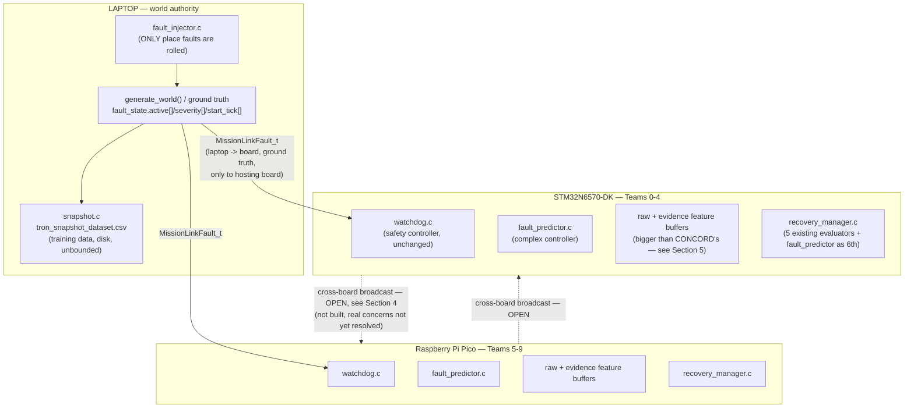
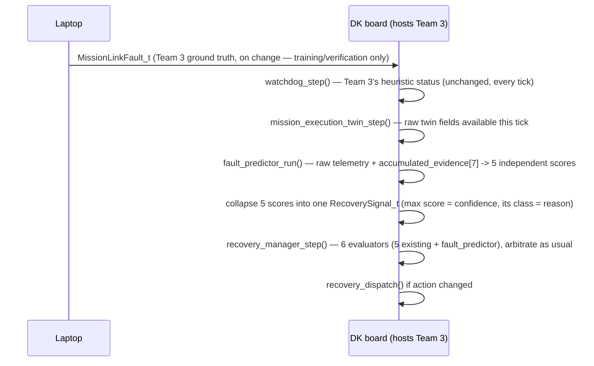
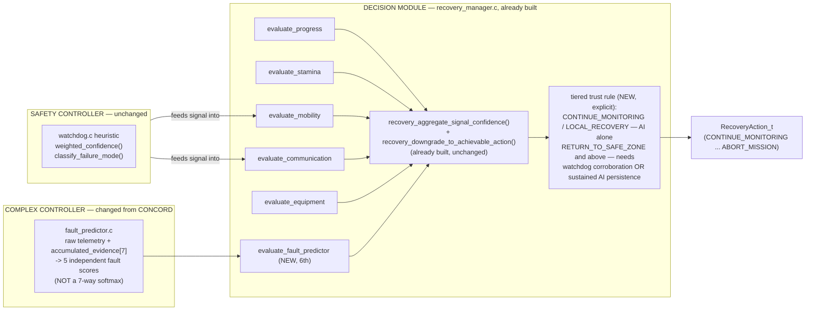
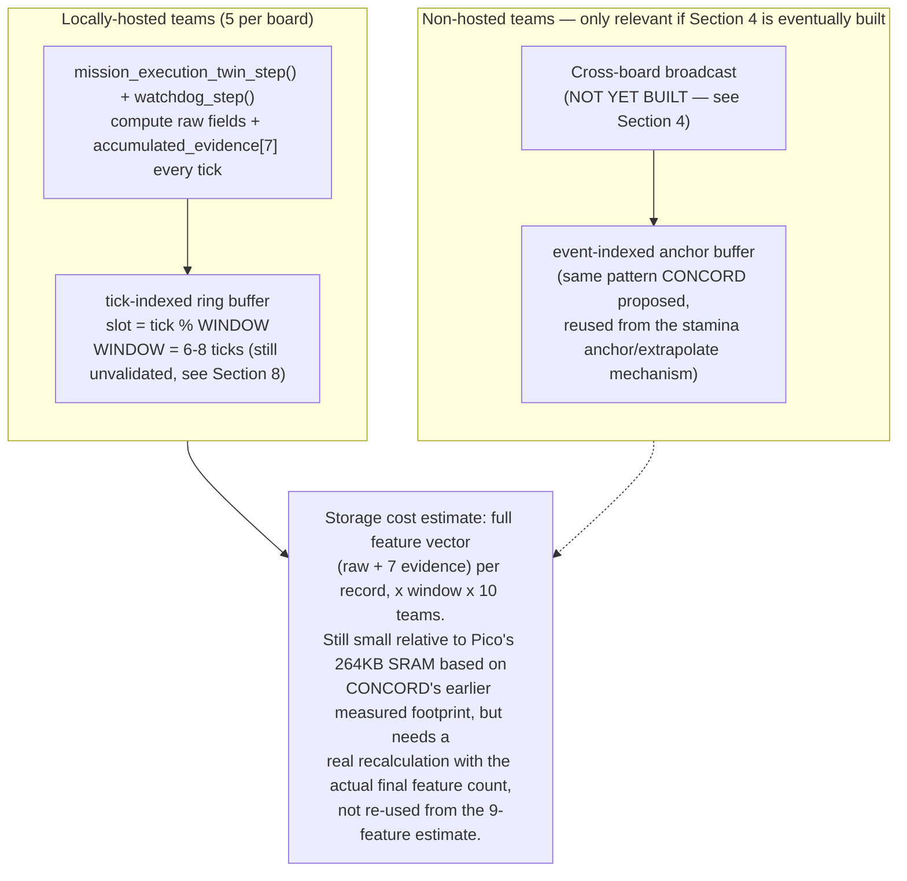
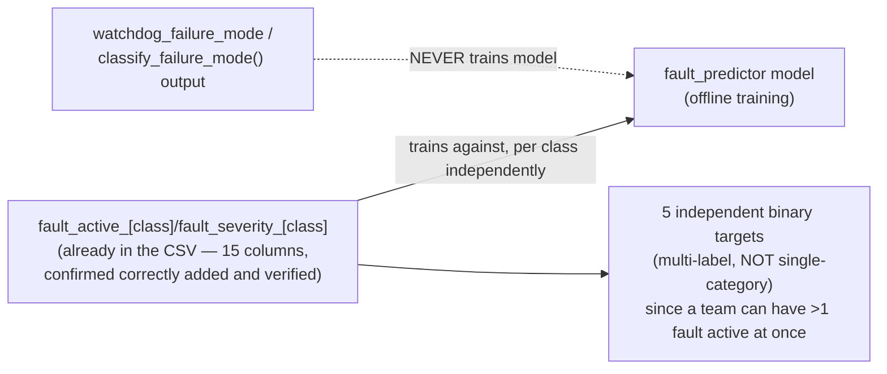

# Fault Predictor — Architecture (v4)

Mirrors the structure of `fault_predictor_architecture.md` (CONCORD) section-for-section,
updated to reflect what's actually been agreed since. Sections kept unchanged from that
doc are noted as such; changed sections explain what changed and why.

---

## 1. System context — where this sits physically

**Unchanged from CONCORD.** Same physical layout: laptop as world authority (only place
faults are rolled), DK board hosting Teams 0-4, Pico board hosting Teams 5-9.



**What changed:** `fault_predictor.c`'s input is no longer the 9-feature CONCORD set. Cross-board
arrows are drawn dashed/open — we're not saying no to this, but it's not locked design yet (Section 4).

---

## 2. Per-tick flow, one team's view

**Structurally unchanged** — same sequence, different feature set and output shape at the
`fault_predictor_run()` step.



Team 3 does nothing differently at any point. No cross-board step in this flow — that's the
open piece (Section 4).

---

## 3. Simplex safety architecture — where each piece sits

**Mostly unchanged from CONCORD's framing** — `recovery_manager.c` is still the decision
module, still doesn't need new arbitration logic. Two changes: the AI box's input/output,
and an explicit tiered-trust rule that CONCORD's doc implied but didn't spell out numerically.



**What changed from CONCORD:**
- No cross-board vote feeding `EV6` — `fault_predictor.c`'s own output goes straight in.
- The tiered-trust rule is now its own explicit step, not folded silently into the existing
  confidence floors (see Section 8 — the actual numbers for this are still open).

---

## 4. Cross-board consensus — open, not dropped

**We are not ruling this out.** It's a legitimate idea — protecting against one team's model
being wrong for an unpredictable reason (bad luck in training, a rare input, on-device
corruption) by checking it against other independent opinions. It's staying in this document
as a real, wanted piece of the system. What changed is that we're naming the actual
engineering problems that need solving before it gets built, instead of moving forward with
the version already proposed.

**Concern 1 — the fault-tolerance math doesn't hold for 2 physical boards.**
Brooks-Iyengar's `f < N/3` bound assumes each of the `N` voters can fail independently. With
`N=9` split across only 2 physical boards (5 teams each), one board misbehaving doesn't cost
1 vote — it costs up to 5 at once, since all 5 share the same compute. That's more than double
what the tolerance bound assumes, for the single most likely real-world failure (a whole board
glitching), not an edge case. The proposed fix (cap a board's max contributed weight at `N-3=6`)
doesn't currently do anything, because a board's maximum possible weight is already 5 — under
the cap. **This needs a real number that actually changes behavior at 5-teams-per-board, or a
different weighting scheme entirely** (e.g. weight by confidence rather than flat vote count,
so a cap can meaningfully bind).

**Concern 2 — bandwidth cost is bigger than CONCORD assumed.** CONCORD's plan broadcast a
9-float evidence vector per team, per tick. Our feature set (raw telemetry + evidence
channels) is substantially larger — broadcasting the full feature vector every tick, for every
team, over LoRa, needs a real bandwidth/airtime budget check against `LORA_FRAME_MAX_PAYLOAD`
and the tick rate, not an assumption that it scales the same way a 9-float vector would.

**Concern 3 — board liveness and model correctness are two different signals, and conflating
them is a real risk, not just a labeling nitpick.** If a board goes fully dark, that should be
caught by existing comms/heartbeat logic (`evaluate_communication`), not inferred from a vote
tally going quiet. Building both into one number risks silent failure if the "boards's gone
dark" case isn't actually distinguishable from "boards agree there's no fault" in the vote data.

**Sequencing:** get the single-team model (Section 3) working and evaluated first. Revisit
this section once there's a working base model and either (a) a corrected weighting scheme
that actually tolerates a whole-board failure, or (b) a bandwidth budget confirming full
feature-vector broadcast is actually feasible at the real tick rate. Not doing this first isn't
skipping it — it's making sure it isn't built on math or bandwidth assumptions that don't hold.

**Concern 2, partial answer — `fault_comms_broadcast_local_teams()`'s real airtime cost and a
proposed pacing fix, READY TO APPLY ONCE THE TWO-BOARD HARNESS WIRES THIS FUNCTION INTO A REAL
CALL SITE (it currently has zero callers anywhere in `core/`, `board/`, or `laptop/` — confirmed
by repo-wide grep, also noted in `ARCHITECTURE.md`/`AUDIT.md` — so there is nothing to pace yet
and this is deliberately not being added to `core/fault_comms.c` as a standing TODO in code with
no caller to exercise it):**

- `FaultBroadcastPayload_t` is 48 bytes (confirmed via `sizeof`, not estimated) → wire frame =
  3 (`LORA_FRAME_HEADER_SIZE`) + 48 + 19 (AEAD trailer: tag+counter-frag+checksum) = **70 bytes**.
- Applying the same Semtech AN1200.13 time-on-air formula `core/comms_transport.c` already uses
  and locks for its own 166-byte/266.496ms worked example (SF7/BW125/CR4:5/8-symbol
  preamble/explicit header/CRC on — reproduced exactly, not re-derived differently) to this
  70-byte frame gives **128.256ms per frame**.
- On real hardware (`NUM_TEAMS=10`, `FAULT_BUFFER_TEAMS_PER_BOARD=5` → 2 boards), one call to
  `fault_comms_broadcast_local_teams()` sends one `FAULT_BROADCAST` frame per locally-hosted
  team to the one other board — **5 frames per call**, independent of model state (this
  function never emits `FAULT_VOTE` frames itself; those only originate from the separate
  ingest-side `fault_comms_cast_vote()` path). Total TX-locked time per call: **5 × 128.256ms ≈
  641.28ms**.
- **Failure mode this prevents, not hypothetical:** `comms_transport_send()`'s cross-board path
  doesn't block on the radio — it enqueues into one of four fixed-capacity precedence queues
  (`core/comms_transport.c`; `FAULT_BROADCAST` uses `COMMS_PRECEDENCE_PRIORITY`, capacity 12
  slots). An unpaced caller on a flat-out main loop (`BOARD_TICK_DELAY_MS=0` by default, both
  boards) would overflow that 12-slot queue within 2-3 ticks and start silently dropping frames
  (`comms_transport_send()` returns non-zero on a full queue; every current call site already
  discards that return value with `(void)`) — a data-loss bug, not a graceful degradation, and
  one that would also starve CBBA/mission-link traffic sharing the same `PRIORITY`/`FLASH` TX
  queues and the same physical radio.
- **Proposed fix — self-paced interval against a real wall-clock primitive, mirroring the
  existing `mission_link_status_tx_step()`/`MISSION_LINK_HEARTBEAT_INTERVAL_MS` pattern
  (`core/mission_link.c`, `core/cbba.c`'s `cbba_now_ms()`), not a blocking `tk_dly_tsk()` (which
  would stall CBBA/mission-link on the same loop):**

  ```c
  #ifndef FAULT_COMMS_BROADCAST_INTERVAL_MS
  #define FAULT_COMMS_BROADCAST_INTERVAL_MS 120000u /* 2 min - see duty-cycle derivation, this doc */
  #endif

  void fault_comms_broadcast_local_teams(void)
  {
      static uint32_t s_last_broadcast_ms = 0u;
      uint32_t now_ms = cbba_now_ms();

      if (now_ms - s_last_broadcast_ms < FAULT_COMMS_BROADCAST_INTERVAL_MS)
          return;
      s_last_broadcast_ms = now_ms;
      /* ... existing body, unchanged ... */
  }
  ```

  Callable every tick, unconditionally — it self-throttles, same as the heartbeat pattern it
  mirrors, so nothing about the call site needs to coordinate timing.
- **Duty-cycle recomputation, against real wall-clock timing, not `TICK_TIME_SEC`** (the prior
  0.37% figure was computed against the simulated-time constant and was invalidated for exactly
  that reason — duty cycle depends on wall-clock call frequency, which `TICK_TIME_SEC` does not
  represent on hardware since `BOARD_TICK_DELAY_MS=0` means tick rate has no fixed real-time
  period):
  - Minimum interval for a ≤1% ceiling: 641.28ms / 0.01 = **64.13s**.
  - Proposed 120s interval: **641.28ms / 120,000ms ≈ 0.53%** — under 1% with margin for clock
    drift, and leaving headroom since CBBA/mission-link traffic shares the same radio's overall
    duty budget (not accounted for in this 0.53% figure, which covers only this function's own
    `FAULT_BROADCAST` traffic — flagged, not solved, here).
  - `FAULT_COMMS_BROADCAST_INTERVAL_MS=120000` is a proposed, untuned starting point (same
    "provisional, not derived from a regulatory filing" status as this project's other
    duty-cycle-adjacent placeholders) pending confirmation of what "1%" actually means under
    this band's real WPC IN865 de-licensing terms — not yet a settled decision.

---

## 5. On-device buffer — two shapes, not one

**Structurally unchanged from CONCORD** (local tick-indexed ring buffer vs. remote
event-indexed anchor buffer) — but the per-record size is bigger now, since the buffer holds
raw telemetry alongside the 7 evidence values, not evidence alone.



**What changed:** the storage-cost number from CONCORD's doc (`~2.2KB`, based on 7 floats)
no longer applies as-is — needs recalculating once the final feature list is locked, since it's
several times larger per record now. Not expected to be a binding constraint (SRAM headroom
was large), but should be confirmed with real numbers, not carried over.

---

## 6. Message/frame inventory

**Unchanged in structure from CONCORD** — same tier table, same reasoning for `FAULT_VOTE`
sitting at `COMMS_PRECEDENCE_FLASH` (confirmed real, `core/comms_precedence.h`). One addition:

| Frame type | Direction | Payload | Cadence | Tier | Status |
|---|---|---|---|---|---|
| `LORA_FRAME_TYPE_CBBA` (existing) | board ↔ board | `CBBAMessage_t` | every CBBA round | PRIORITY | built |
| `LORA_FRAME_TYPE_MISSION_LINK` (existing) | laptop ↔ board | roster/status/fault ground truth | on change | varies | built |
| `LORA_FRAME_TYPE_HANDSHAKE` (existing) | board ↔ board | link establishment | as needed | IMMEDIATE | built |
| `LORA_FRAME_TYPE_FAULT_BROADCAST` (proposed) | board → board | full feature vector (larger than CONCORD's 9 floats) | every tick | PRIORITY (proposed) | **open — payload size vs. `LORA_FRAME_MAX_PAYLOAD` needs checking, Section 4** |
| `LORA_FRAME_TYPE_FAULT_VOTE` (proposed) | board → board | `voter_team_id`+`target_team_id`+verdict | on verdict change | FLASH | **open — depends on Section 4's weighting fix landing first** |

---

## 7. Ground-truth vs. learned-signal separation

**Same principle as CONCORD, confirmed and unchanged:** train on `fault_state.active[]`/
`fault_severity[]` directly, never on the watchdog's own output.



**What changed from CONCORD:** the label is multi-label (5 independent yes/no targets), not a
single 7-way category — because `fault_injector.c` rolls each fault class independently, with
nothing preventing more than one being active on the same team at the same time. A single
pick-one answer can't represent that.

**Status: everything needed to build this already exists.** No further simulator or CSV
changes are required — the 15 ground-truth columns are already in the current dataset,
confirmed correctly wired, verified by inspecting a real generated file. This is purely a
`data_prep.py` label-construction task at this point, not blocked on anything upstream.

---

## 8. What's still open

1. **Cross-board consensus** (Section 4) — real, unresolved engineering concerns (correlated
   board-failure math, bandwidth, board-liveness conflation), not a "do we need it" question.
   Not dropped — sequenced after the base model. Concern 2 (bandwidth) now has a real airtime
   figure and a proposed pacing fix (`FAULT_COMMS_BROADCAST_INTERVAL_MS`, ~0.53% duty cycle at a
   120s interval) documented in Section 4 — ready to apply once `fault_comms_broadcast_local_
   teams()` actually has a caller, not applied yet since it doesn't.
2. **Exact tiered-trust confidence thresholds** (Section 3) — principle locked, numbers not
   set. Same open status CONCORD's doc had it in; still unresolved.
3. **6-8 tick evidence window** — measured against a real onset-to-detection lag distribution
   (60 seeds × 10 teams × 400 ticks, `--fault-profile combined`, `evidence_channels.py`
   recomputation): pooled median lag is 7 ticks, but the distribution is heavily right-skewed
   (mean 14.1, p90 35, p95 47, p99 88 ticks), so 6-8 ticks captures only ~50-53% of onsets, not
   "most." Recommended shared constant: `FAULT_EVIDENCE_ONSET_LAG_TICKS = 20` (~74th
   percentile) for `FAULT_BUFFER_LOCAL_DEPTH_TICKS` and the consensus liveness window. **Does
   NOT double as the persistence-streak trip limit H** — that measures a different quantity
   (consecutive ticks sustained above threshold, not ticks-to-first-detection) and needs its
   own constant; see item 6 below for both this and the accompanying false-negative rate.
4. **`ENVIRONMENT`-class fault visibility — structural observability gap, confirmed by a
   scoping-study ablation (baseline `HistGradientBoostingClassifier`, 60 seeds × 10 teams ×
   400 ticks, `--fault-profile combined`; not `train.py`, not the real model).** `MISSION`
   was originally flagged here as not-yet-confirmed-learnable; that flag was wrong and is
   corrected below — the ablation shows `MISSION` recall climbing from 0.474 to 0.637 as
   feature count increases (k=3 → k=71, monotonic, not noise), a real feature-count-dependent
   signal (`incident_priority`/`victim_count` carry it, importances 0.38/0.15). `ENVIRONMENT`
   is the class that is actually stuck: F1 stays flat at 0.02–0.08 from k=3 through the full
   ~70-feature set — ruling out "needs more features" as the explanation, since more features
   never help.

   **Root cause, confirmed by reading `core/fault_injector.c`/`core/mission_execution_twin.c`
   and manually inspecting logged onset windows — an observability gap, not a label bug or a
   sample-size problem:**
   - `inject_environment_fault()` ([fault_injector.c:146-226](core/fault_injector.c#L146-L226))
     manifests the fault as a `travel_cost` bump on one grid cell (the next choke point on the
     team's route), not a direct perturbation of any team-level telemetry field.
   - Critically, `twin_advance_expected_position()`
     ([mission_execution_twin.c:335-374](core/mission_execution_twin.c#L335-L374)) recomputes
     the twin's *expected* per-tick path cost via `environment_cell_travel_cost()` — the same
     live, fault-elevated cost the *actual* pathfinding also uses. Expected and actual progress
     therefore degrade together, so `twin_progress_error` (the feature nearly every other fault
     class's signal depends on) stays near zero through a genuine active episode. Manually
     inspected onset windows confirm this directly: `twin_progress_error` sits at ~0.01-0.02
     during active `ENVIRONMENT` faults (e.g. run 1789220577/team 0, cycles 151-157) — an order
     below `PROGRESS_FULL_SCALE=0.35`, i.e. below the noise floor `evidence_channels.py`'s
     `progress` channel can resolve. `twin_expected_arrival_tick` is the one twin field set
     once at assignment rather than re-derived from live costs
     ([mission_execution_twin.c:311](core/mission_execution_twin.c#L311)), so it shifts a
     little during a fault, but the shift is small and noisy against reassignment churn — it
     doesn't reach `evidence_timeout`'s threshold (absent from `ENVIRONMENT`'s top-10 importances
     in the same ablation).
   - Not a rare-class/sample-size problem: 15,195 positive rows (6.3% base rate) in the 240k-row
     dataset, and 1,798 distinct onset episodes — more than any other class (mobility 1,673,
     communication 1,689, resource 1,684, mission only 824). The signal is genuinely absent from
     currently-logged telemetry, not thinned out by scarcity.
   - Not a label bug: `fault_active_environment` flips exactly on injection/recovery and its
     active duration matches `fault_config.c`'s configured 5-16 tick range in every inspected
     window.

   **Consequence: no feature-engineering or feature-count fix inside the current telemetry set
   closes this gap.** Closing it needs a new logged signal that actually reacts to the fault
   (e.g. a raw, non-twin-relative reading of the faulted cell's live `travel_cost`/`road_blocked`
   near the team's position, since the twin's self-relative comparison is what cancels the
   signal) — an instrumentation change, to be scoped separately, not assumed solved by wider
   `train.py` features.

   **Addendum — cross-team labeling artifact, distinct from the observability gap above, and
   confirmed empirically, not assumed:**
   - `environment_cell_travel_cost()` ([environment.c:2063](core/environment.c#L2063)) reads a
     single global grid (`g_environment[x][y]`) with no team parameter, and `find_next_path_step`/
     `find_path_cost` — called from every team's own allocation/scoring/twin-advance path (cbba.c,
     incident.c, scoring.c, simulation.c, mission_execution_twin.c) — read that same shared cell.
     `inject_environment_fault()` writes its cost bump into that shared cell
     ([fault_injector.c:216-221](core/fault_injector.c#L216-L221)); its own comments already
     acknowledge multiple teams stacking faults on one cell. So a target team's environment fault
     can raise pathfinding cost for **any other team** currently routed through the same cell, live,
     in production — not a hypothetical.
   - This was checked directly, not inferred: 30 seeds × 400 ticks (`--fault-profile combined`),
     instrumented to record, for every tick some team `T` has an active environment fault, which
     grid cell it targeted and whether any other team `O` currently occupied that exact cell. Result:
     10,029 such co-occupied ticks across 1,292 distinct (target, other) episodes out of 7,615
     total environment-active ticks. Restricting to cases where `O` is actually `EN_ROUTE` (so the
     shared cell can plausibly affect `O`'s own live path cost, not just incidental co-location at a
     worksite) and has **no fault of its own active** (`active_mask == 0`, ruling out the obvious
     confound of `O`'s own concurrent fault explaining its error): `O`'s `twin_progress_error` is
     visibly nonzero and sometimes large (observed up to ~0.39, e.g. two teams sharing a cell at
     tick 34-35 of seed 2) while `fault_active_environment=0` for `O` the whole time — i.e. `O` is
     showing a real, measurable effect the label says isn't there. This is NOT universal: only
     ~1% of all co-occupied ticks (98/10,029) show `|progress_error| > 0.05`, and ~0.25%
     (25/10,029) exceed 0.10 — teams sharing a chokepoint cell at the exact moment one of them has
     an active environment fault is a real but modest fraction of onsets, not the dominant case.
   - **Implication for the ablation's F1 numbers:** some non-trivial slice of what the k=3→k=71
     ablation scored as environment-class false positives may be correct detections of a real,
     currently-unlabeled effect on a bystander team, not pure classifier failure. This is a
     distinct nuance from the observability gap above (which explains why the *target* team's own
     signal is invisible) — it instead means the *false-positive side* of environment's near-chance
     F1 is partly a labeling artifact (ground truth says "no fault" for a team that is, in fact,
     riding someone else's fault's cost bump), not solely model or feature failure. Not quantified
     further here (would need the co-occupied-tick rate applied against the ablation's actual FP
     set, which this pass didn't do) — flagged as an open question for whoever revisits environment
     class labeling, not treated as resolved.
5. **Buffer storage-cost recalculation** (Section 5) — needs the real final feature count, not
   reused from CONCORD's 9-feature estimate.
6. **Evidence-based detection has a permanent, non-zero false-negative rate — a latency
   tradeoff, not a bug to fix away.** From the same onset-lag measurement as item 3: **6.4% of
   clean fault onsets never register on any evidence channel within 200 ticks at all** (not a
   window-size problem — these are short-duration/low-severity draws whose instantaneous
   signal never sustains enough consecutive high ticks for `accumulate()`'s
   RISE=0.35/DECAY=0.80 to reach the 0.20 flag threshold). At the recommended
   `FAULT_EVIDENCE_ONSET_LAG_TICKS = 20`, **~26% of onsets are still undetected** at that point
   (74th percentile by construction). No choice of window size eliminates this — it only trades
   the false-negative rate against latency, and any of the three dependent mechanisms
   (consensus liveness, persistence trip limit, event-triggered broadcast's fallback heartbeat)
   built on this signal inherits that tradeoff, not just a tuning question.

   **The persistence-streak trip limit H is a separate, weaker-signal problem, not solvable by
   reusing `FAULT_EVIDENCE_ONSET_LAG_TICKS`.** Measured directly (same dataset): once a channel
   first crosses 0.20, the length of its *consecutive* above-threshold run is a poor
   discriminator between a genuine sustained fault and a single-tick noise blip — any one-tick
   full-strength instantaneous spike mechanically produces ~3 ticks above 0.20 purely from
   `DECAY=0.80`'s tail (0.35 → 0.28 → 0.224 → 0.179), regardless of whether anything real is
   still happening. Genuine onset-triggered runs and no-ground-truth-fault ("noise") runs
   overlap heavily as a result: at H=6, 49.7% of real onset runs are still shorter than H
   (would be wrongly rejected as transient) while 34.3% of noise runs are still longer than H
   (would be wrongly accepted as real); the tradeoff improves only slowly with larger H (H=10:
   53.3% / 25.0%; H=20: 60.2% / 8.1% — chasing noise-rejection costs real-detection rejection
   at a similar rate throughout). No H value cleanly separates the two populations using a
   single channel's raw run-length.

   **Follow-up tested and rejected: naive multi-channel voting ("≥2 of the 7 evidence channels
   simultaneously ≥ 0.20") does not fix this — it is measurably worse.** No fault-class→
   evidence-channel mapping exists anywhere in this codebase (`fault_predictor.h` explicitly
   scopes the not-yet-trained model to the full 9-feature vector, not a hand-mapped per-class
   subset), so this was tested channel-agnostically. Result: onset-triggered and no-fault
   ("spurious") joint-run-length distributions were nearly indistinguishable (median 3 vs. 5
   ticks); at H=6, false-reject rose to 68.9% while false-accept was still 43.9% — worse on
   both axes than single-channel. The 7 channels are not independent the way separate boards
   are (Section 4's premise) — they're all computed from the same underlying tick's telemetry,
   so multi-channel co-elevation is common in ordinary operational noise (task/assignment
   churn), not just in real faults, and doesn't provide the corroboration board-diversity does.

   **What does work better: persisting the already-existing `recomputed_anomaly_confidence`
   (the weighted combination of all 7 channels — `evidence_channels.py`'s existing
   `WEIGHTS`/combined-score mechanism, watchdog.c's `weighted_confidence()` equivalent) held
   above a 0.20 floor — deliberately lower than the 0.35 `ANOMALY_THRESHOLD`, which stays the
   separate action-trigger threshold, not the persistence floor.** At H=8: 48.5% false-reject,
   8.2% false-accept — still misses roughly half of genuine sustained episodes at that H, but
   the false-accept rate is 3-4x better than any single-channel or channel-voting alternative
   tested (8.2% vs. 25-40% at comparable H). At H=6: 34.5% / 28.1% (weaker but more permissive).
   Recommend **`FAULT_PERSISTENCE_TRIP_TICKS = 8`, defined against `recomputed_anomaly_confidence
   >= 0.20`, as its own constant — distinct from both `FAULT_EVIDENCE_ONSET_LAG_TICKS=20`
   (answers a different question) and from a single-channel streak (confirmed non-viable
   above).** This is a real improvement, not a strong classifier: an 8.2% residual false-accept
   rate is a real, accepted risk, not zero. Given that, don't extend the existing "AI alone"
   tier (Section 3: `CONTINUE_MONITORING`/`LOCAL_RECOVERY` only) any further based on this
   result — it's an argument for keeping that boundary exactly where it already sits (those two
   actions are low-consequence/reversible, where an 8% false-accept rate is a defensible
   tradeoff to accept explicitly), not for widening AI-alone trust to `RETURN_TO_SAFE_ZONE` or
   above, which Section 3 already correctly gates behind watchdog corroboration.

   Dataset caveat (same standard as this file's own JP920 channel-count confidence flag):
   these figures come from `FAULT_PROFILE_COMBINED`'s hand-picked severity/duration constants
   in `core/fault_config.c` (durations 5-14 ticks, `effect_strength` 2-3 on an uncalibrated
   scale) — simulator design choices with no cited derivation from real fault-occurrence data
   or measured hardware timing. Treat the lag/persistence numbers above as internally
   consistent with this simulator's current tuning, not as validated against reality. Re-measure
   once real training-run data or hardware-timed traces are available, before leaning on these
   specific numbers for anything safety-critical.

---

## 9. Build order

1. Label-construction script in `data_prep.py` — **unblocked, everything needed already
   exists** (Section 7). This is the next concrete step.
2. Train the base per-team model (raw telemetry + evidence channels → 5 independent scores).
3. `core/fault_predictor.h/.c` skeleton, inert until real weights land — same hand-off pattern
   CONCORD proposed (flat weights header, `FAULT_MODEL_LOADED` guard).
4. `evaluate_fault_predictor()` as `recovery_manager.c`'s 6th evaluator, plus the tiered-trust
   rule from Section 3.
5. Cross-board consensus (Section 4) — only after 1-4 are working, and only once the
   correlated-failure weighting and bandwidth concerns have real answers.
